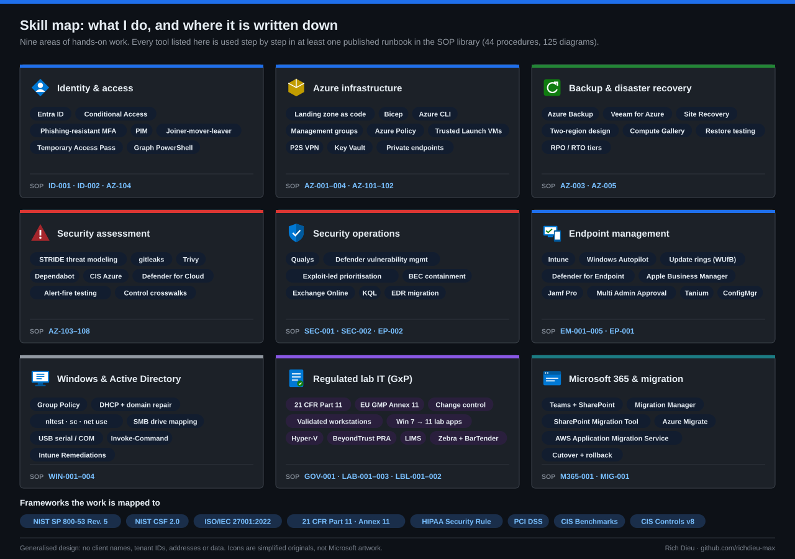

# SOP Library · Field Guide Series

 

**44 standard operating procedures · 125 architecture, flow and concept diagrams · 14 technology families**

Production runbooks from my work across Microsoft Azure, Entra ID, Intune, AWS, Red Hat Enterprise Linux, security operations, regulated (GxP) lab IT and Windows support. Every page reads directly on GitHub: what the procedure achieves, two to four diagrams (how it fits together, the procedure or decision path, and the mechanism behind it), prerequisites, the steps (console first, then PowerShell, AWS CLI or shell, then at scale), how to verify it, how to roll it back (for procedures that change something), troubleshooting, and the controls it supports.

> **Production procedures, sanitized for publication.** Every runbook here is one I run in production. Client names, hostnames, tenant IDs and ticket numbers are replaced with placeholders (Contoso, documentation IP ranges, sample change numbers). Microsoft's own built-in role, policy and app IDs are kept because the commands need them.

## Start here

New to the library? These six show the range in about ten minutes:

| If you care about | Read |
|---|---|
| Identity and Zero Trust | [ID-001 · Conditional Access and MFA baseline](identity-access/SOP-ID-001-conditional-access-mfa-baseline.md) |
| Endpoint provisioning | [EM-004 · Windows Autopilot and Intune](endpoint-management/SOP-EM-004-windows-autopilot-provisioning.md) |
| Patching to an SLA | [EM-005 · Windows Update rings and patch compliance](endpoint-management/SOP-EM-005-windows-update-rings-patch-compliance.md) |
| Vulnerability management | [SEC-001 · Qualys and Defender remediation program](security-operations/SOP-SEC-001-vulnerability-remediation-qualys-defender.md) |
| Regulated (GxP) change control | [GOV-001 · Change control and objective evidence](governance/SOP-GOV-001-gxp-change-control-and-objective-evidence.md) |
| Regulated lab modernization | [LAB-001 · Windows 7 lab application to Windows 11](regulated-lab-it/SOP-LAB-001-windows-7-lab-application-to-windows-11.md) |

Every runbook opens with a tag block: its status, plain-language topics and keywords, and the NIST SP 800-53 Rev. 5 controls and NIST CSF 2.0 outcomes it supports, each with its name. To browse by subject, use [Browse by topic](#browse-by-topic); to browse by control, use [Coverage by framework](#coverage-by-framework).

## Browse by topic

<!-- topics:start (generated by tools/catalog/build.py) -->
| Topic | Runbooks |
|---|---|
| **Identity, sign-in and MFA** | [AWS-001](aws-procedures/SOP-AWS-001-creating-securing-aws-account.md) · [AWS-003](aws-procedures/SOP-AWS-003-client-vpn-identity-center.md) · [AZ-104](azure-landing-zone-series/SOP-AZ-104-hardening-identity-access-azure.md) · [AZ-001](azure-procedures/SOP-AZ-001-creating-securing-azure-tenant.md) · [AZ-004](azure-procedures/SOP-AZ-004-point-to-site-vpn-entra-id.md) · [ID-001](identity-access/SOP-ID-001-conditional-access-mfa-baseline.md) · [ID-002](identity-access/SOP-ID-002-joiner-mover-leaver-lifecycle.md) · [LNX-003](linux-administration/SOP-LNX-003-join-rhel-active-directory-sssd.md) · [SEC-002](security-operations/SOP-SEC-002-containing-compromised-m365-account.md) |
| **Least privilege and admin control** | [AZ-104](azure-landing-zone-series/SOP-AZ-104-hardening-identity-access-azure.md) · [EM-003](endpoint-management/SOP-EM-003-multi-admin-approval-wipe-retire-delete.md) · [ID-001](identity-access/SOP-ID-001-conditional-access-mfa-baseline.md) · [ID-002](identity-access/SOP-ID-002-joiner-mover-leaver-lifecycle.md) |
| **Endpoint and device management** | [EP-001](endpoint-agents/SOP-EP-001-tanium-client-deployment.md) · [EP-002](endpoint-agents/SOP-EP-002-legacy-av-removal-edr-migration.md) · [EM-001](endpoint-management/SOP-EM-001-defender-for-endpoint-macos-intune.md) · [EM-002](endpoint-management/SOP-EM-002-macos-intune-enrollment.md) · [EM-003](endpoint-management/SOP-EM-003-multi-admin-approval-wipe-retire-delete.md) · [EM-004](endpoint-management/SOP-EM-004-windows-autopilot-provisioning.md) · [EM-005](endpoint-management/SOP-EM-005-windows-update-rings-patch-compliance.md) · [LAB-002](regulated-lab-it/SOP-LAB-002-lab-compliance-data-agent.md) · [LAB-003](regulated-lab-it/SOP-LAB-003-requesting-provisioning-gxp-lab-workstation.md) |
| **Windows** | [EP-001](endpoint-agents/SOP-EP-001-tanium-client-deployment.md) · [EP-002](endpoint-agents/SOP-EP-002-legacy-av-removal-edr-migration.md) · [EM-004](endpoint-management/SOP-EM-004-windows-autopilot-provisioning.md) · [EM-005](endpoint-management/SOP-EM-005-windows-update-rings-patch-compliance.md) · [LBL-001](label-printing/SOP-LBL-001-zebra-dpi-mismatch-undersized-labels.md) · [LAB-001](regulated-lab-it/SOP-LAB-001-windows-7-lab-application-to-windows-11.md) · [WIN-001](windows-support/SOP-WIN-001-usb-serial-com-port-troubleshooting.md) · [WIN-002](windows-support/SOP-WIN-002-dhcp-client-and-domain-connectivity.md) · [WIN-003](windows-support/SOP-WIN-003-mapped-network-drive-access.md) · [WIN-004](windows-support/SOP-WIN-004-windows-command-line-toolkit.md) |
| **macOS** | [EM-001](endpoint-management/SOP-EM-001-defender-for-endpoint-macos-intune.md) · [EM-002](endpoint-management/SOP-EM-002-macos-intune-enrollment.md) |
| **Linux (Red Hat)** | [LNX-001](linux-administration/SOP-LNX-001-hardening-rhel-baseline-ansible-openscap.md) · [LNX-002](linux-administration/SOP-LNX-002-rhel-patching-maintenance-windows.md) · [LNX-003](linux-administration/SOP-LNX-003-join-rhel-active-directory-sssd.md) · [LNX-004](linux-administration/SOP-LNX-004-rhel-troubleshooting-toolkit.md) |
| **Microsoft Azure** | [AZ-101](azure-landing-zone-series/SOP-AZ-101-azure-landing-zone-as-code.md) · [AZ-102](azure-landing-zone-series/SOP-AZ-102-repeatable-customer-stamp.md) · [AZ-103](azure-landing-zone-series/SOP-AZ-103-threat-modeling-azure-build-stride.md) · [AZ-104](azure-landing-zone-series/SOP-AZ-104-hardening-identity-access-azure.md) · [AZ-106](azure-landing-zone-series/SOP-AZ-106-network-segmentation-container-hosting.md) · [AZ-107](azure-landing-zone-series/SOP-AZ-107-validating-logging-alerts-fire.md) · [AZ-001](azure-procedures/SOP-AZ-001-creating-securing-azure-tenant.md) · [AZ-002](azure-procedures/SOP-AZ-002-hardened-azure-vm-data-residency-region.md) · [AZ-003](azure-procedures/SOP-AZ-003-cloning-azure-virtual-machine.md) · [AZ-004](azure-procedures/SOP-AZ-004-point-to-site-vpn-entra-id.md) · [AZ-005](azure-procedures/SOP-AZ-005-multi-region-backup-disaster-recovery.md) · [MIG-001](cloud-migration/SOP-MIG-001-lift-and-shift-label-printing-server.md) |
| **Amazon Web Services** | [AWS-001](aws-procedures/SOP-AWS-001-creating-securing-aws-account.md) · [AWS-002](aws-procedures/SOP-AWS-002-hardened-ec2-data-residency-region.md) · [AWS-003](aws-procedures/SOP-AWS-003-client-vpn-identity-center.md) · [AWS-004](aws-procedures/SOP-AWS-004-multi-region-backup-disaster-recovery.md) · [MIG-001](cloud-migration/SOP-MIG-001-lift-and-shift-label-printing-server.md) |
| **Microsoft 365** | [ID-001](identity-access/SOP-ID-001-conditional-access-mfa-baseline.md) · [ID-002](identity-access/SOP-ID-002-joiner-mover-leaver-lifecycle.md) · [M365-001](microsoft-365/SOP-M365-001-file-shares-to-teams-sharepoint.md) · [SEC-002](security-operations/SOP-SEC-002-containing-compromised-m365-account.md) |
| **Patching and updates** | [EM-005](endpoint-management/SOP-EM-005-windows-update-rings-patch-compliance.md) · [LNX-002](linux-administration/SOP-LNX-002-rhel-patching-maintenance-windows.md) · [SEC-001](security-operations/SOP-SEC-001-vulnerability-remediation-qualys-defender.md) |
| **Vulnerability management** | [AZ-105](azure-landing-zone-series/SOP-AZ-105-scanning-secrets-supply-chain-risk.md) · [EM-001](endpoint-management/SOP-EM-001-defender-for-endpoint-macos-intune.md) · [SEC-001](security-operations/SOP-SEC-001-vulnerability-remediation-qualys-defender.md) |
| **Backup and disaster recovery** | [AWS-004](aws-procedures/SOP-AWS-004-multi-region-backup-disaster-recovery.md) · [AZ-102](azure-landing-zone-series/SOP-AZ-102-repeatable-customer-stamp.md) · [AZ-003](azure-procedures/SOP-AZ-003-cloning-azure-virtual-machine.md) · [AZ-005](azure-procedures/SOP-AZ-005-multi-region-backup-disaster-recovery.md) |
| **Incident response** | [LNX-004](linux-administration/SOP-LNX-004-rhel-troubleshooting-toolkit.md) · [SEC-002](security-operations/SOP-SEC-002-containing-compromised-m365-account.md) |
| **Logging, monitoring and alerting** | [AWS-001](aws-procedures/SOP-AWS-001-creating-securing-aws-account.md) · [AZ-101](azure-landing-zone-series/SOP-AZ-101-azure-landing-zone-as-code.md) · [AZ-107](azure-landing-zone-series/SOP-AZ-107-validating-logging-alerts-fire.md) · [LAB-002](regulated-lab-it/SOP-LAB-002-lab-compliance-data-agent.md) · [SEC-002](security-operations/SOP-SEC-002-containing-compromised-m365-account.md) |
| **Networking and VPN** | [AWS-002](aws-procedures/SOP-AWS-002-hardened-ec2-data-residency-region.md) · [AWS-003](aws-procedures/SOP-AWS-003-client-vpn-identity-center.md) · [AZ-106](azure-landing-zone-series/SOP-AZ-106-network-segmentation-container-hosting.md) · [AZ-002](azure-procedures/SOP-AZ-002-hardened-azure-vm-data-residency-region.md) · [AZ-004](azure-procedures/SOP-AZ-004-point-to-site-vpn-entra-id.md) · [LBL-002](label-printing/SOP-LBL-002-static-ip-reservation-network-label-printer.md) · [WIN-002](windows-support/SOP-WIN-002-dhcp-client-and-domain-connectivity.md) · [WIN-003](windows-support/SOP-WIN-003-mapped-network-drive-access.md) |
| **Encryption and keys** | [AWS-002](aws-procedures/SOP-AWS-002-hardened-ec2-data-residency-region.md) · [AZ-102](azure-landing-zone-series/SOP-AZ-102-repeatable-customer-stamp.md) · [AZ-002](azure-procedures/SOP-AZ-002-hardened-azure-vm-data-residency-region.md) |
| **Compliance and audit evidence** | [AWS-001](aws-procedures/SOP-AWS-001-creating-securing-aws-account.md) · [AWS-002](aws-procedures/SOP-AWS-002-hardened-ec2-data-residency-region.md) · [AZ-101](azure-landing-zone-series/SOP-AZ-101-azure-landing-zone-as-code.md) · [AZ-108](azure-landing-zone-series/SOP-AZ-108-mapping-build-many-compliance-frameworks.md) · [AZ-001](azure-procedures/SOP-AZ-001-creating-securing-azure-tenant.md) · [AZ-002](azure-procedures/SOP-AZ-002-hardened-azure-vm-data-residency-region.md) · [EM-005](endpoint-management/SOP-EM-005-windows-update-rings-patch-compliance.md) · [GOV-001](governance/SOP-GOV-001-gxp-change-control-and-objective-evidence.md) · [LNX-001](linux-administration/SOP-LNX-001-hardening-rhel-baseline-ansible-openscap.md) · [LAB-003](regulated-lab-it/SOP-LAB-003-requesting-provisioning-gxp-lab-workstation.md) · [SEC-001](security-operations/SOP-SEC-001-vulnerability-remediation-qualys-defender.md) |
| **GxP and FDA-regulated IT** | [GOV-001](governance/SOP-GOV-001-gxp-change-control-and-objective-evidence.md) · [LAB-001](regulated-lab-it/SOP-LAB-001-windows-7-lab-application-to-windows-11.md) · [LAB-002](regulated-lab-it/SOP-LAB-002-lab-compliance-data-agent.md) · [LAB-003](regulated-lab-it/SOP-LAB-003-requesting-provisioning-gxp-lab-workstation.md) |
| **Automation and infrastructure as code** | [AZ-101](azure-landing-zone-series/SOP-AZ-101-azure-landing-zone-as-code.md) · [AZ-102](azure-landing-zone-series/SOP-AZ-102-repeatable-customer-stamp.md) · [AZ-001](azure-procedures/SOP-AZ-001-creating-securing-azure-tenant.md) · [EP-001](endpoint-agents/SOP-EP-001-tanium-client-deployment.md) · [EM-004](endpoint-management/SOP-EM-004-windows-autopilot-provisioning.md) · [LNX-001](linux-administration/SOP-LNX-001-hardening-rhel-baseline-ansible-openscap.md) · [LNX-002](linux-administration/SOP-LNX-002-rhel-patching-maintenance-windows.md) · [WIN-004](windows-support/SOP-WIN-004-windows-command-line-toolkit.md) |
| **Migrations** | [MIG-001](cloud-migration/SOP-MIG-001-lift-and-shift-label-printing-server.md) · [EP-002](endpoint-agents/SOP-EP-002-legacy-av-removal-edr-migration.md) · [M365-001](microsoft-365/SOP-M365-001-file-shares-to-teams-sharepoint.md) · [LAB-001](regulated-lab-it/SOP-LAB-001-windows-7-lab-application-to-windows-11.md) |
| **Security assessment** | [AZ-103](azure-landing-zone-series/SOP-AZ-103-threat-modeling-azure-build-stride.md) · [AZ-104](azure-landing-zone-series/SOP-AZ-104-hardening-identity-access-azure.md) · [AZ-105](azure-landing-zone-series/SOP-AZ-105-scanning-secrets-supply-chain-risk.md) · [AZ-106](azure-landing-zone-series/SOP-AZ-106-network-segmentation-container-hosting.md) · [AZ-107](azure-landing-zone-series/SOP-AZ-107-validating-logging-alerts-fire.md) · [AZ-108](azure-landing-zone-series/SOP-AZ-108-mapping-build-many-compliance-frameworks.md) |
| **Troubleshooting** | [LBL-001](label-printing/SOP-LBL-001-zebra-dpi-mismatch-undersized-labels.md) · [LNX-004](linux-administration/SOP-LNX-004-rhel-troubleshooting-toolkit.md) · [WIN-001](windows-support/SOP-WIN-001-usb-serial-com-port-troubleshooting.md) · [WIN-002](windows-support/SOP-WIN-002-dhcp-client-and-domain-connectivity.md) · [WIN-003](windows-support/SOP-WIN-003-mapped-network-drive-access.md) · [WIN-004](windows-support/SOP-WIN-004-windows-command-line-toolkit.md) |
| **Label printing** | [MIG-001](cloud-migration/SOP-MIG-001-lift-and-shift-label-printing-server.md) · [LBL-001](label-printing/SOP-LBL-001-zebra-dpi-mismatch-undersized-labels.md) · [LBL-002](label-printing/SOP-LBL-002-static-ip-reservation-network-label-printer.md) |
<!-- topics:end -->

## Families

| Prefix | Family | Scope | SOPs |
|---|---|---|---|
| ID | [Identity & Access](#identity--access) | Entra ID policy, account lifecycle and privileged access | 2 |
| EM | [Endpoint Management](#endpoint-management) | Intune enrollment, configuration, updates and safeguards for Windows and macOS | 5 |
| EP | [Endpoint Agents & Protection](#endpoint-agents--protection) | Deploying and retiring endpoint agents ahead of EDR | 2 |
| SEC | [Security Operations](#security-operations) | Vulnerability remediation and incident response | 2 |
| GOV | [Governance & Compliance](#governance--compliance) | Change control and objective evidence for regulated (GxP) systems | 1 |
| AZ-0xx | [Microsoft Azure · Procedures](#microsoft-azure--procedures) | Hands-on builds: tenant, hardened VMs, cloning, VPN, backup and DR | 5 |
| AZ-1xx | [Microsoft Azure · Landing Zone Build & Assessment Series](#microsoft-azure--landing-zone-build--assessment-series) | Landing zone as code, customer stamps, and the security assessment of that build | 8 |
| AWS | [AWS · Procedures](#aws--procedures) | Account foundation, hardened EC2, Client VPN, two-region backup and DR: the AWS counterparts of AZ-001 to AZ-005 | 4 |
| LNX | [Linux Administration (RHEL)](#linux-administration-rhel) | Hardening, patching, Active Directory join and troubleshooting for Red Hat Enterprise Linux 8 and 9 | 4 |
| M365 | [Microsoft 365](#microsoft-365) | Collaboration platform migrations | 1 |
| MIG | [Cloud Migration](#cloud-migration) | Moving on-premises servers to the cloud | 1 |
| LAB | [Regulated Lab IT](#regulated-lab-it) | GxP lab workstations, lab applications and compliance agents | 3 |
| LBL | [Label Printing](#label-printing) | Zebra label printers: drivers, DPI and network integration | 2 |
| WIN | [Windows Desktop Support](#windows-desktop-support) | Tier 1–3 Windows troubleshooting and command-line tooling | 4 |

## Catalog

### Identity & Access

| SOP | Runbook | What it covers | NIST 800-53 |
|---|---|---|---|
| ID-001 | [Building a Conditional Access and MFA baseline in Microsoft Entra ID](identity-access/SOP-ID-001-conditional-access-mfa-baseline.md) | Replace security defaults with a named, testable Conditional Access set: emergency access, legacy auth blocked, MFA for all, phishing-resistant MFA for admins. | AC · IA · SC |
| ID-002 | [Managing the joiner-mover-leaver account lifecycle in Microsoft Entra ID](identity-access/SOP-ID-002-joiner-mover-leaver-lifecycle.md) | Joiner-mover-leaver driven from the HR record: birthright access and a Temporary Access Pass on hire, access moved on role change, clean offboarding. | AC · PS |

### Endpoint Management

| SOP | Runbook | What it covers | NIST 800-53 |
|---|---|---|---|
| EM-001 | [Deploy Microsoft Defender for Endpoint to macOS with Intune](endpoint-management/SOP-EM-001-defender-for-endpoint-macos-intune.md) | Defender for Endpoint on macOS five ways (Intune, Graph PowerShell, Settings Catalog, local script, Jamf Pro), verified down to mdatp health. | CM · SI |
| EM-002 | [Enrolling macOS devices into Microsoft Intune](endpoint-management/SOP-EM-002-macos-intune-enrollment.md) | macOS enrollment: Company Portal, Automated Device Enrollment through Apple Business Manager, direct enrollment, plus a readiness check script. | AC · CM |
| EM-003 | [Two-person control for Intune device wipe (Multi Admin Approval)](endpoint-management/SOP-EM-003-multi-admin-approval-wipe-retire-delete.md) | Two-person rule for Intune wipe, retire and delete, in the admin center or Graph PowerShell, with a request-notification flow. | AC · AU · CM |
| EM-004 | [Provisioning Windows devices with Windows Autopilot and Intune](endpoint-management/SOP-EM-004-windows-autopilot-provisioning.md) | Windows Autopilot end to end: hardware hash, ZTDId dynamic group, deployment profile and Enrollment Status Page, sealed laptop to user. | CM · IA · SC |
| EM-005 | [Managing Windows Update rings and patch compliance with Intune](endpoint-management/SOP-EM-005-windows-update-rings-patch-compliance.md) | Update rings with Windows Update for Business: pinned feature versions, expedited zero-day fixes, driver control, monthly patch compliance against an SLA. | CM · RA · SI |

### Endpoint Agents & Protection

| SOP | Runbook | What it covers | NIST 800-53 |
|---|---|---|---|
| EP-001 | [Deploying an endpoint management agent (Tanium Client example)](endpoint-agents/SOP-EP-001-tanium-client-deployment.md) | Install, register and verify an endpoint management agent (Tanium) manually, silently, remotely and at scale with Intune Win32 or ConfigMgr. | AC · AU · CM · SI |
| EP-002 | [Removing a legacy antivirus agent before EDR migration](endpoint-agents/SOP-EP-002-legacy-av-removal-edr-migration.md) | Remove a legacy antivirus agent (Trend Micro) before EDR migration, by console, vendor tool or scripted mass removal, then prove it is gone. | AC · AU · CM · IA · SI |

### Security Operations

| SOP | Runbook | What it covers | NIST 800-53 |
|---|---|---|---|
| SEC-001 | [Running a vulnerability remediation program with Qualys and Microsoft Defender](security-operations/SOP-SEC-001-vulnerability-remediation-qualys-defender.md) | Vulnerability remediation with Qualys and Microsoft Defender: one reconciled queue, exploit-led priorities, SLAs by tier, dated exceptions. | CA · CM · RA · SI |
| SEC-002 | [Containing a compromised Microsoft 365 account](security-operations/SOP-SEC-002-containing-compromised-m365-account.md) | Contain a compromised Microsoft 365 account: preserve evidence, contain in a fixed order across Entra ID and Exchange Online, scope, recover. | AC · AU · IR · SI |

### Governance & Compliance

| SOP | Runbook | What it covers | NIST 800-53 |
|---|---|---|---|
| GOV-001 | [Change control and objective evidence for GxP and 21 CFR Part 11 systems](governance/SOP-GOV-001-gxp-change-control-and-objective-evidence.md) | Change control for GxP and 21 CFR Part 11 systems: classify, assess impact, plan test and rollback, e-signed Quality approval, objective evidence. | CM · SA |

### Microsoft Azure · Procedures

| SOP | Runbook | What it covers | NIST 800-53 |
|---|---|---|---|
| AZ-001 | [Azure tenant foundation: day-zero identity and governance](azure-procedures/SOP-AZ-001-creating-securing-azure-tenant.md) | Create a tenant and apply a security and governance baseline four ways: portal, Graph + Az PowerShell, Azure CLI / Bicep, configuration as code. | AC · CM · CP · IA · PL |
| AZ-002 | [Deploying a hardened Azure VM in a data-residency region](azure-procedures/SOP-AZ-002-hardened-azure-vm-data-residency-region.md) | Trusted Launch Windows Server VM with encryption at host, no public IP, backup and monitoring, kept in-region by Azure Policy. | AC · AU · CM · CP · SA · SC · SI |
| AZ-003 | [Cloning an Azure virtual machine](azure-procedures/SOP-AZ-003-cloning-azure-virtual-machine.md) | Clone a VM: snapshot to managed disk to new VM via portal, PowerShell, CLI or Compute Gallery, with secure access and rollback. | AC · CM · CP · SC |
| AZ-004 | [Azure point-to-site VPN with Entra ID sign-in](azure-procedures/SOP-AZ-004-point-to-site-vpn-entra-id.md) | Point-to-site VPN with Entra ID sign-in: an MFA-protected OpenVPN tunnel into a private network, plus certificate auth and the user connection. | AC · AU · CM · IA · SC |
| AZ-005 | [Two-region backup and disaster recovery design for Azure workloads](azure-procedures/SOP-AZ-005-multi-region-backup-disaster-recovery.md) | Two-region backup and DR for VMs and SQL with Azure Backup, Veeam for Azure and Site Recovery, proven by restore testing. | CP · SC |

### Microsoft Azure · Landing Zone Build & Assessment Series

| SOP | Runbook | What it covers | NIST 800-53 |
|---|---|---|---|
| AZ-101 | [Building an Azure landing zone as code](azure-landing-zone-series/SOP-AZ-101-azure-landing-zone-as-code.md) | Landing zone as code: management groups, group-based RBAC, Policy guardrails, central logging with an immutable archive, hub network. | AC · AU · CM |
| AZ-102 | [Deploying a repeatable customer stamp](azure-landing-zone-series/SOP-AZ-102-repeatable-customer-stamp.md) | A repeatable customer stamp: private spoke, Key Vault read by managed identity, customer-managed disk keys, geo-redundant backup. | CP · IA · SC |
| AZ-103 | [Threat modeling an Azure build with STRIDE](azure-landing-zone-series/SOP-AZ-103-threat-modeling-azure-build-stride.md) | STRIDE threat model of the deployed build: trust boundaries, data flows and attack surface reviewed at every boundary. | RA · SA |
| AZ-104 | [Hardening identity and access in Azure](azure-landing-zone-series/SOP-AZ-104-hardening-identity-access-azure.md) | Identity hardening: Entra groups, roles at management group scope, PIM, Conditional Access and a role-to-permission matrix tested with real accounts. | AC · IA |
| AZ-105 | [Scanning for secrets and supply-chain risk](azure-landing-zone-series/SOP-AZ-105-scanning-secrets-supply-chain-risk.md) | Secrets and supply chain: gitleaks, Trivy and Dependabot across full history, a licence inventory and a Key Vault posture check. | IA · RA · SA · SC · SR |
| AZ-106 | [Assessing network segmentation and container hosting](azure-landing-zone-series/SOP-AZ-106-network-segmentation-container-hosting.md) | Network segmentation and container hosting: effective routes, NSG rules, public exposure, host hardening, scored against CIS and Defender for Cloud. | AC · CM · SC |
| AZ-107 | [Validating logging and proving every alert fires](azure-landing-zone-series/SOP-AZ-107-validating-logging-alerts-fire.md) | Logging validation: source inventory, retention, alerts on destructive actions, immutability, and a controlled test that fires every alert. | AU · SI |
| AZ-108 | [Mapping one build to many compliance frameworks](azure-landing-zone-series/SOP-AZ-108-mapping-build-many-compliance-frameworks.md) | One control matrix crosswalked to NIST CSF 2.0, SP 800-53 R5, ISO 27001:2022, HIPAA and a PCI DSS boundary, every row backed by hashed evidence. | CA · PL |

### AWS · Procedures

| SOP | Runbook | What it covers | NIST 800-53 |
|---|---|---|---|
| AWS-001 | [AWS account foundation: day-zero identity, logging and guardrails](aws-procedures/SOP-AWS-001-creating-securing-aws-account.md) | Lock down root, sign in through IAM Identity Center, turn on CloudTrail, GuardDuty, Security Hub and Config, and set the defaults AWS leaves off. | AC · AU · CA · IA · RA · SC · SI |
| AWS-002 | [Deploying a hardened EC2 instance in a data-residency region](aws-procedures/SOP-AWS-002-hardened-ec2-data-residency-region.md) | Private EC2 with IMDSv2, KMS-encrypted volumes, Session Manager access and backup, kept in one region by a service control policy. | AC · AU · CM · CP · SA · SC · SI |
| AWS-003 | [AWS Client VPN with IAM Identity Center sign-in](aws-procedures/SOP-AWS-003-client-vpn-identity-center.md) | Client VPN with SAML sign-in and MFA through Identity Center, and group-based authorization rules for each network. | AC · AU · IA · SC |
| AWS-004 | [Two-region backup and disaster recovery for AWS workloads](aws-procedures/SOP-AWS-004-multi-region-backup-disaster-recovery.md) | AWS Backup with locked vaults and cross-region copies, Elastic Disaster Recovery for tier 1, RDS cross-region backups, restore testing. | AU · CP · SI |

### Linux Administration (RHEL)

| SOP | Runbook | What it covers | NIST 800-53 |
|---|---|---|---|
| LNX-001 | [Hardening a RHEL server to a CIS baseline with Ansible, proven by OpenSCAP](linux-administration/SOP-LNX-001-hardening-rhel-baseline-ansible-openscap.md) | Dry run, staged apply by tag, OpenSCAP before and after, reading the results, dated exceptions, rollback by area. | AC · AU · CA · CM · IA · RA · SI |
| LNX-002 | [Patching RHEL servers in rings, with maintenance windows and rollback](linux-administration/SOP-LNX-002-rhel-patching-maintenance-windows.md) | Patch rings, the SLA clock, an Ansible play with batches and health checks, live kernel patching, and rollback with dnf history or GRUB. | CM · CP · SI |
| LNX-003 | [Joining RHEL to Active Directory with realmd and SSSD](linux-administration/SOP-LNX-003-join-rhel-active-directory-sssd.md) | realm join, SSSD access by AD group, sudo by group, home directories, and the usual failures (DNS, clock, keytab, cache). | AC · AU · IA |
| LNX-004 | [The RHEL troubleshooting toolkit for support engineers](linux-administration/SOP-LNX-004-rhel-troubleshooting-toolkit.md) | A triage order with the commands for each step: systemd, sockets, firewalld, SELinux denials, disk and memory, names and time, recent changes. | AC · AU · CM · IR · SI |

### Microsoft 365

| SOP | Runbook | What it covers | NIST 800-53 |
|---|---|---|---|
| M365-001 | [Migrating file shares to Teams and SharePoint](microsoft-365/SOP-M365-001-file-shares-to-teams-sharepoint.md) | File shares to Teams and SharePoint: scan, clean up, migrate with Migration Manager or SPMT (GUI and PowerShell), then cut over. | AC · CM · CP · SC |

### Cloud Migration

| SOP | Runbook | What it covers | NIST 800-53 |
|---|---|---|---|
| MIG-001 | [Lift-and-shift migration of a label printing server](cloud-migration/SOP-MIG-001-lift-and-shift-label-printing-server.md) | Rehost a BarTender label server with AWS Application Migration Service or Azure Migrate, or rebuild it, with tested cutover and rollback. | AC · AU · CM · CP · SC |

### Regulated Lab IT

| SOP | Runbook | What it covers | NIST 800-53 |
|---|---|---|---|
| LAB-001 | [Modernizing a Windows 7 lab application onto Windows 11](regulated-lab-it/SOP-LAB-001-windows-7-lab-application-to-windows-11.md) | Move an instrument-control application off Windows 7 onto Windows 11: compatibility mode, shims, isolated Hyper-V and more. | CM · CP · SC · SI |
| LAB-002 | [Installing, registering and patching a lab compliance data agent](regulated-lab-it/SOP-LAB-002-lab-compliance-data-agent.md) | Register, install, connect and hotfix a GxP data-capture agent interactively, silently, remotely (BeyondTrust PRA) and at scale. | AC · AU · CM |
| LAB-003 | [Requesting and provisioning a regulated (GxP) lab workstation](regulated-lab-it/SOP-LAB-003-requesting-provisioning-gxp-lab-workstation.md) | A regulated lab workstation from funding to retirement: standard, qualified, break-fix and decommission paths through ITSM. | CM · MP |

### Label Printing

| SOP | Runbook | What it covers | NIST 800-53 |
|---|---|---|---|
| LBL-001 | [Fixing undersized labels caused by a Zebra driver DPI mismatch](label-printing/SOP-LBL-001-zebra-dpi-mismatch-undersized-labels.md) | Fix undersized labels caused by a Zebra driver DPI mismatch via Print Management, PowerShell, PrintUI/pnputil or print-server policy. | AC · CM · CP · SC |
| LBL-002 | [Static IP reservation and network label printer integration](label-printing/SOP-LBL-002-static-ip-reservation-network-label-printer.md) | Give a network label printer a reserved address and connect it to Windows, BarTender and the LIMS, four ways. | AC · CM · CP · SC |

### Windows Desktop Support

| SOP | Runbook | What it covers | NIST 800-53 |
|---|---|---|---|
| WIN-001 | [Troubleshooting USB serial (COM port) device connectivity on Windows](windows-support/SOP-WIN-001-usb-serial-com-port-troubleshooting.md) | USB-to-serial and COM port repair five ways: Device Manager, CMD, PowerShell with pnputil, a power-management fix, Intune Remediations. | AC · CM · SI |
| WIN-002 | [Restoring the DHCP Client service and domain connectivity](windows-support/SOP-WIN-002-dhcp-client-and-domain-connectivity.md) | From "no network, no domain" back to working: Services and Event Viewer, sc / ipconfig / nltest, a PowerShell repair, a controlled rejoin. | AC · CM · IA |
| WIN-003 | [Restoring mapped network drive access on Windows 11](windows-support/SOP-WIN-003-mapped-network-drive-access.md) | Restore mapped drives on Windows 11: Workstation service and SMB client, net use / cmdkey, SMB cmdlets, Group Policy or Intune at scale. | AC · CM · IA · SC |
| WIN-004 | [The Windows command-line toolkit for support engineers](windows-support/SOP-WIN-004-windows-command-line-toolkit.md) | The everyday Windows support commands in CMD and PowerShell, run remotely with Invoke-Command and at scale with Intune Remediations. | AC · AU · CM · IA |

## What every runbook contains

| Chapter | What you get |
|---|---|
| Tags | Status, plain-language topics and keywords, and the NIST SP 800-53 Rev. 5 controls and NIST CSF 2.0 outcomes it supports, each with its name |
| Diagrams | Two to four per runbook: the architecture, the procedure or decision path, and the mechanism it rests on (token flows, rule evaluation order, dependency chains, retention and SLA clocks, what-gets-copied matrices), each drawn to the same system |
| Before you start | Roles, licensing, access and the risks worth knowing first |
| Steps | The procedure in the portal or GUI, then as PowerShell / CLI / KQL, then at scale |
| Verify, rollback, troubleshooting | Checks that prove the result, the safe way back where the procedure changes something (assessment and design runbooks have none to undo), symptom → cause → fix |
| Control mapping | The NIST SP 800-53, CSF 2.0, ISO 27001 or GxP controls it supports |

## Coverage by framework

Generated from each runbook's Control mapping table, so it always matches the runbooks.

### NIST SP 800-53 Rev. 5

<!-- nist80053:start (generated by tools/catalog/build.py) -->
| NIST SP 800-53 Rev. 5 family | Controls covered | Runbooks |
|---|---|---|
| **AC** · Access Control | AC-2, AC-2(1), AC-2(3), AC-2(4), AC-3, AC-3(2), AC-4, AC-5, AC-6, AC-6(5), AC-6(9), AC-7, AC-17, AC-17(1), AC-17(2) | [AWS-001](aws-procedures/SOP-AWS-001-creating-securing-aws-account.md) · [AWS-002](aws-procedures/SOP-AWS-002-hardened-ec2-data-residency-region.md) · [AWS-003](aws-procedures/SOP-AWS-003-client-vpn-identity-center.md) · [AZ-101](azure-landing-zone-series/SOP-AZ-101-azure-landing-zone-as-code.md) · [AZ-104](azure-landing-zone-series/SOP-AZ-104-hardening-identity-access-azure.md) · [AZ-106](azure-landing-zone-series/SOP-AZ-106-network-segmentation-container-hosting.md) · [AZ-001](azure-procedures/SOP-AZ-001-creating-securing-azure-tenant.md) · [AZ-002](azure-procedures/SOP-AZ-002-hardened-azure-vm-data-residency-region.md) · [AZ-003](azure-procedures/SOP-AZ-003-cloning-azure-virtual-machine.md) · [AZ-004](azure-procedures/SOP-AZ-004-point-to-site-vpn-entra-id.md) · [MIG-001](cloud-migration/SOP-MIG-001-lift-and-shift-label-printing-server.md) · [EP-001](endpoint-agents/SOP-EP-001-tanium-client-deployment.md) · [EP-002](endpoint-agents/SOP-EP-002-legacy-av-removal-edr-migration.md) · [EM-002](endpoint-management/SOP-EM-002-macos-intune-enrollment.md) · [EM-003](endpoint-management/SOP-EM-003-multi-admin-approval-wipe-retire-delete.md) · [ID-001](identity-access/SOP-ID-001-conditional-access-mfa-baseline.md) · [ID-002](identity-access/SOP-ID-002-joiner-mover-leaver-lifecycle.md) · [LBL-001](label-printing/SOP-LBL-001-zebra-dpi-mismatch-undersized-labels.md) · [LBL-002](label-printing/SOP-LBL-002-static-ip-reservation-network-label-printer.md) · [LNX-001](linux-administration/SOP-LNX-001-hardening-rhel-baseline-ansible-openscap.md) · [LNX-003](linux-administration/SOP-LNX-003-join-rhel-active-directory-sssd.md) · [LNX-004](linux-administration/SOP-LNX-004-rhel-troubleshooting-toolkit.md) · [M365-001](microsoft-365/SOP-M365-001-file-shares-to-teams-sharepoint.md) · [LAB-002](regulated-lab-it/SOP-LAB-002-lab-compliance-data-agent.md) · [SEC-002](security-operations/SOP-SEC-002-containing-compromised-m365-account.md) · [WIN-001](windows-support/SOP-WIN-001-usb-serial-com-port-troubleshooting.md) · [WIN-002](windows-support/SOP-WIN-002-dhcp-client-and-domain-connectivity.md) · [WIN-003](windows-support/SOP-WIN-003-mapped-network-drive-access.md) · [WIN-004](windows-support/SOP-WIN-004-windows-command-line-toolkit.md) |
| **AU** · Audit and Accountability | AU-2, AU-3, AU-6, AU-8, AU-9, AU-11, AU-12 | [AWS-001](aws-procedures/SOP-AWS-001-creating-securing-aws-account.md) · [AWS-002](aws-procedures/SOP-AWS-002-hardened-ec2-data-residency-region.md) · [AWS-003](aws-procedures/SOP-AWS-003-client-vpn-identity-center.md) · [AWS-004](aws-procedures/SOP-AWS-004-multi-region-backup-disaster-recovery.md) · [AZ-101](azure-landing-zone-series/SOP-AZ-101-azure-landing-zone-as-code.md) · [AZ-107](azure-landing-zone-series/SOP-AZ-107-validating-logging-alerts-fire.md) · [AZ-002](azure-procedures/SOP-AZ-002-hardened-azure-vm-data-residency-region.md) · [AZ-004](azure-procedures/SOP-AZ-004-point-to-site-vpn-entra-id.md) · [MIG-001](cloud-migration/SOP-MIG-001-lift-and-shift-label-printing-server.md) · [EP-001](endpoint-agents/SOP-EP-001-tanium-client-deployment.md) · [EP-002](endpoint-agents/SOP-EP-002-legacy-av-removal-edr-migration.md) · [EM-003](endpoint-management/SOP-EM-003-multi-admin-approval-wipe-retire-delete.md) · [LNX-001](linux-administration/SOP-LNX-001-hardening-rhel-baseline-ansible-openscap.md) · [LNX-003](linux-administration/SOP-LNX-003-join-rhel-active-directory-sssd.md) · [LNX-004](linux-administration/SOP-LNX-004-rhel-troubleshooting-toolkit.md) · [LAB-002](regulated-lab-it/SOP-LAB-002-lab-compliance-data-agent.md) · [SEC-002](security-operations/SOP-SEC-002-containing-compromised-m365-account.md) · [WIN-004](windows-support/SOP-WIN-004-windows-command-line-toolkit.md) |
| **CA** · Assessment, Authorization and Monitoring | CA-2, CA-5, CA-7 | [AWS-001](aws-procedures/SOP-AWS-001-creating-securing-aws-account.md) · [AZ-108](azure-landing-zone-series/SOP-AZ-108-mapping-build-many-compliance-frameworks.md) · [LNX-001](linux-administration/SOP-LNX-001-hardening-rhel-baseline-ansible-openscap.md) · [SEC-001](security-operations/SOP-SEC-001-vulnerability-remediation-qualys-defender.md) |
| **CM** · Configuration Management | CM-2, CM-3, CM-4, CM-5, CM-6, CM-7, CM-8, CM-11 | [AWS-002](aws-procedures/SOP-AWS-002-hardened-ec2-data-residency-region.md) · [AZ-101](azure-landing-zone-series/SOP-AZ-101-azure-landing-zone-as-code.md) · [AZ-106](azure-landing-zone-series/SOP-AZ-106-network-segmentation-container-hosting.md) · [AZ-001](azure-procedures/SOP-AZ-001-creating-securing-azure-tenant.md) · [AZ-002](azure-procedures/SOP-AZ-002-hardened-azure-vm-data-residency-region.md) · [AZ-003](azure-procedures/SOP-AZ-003-cloning-azure-virtual-machine.md) · [AZ-004](azure-procedures/SOP-AZ-004-point-to-site-vpn-entra-id.md) · [MIG-001](cloud-migration/SOP-MIG-001-lift-and-shift-label-printing-server.md) · [EP-001](endpoint-agents/SOP-EP-001-tanium-client-deployment.md) · [EP-002](endpoint-agents/SOP-EP-002-legacy-av-removal-edr-migration.md) · [EM-001](endpoint-management/SOP-EM-001-defender-for-endpoint-macos-intune.md) · [EM-002](endpoint-management/SOP-EM-002-macos-intune-enrollment.md) · [EM-003](endpoint-management/SOP-EM-003-multi-admin-approval-wipe-retire-delete.md) · [EM-004](endpoint-management/SOP-EM-004-windows-autopilot-provisioning.md) · [EM-005](endpoint-management/SOP-EM-005-windows-update-rings-patch-compliance.md) · [GOV-001](governance/SOP-GOV-001-gxp-change-control-and-objective-evidence.md) · [LBL-001](label-printing/SOP-LBL-001-zebra-dpi-mismatch-undersized-labels.md) · [LBL-002](label-printing/SOP-LBL-002-static-ip-reservation-network-label-printer.md) · [LNX-001](linux-administration/SOP-LNX-001-hardening-rhel-baseline-ansible-openscap.md) · [LNX-002](linux-administration/SOP-LNX-002-rhel-patching-maintenance-windows.md) · [LNX-004](linux-administration/SOP-LNX-004-rhel-troubleshooting-toolkit.md) · [M365-001](microsoft-365/SOP-M365-001-file-shares-to-teams-sharepoint.md) · [LAB-001](regulated-lab-it/SOP-LAB-001-windows-7-lab-application-to-windows-11.md) · [LAB-002](regulated-lab-it/SOP-LAB-002-lab-compliance-data-agent.md) · [LAB-003](regulated-lab-it/SOP-LAB-003-requesting-provisioning-gxp-lab-workstation.md) · [SEC-001](security-operations/SOP-SEC-001-vulnerability-remediation-qualys-defender.md) · [WIN-001](windows-support/SOP-WIN-001-usb-serial-com-port-troubleshooting.md) · [WIN-002](windows-support/SOP-WIN-002-dhcp-client-and-domain-connectivity.md) · [WIN-003](windows-support/SOP-WIN-003-mapped-network-drive-access.md) · [WIN-004](windows-support/SOP-WIN-004-windows-command-line-toolkit.md) |
| **CP** · Contingency Planning | CP-2, CP-6, CP-7, CP-9, CP-9(1), CP-9(8), CP-10 | [AWS-002](aws-procedures/SOP-AWS-002-hardened-ec2-data-residency-region.md) · [AWS-004](aws-procedures/SOP-AWS-004-multi-region-backup-disaster-recovery.md) · [AZ-102](azure-landing-zone-series/SOP-AZ-102-repeatable-customer-stamp.md) · [AZ-001](azure-procedures/SOP-AZ-001-creating-securing-azure-tenant.md) · [AZ-002](azure-procedures/SOP-AZ-002-hardened-azure-vm-data-residency-region.md) · [AZ-003](azure-procedures/SOP-AZ-003-cloning-azure-virtual-machine.md) · [AZ-005](azure-procedures/SOP-AZ-005-multi-region-backup-disaster-recovery.md) · [MIG-001](cloud-migration/SOP-MIG-001-lift-and-shift-label-printing-server.md) · [LBL-001](label-printing/SOP-LBL-001-zebra-dpi-mismatch-undersized-labels.md) · [LBL-002](label-printing/SOP-LBL-002-static-ip-reservation-network-label-printer.md) · [LNX-002](linux-administration/SOP-LNX-002-rhel-patching-maintenance-windows.md) · [M365-001](microsoft-365/SOP-M365-001-file-shares-to-teams-sharepoint.md) · [LAB-001](regulated-lab-it/SOP-LAB-001-windows-7-lab-application-to-windows-11.md) |
| **IA** · Identification and Authentication | IA-2, IA-2(1), IA-2(2), IA-2(6), IA-3, IA-5, IA-5(1), IA-5(7), IA-8 | [AWS-001](aws-procedures/SOP-AWS-001-creating-securing-aws-account.md) · [AWS-003](aws-procedures/SOP-AWS-003-client-vpn-identity-center.md) · [AZ-102](azure-landing-zone-series/SOP-AZ-102-repeatable-customer-stamp.md) · [AZ-104](azure-landing-zone-series/SOP-AZ-104-hardening-identity-access-azure.md) · [AZ-105](azure-landing-zone-series/SOP-AZ-105-scanning-secrets-supply-chain-risk.md) · [AZ-001](azure-procedures/SOP-AZ-001-creating-securing-azure-tenant.md) · [AZ-004](azure-procedures/SOP-AZ-004-point-to-site-vpn-entra-id.md) · [EP-002](endpoint-agents/SOP-EP-002-legacy-av-removal-edr-migration.md) · [EM-004](endpoint-management/SOP-EM-004-windows-autopilot-provisioning.md) · [ID-001](identity-access/SOP-ID-001-conditional-access-mfa-baseline.md) · [LNX-001](linux-administration/SOP-LNX-001-hardening-rhel-baseline-ansible-openscap.md) · [LNX-003](linux-administration/SOP-LNX-003-join-rhel-active-directory-sssd.md) · [WIN-002](windows-support/SOP-WIN-002-dhcp-client-and-domain-connectivity.md) · [WIN-003](windows-support/SOP-WIN-003-mapped-network-drive-access.md) · [WIN-004](windows-support/SOP-WIN-004-windows-command-line-toolkit.md) |
| **IR** · Incident Response | IR-4, IR-5, IR-6 | [LNX-004](linux-administration/SOP-LNX-004-rhel-troubleshooting-toolkit.md) · [SEC-002](security-operations/SOP-SEC-002-containing-compromised-m365-account.md) |
| **MP** · Media Protection | MP-6 | [LAB-003](regulated-lab-it/SOP-LAB-003-requesting-provisioning-gxp-lab-workstation.md) |
| **PL** · Planning | PL-2, PL-8 | [AZ-108](azure-landing-zone-series/SOP-AZ-108-mapping-build-many-compliance-frameworks.md) · [AZ-001](azure-procedures/SOP-AZ-001-creating-securing-azure-tenant.md) |
| **PS** · Personnel Security | PS-4, PS-5 | [ID-002](identity-access/SOP-ID-002-joiner-mover-leaver-lifecycle.md) |
| **RA** · Risk Assessment | RA-3, RA-5, RA-5(5) | [AWS-001](aws-procedures/SOP-AWS-001-creating-securing-aws-account.md) · [AZ-103](azure-landing-zone-series/SOP-AZ-103-threat-modeling-azure-build-stride.md) · [AZ-105](azure-landing-zone-series/SOP-AZ-105-scanning-secrets-supply-chain-risk.md) · [EM-005](endpoint-management/SOP-EM-005-windows-update-rings-patch-compliance.md) · [LNX-001](linux-administration/SOP-LNX-001-hardening-rhel-baseline-ansible-openscap.md) · [SEC-001](security-operations/SOP-SEC-001-vulnerability-remediation-qualys-defender.md) |
| **SA** · System and Services Acquisition | SA-8, SA-9(5), SA-10, SA-11, SA-15 | [AWS-002](aws-procedures/SOP-AWS-002-hardened-ec2-data-residency-region.md) · [AZ-103](azure-landing-zone-series/SOP-AZ-103-threat-modeling-azure-build-stride.md) · [AZ-105](azure-landing-zone-series/SOP-AZ-105-scanning-secrets-supply-chain-risk.md) · [AZ-002](azure-procedures/SOP-AZ-002-hardened-azure-vm-data-residency-region.md) · [GOV-001](governance/SOP-GOV-001-gxp-change-control-and-objective-evidence.md) |
| **SC** · System and Communications Protection | SC-7, SC-7(5), SC-8, SC-12, SC-23, SC-28 | [AWS-001](aws-procedures/SOP-AWS-001-creating-securing-aws-account.md) · [AWS-002](aws-procedures/SOP-AWS-002-hardened-ec2-data-residency-region.md) · [AWS-003](aws-procedures/SOP-AWS-003-client-vpn-identity-center.md) · [AZ-102](azure-landing-zone-series/SOP-AZ-102-repeatable-customer-stamp.md) · [AZ-105](azure-landing-zone-series/SOP-AZ-105-scanning-secrets-supply-chain-risk.md) · [AZ-106](azure-landing-zone-series/SOP-AZ-106-network-segmentation-container-hosting.md) · [AZ-002](azure-procedures/SOP-AZ-002-hardened-azure-vm-data-residency-region.md) · [AZ-003](azure-procedures/SOP-AZ-003-cloning-azure-virtual-machine.md) · [AZ-004](azure-procedures/SOP-AZ-004-point-to-site-vpn-entra-id.md) · [AZ-005](azure-procedures/SOP-AZ-005-multi-region-backup-disaster-recovery.md) · [MIG-001](cloud-migration/SOP-MIG-001-lift-and-shift-label-printing-server.md) · [EM-004](endpoint-management/SOP-EM-004-windows-autopilot-provisioning.md) · [ID-001](identity-access/SOP-ID-001-conditional-access-mfa-baseline.md) · [LBL-001](label-printing/SOP-LBL-001-zebra-dpi-mismatch-undersized-labels.md) · [LBL-002](label-printing/SOP-LBL-002-static-ip-reservation-network-label-printer.md) · [M365-001](microsoft-365/SOP-M365-001-file-shares-to-teams-sharepoint.md) · [LAB-001](regulated-lab-it/SOP-LAB-001-windows-7-lab-application-to-windows-11.md) · [WIN-003](windows-support/SOP-WIN-003-mapped-network-drive-access.md) |
| **SI** · System and Information Integrity | SI-2, SI-2(2), SI-2(3), SI-3, SI-4, SI-7 | [AWS-001](aws-procedures/SOP-AWS-001-creating-securing-aws-account.md) · [AWS-002](aws-procedures/SOP-AWS-002-hardened-ec2-data-residency-region.md) · [AWS-004](aws-procedures/SOP-AWS-004-multi-region-backup-disaster-recovery.md) · [AZ-107](azure-landing-zone-series/SOP-AZ-107-validating-logging-alerts-fire.md) · [AZ-002](azure-procedures/SOP-AZ-002-hardened-azure-vm-data-residency-region.md) · [EP-001](endpoint-agents/SOP-EP-001-tanium-client-deployment.md) · [EP-002](endpoint-agents/SOP-EP-002-legacy-av-removal-edr-migration.md) · [EM-001](endpoint-management/SOP-EM-001-defender-for-endpoint-macos-intune.md) · [EM-005](endpoint-management/SOP-EM-005-windows-update-rings-patch-compliance.md) · [LNX-001](linux-administration/SOP-LNX-001-hardening-rhel-baseline-ansible-openscap.md) · [LNX-002](linux-administration/SOP-LNX-002-rhel-patching-maintenance-windows.md) · [LNX-004](linux-administration/SOP-LNX-004-rhel-troubleshooting-toolkit.md) · [LAB-001](regulated-lab-it/SOP-LAB-001-windows-7-lab-application-to-windows-11.md) · [SEC-001](security-operations/SOP-SEC-001-vulnerability-remediation-qualys-defender.md) · [SEC-002](security-operations/SOP-SEC-002-containing-compromised-m365-account.md) · [WIN-001](windows-support/SOP-WIN-001-usb-serial-com-port-troubleshooting.md) |
| **SR** · Supply Chain Risk Management | SR-3 | [AZ-105](azure-landing-zone-series/SOP-AZ-105-scanning-secrets-supply-chain-risk.md) |
<!-- nist80053:end -->

### NIST Cybersecurity Framework 2.0

<!-- csf:start (generated by tools/catalog/build.py) -->
| NIST CSF 2.0 function | Category | Runbooks |
|---|---|---|
| **Govern** | GV.OC Organizational context | [AZ-108](azure-landing-zone-series/SOP-AZ-108-mapping-build-many-compliance-frameworks.md) · [GOV-001](governance/SOP-GOV-001-gxp-change-control-and-objective-evidence.md) · [LAB-001](regulated-lab-it/SOP-LAB-001-windows-7-lab-application-to-windows-11.md) · [LAB-002](regulated-lab-it/SOP-LAB-002-lab-compliance-data-agent.md) · [LAB-003](regulated-lab-it/SOP-LAB-003-requesting-provisioning-gxp-lab-workstation.md) |
| **Govern** | GV.RR Roles, responsibilities and authorities | [AWS-001](aws-procedures/SOP-AWS-001-creating-securing-aws-account.md) · [AZ-104](azure-landing-zone-series/SOP-AZ-104-hardening-identity-access-azure.md) · [EM-003](endpoint-management/SOP-EM-003-multi-admin-approval-wipe-retire-delete.md) · [ID-002](identity-access/SOP-ID-002-joiner-mover-leaver-lifecycle.md) |
| **Govern** | GV.PO Policy | [AZ-101](azure-landing-zone-series/SOP-AZ-101-azure-landing-zone-as-code.md) · [AZ-108](azure-landing-zone-series/SOP-AZ-108-mapping-build-many-compliance-frameworks.md) · [AZ-001](azure-procedures/SOP-AZ-001-creating-securing-azure-tenant.md) · [GOV-001](governance/SOP-GOV-001-gxp-change-control-and-objective-evidence.md) |
| **Govern** | GV.SC Supply chain risk management | [AZ-105](azure-landing-zone-series/SOP-AZ-105-scanning-secrets-supply-chain-risk.md) |
| **Identify** | ID.AM Asset management | [EP-001](endpoint-agents/SOP-EP-001-tanium-client-deployment.md) · [EM-002](endpoint-management/SOP-EM-002-macos-intune-enrollment.md) · [EM-004](endpoint-management/SOP-EM-004-windows-autopilot-provisioning.md) · [EM-005](endpoint-management/SOP-EM-005-windows-update-rings-patch-compliance.md) · [LBL-002](label-printing/SOP-LBL-002-static-ip-reservation-network-label-printer.md) · [LAB-003](regulated-lab-it/SOP-LAB-003-requesting-provisioning-gxp-lab-workstation.md) · [SEC-001](security-operations/SOP-SEC-001-vulnerability-remediation-qualys-defender.md) |
| **Identify** | ID.RA Risk assessment | [AZ-103](azure-landing-zone-series/SOP-AZ-103-threat-modeling-azure-build-stride.md) · [AZ-105](azure-landing-zone-series/SOP-AZ-105-scanning-secrets-supply-chain-risk.md) · [AZ-106](azure-landing-zone-series/SOP-AZ-106-network-segmentation-container-hosting.md) · [EM-005](endpoint-management/SOP-EM-005-windows-update-rings-patch-compliance.md) · [LNX-001](linux-administration/SOP-LNX-001-hardening-rhel-baseline-ansible-openscap.md) · [LNX-002](linux-administration/SOP-LNX-002-rhel-patching-maintenance-windows.md) · [SEC-001](security-operations/SOP-SEC-001-vulnerability-remediation-qualys-defender.md) |
| **Identify** | ID.IM Improvement | [GOV-001](governance/SOP-GOV-001-gxp-change-control-and-objective-evidence.md) |
| **Protect** | PR.AA Identity management, authentication and access control | [AWS-001](aws-procedures/SOP-AWS-001-creating-securing-aws-account.md) · [AWS-003](aws-procedures/SOP-AWS-003-client-vpn-identity-center.md) · [AZ-101](azure-landing-zone-series/SOP-AZ-101-azure-landing-zone-as-code.md) · [AZ-102](azure-landing-zone-series/SOP-AZ-102-repeatable-customer-stamp.md) · [AZ-104](azure-landing-zone-series/SOP-AZ-104-hardening-identity-access-azure.md) · [AZ-001](azure-procedures/SOP-AZ-001-creating-securing-azure-tenant.md) · [AZ-004](azure-procedures/SOP-AZ-004-point-to-site-vpn-entra-id.md) · [MIG-001](cloud-migration/SOP-MIG-001-lift-and-shift-label-printing-server.md) · [EM-002](endpoint-management/SOP-EM-002-macos-intune-enrollment.md) · [EM-003](endpoint-management/SOP-EM-003-multi-admin-approval-wipe-retire-delete.md) · [ID-001](identity-access/SOP-ID-001-conditional-access-mfa-baseline.md) · [ID-002](identity-access/SOP-ID-002-joiner-mover-leaver-lifecycle.md) · [LNX-003](linux-administration/SOP-LNX-003-join-rhel-active-directory-sssd.md) · [M365-001](microsoft-365/SOP-M365-001-file-shares-to-teams-sharepoint.md) · [LAB-002](regulated-lab-it/SOP-LAB-002-lab-compliance-data-agent.md) · [WIN-002](windows-support/SOP-WIN-002-dhcp-client-and-domain-connectivity.md) · [WIN-003](windows-support/SOP-WIN-003-mapped-network-drive-access.md) |
| **Protect** | PR.DS Data security | [AWS-002](aws-procedures/SOP-AWS-002-hardened-ec2-data-residency-region.md) · [AWS-004](aws-procedures/SOP-AWS-004-multi-region-backup-disaster-recovery.md) · [AZ-102](azure-landing-zone-series/SOP-AZ-102-repeatable-customer-stamp.md) · [AZ-002](azure-procedures/SOP-AZ-002-hardened-azure-vm-data-residency-region.md) · [AZ-003](azure-procedures/SOP-AZ-003-cloning-azure-virtual-machine.md) · [AZ-005](azure-procedures/SOP-AZ-005-multi-region-backup-disaster-recovery.md) · [MIG-001](cloud-migration/SOP-MIG-001-lift-and-shift-label-printing-server.md) · [EM-004](endpoint-management/SOP-EM-004-windows-autopilot-provisioning.md) · [M365-001](microsoft-365/SOP-M365-001-file-shares-to-teams-sharepoint.md) · [WIN-003](windows-support/SOP-WIN-003-mapped-network-drive-access.md) |
| **Protect** | PR.PS Platform security | [AWS-002](aws-procedures/SOP-AWS-002-hardened-ec2-data-residency-region.md) · [AZ-105](azure-landing-zone-series/SOP-AZ-105-scanning-secrets-supply-chain-risk.md) · [AZ-106](azure-landing-zone-series/SOP-AZ-106-network-segmentation-container-hosting.md) · [AZ-107](azure-landing-zone-series/SOP-AZ-107-validating-logging-alerts-fire.md) · [AZ-002](azure-procedures/SOP-AZ-002-hardened-azure-vm-data-residency-region.md) · [MIG-001](cloud-migration/SOP-MIG-001-lift-and-shift-label-printing-server.md) · [EP-002](endpoint-agents/SOP-EP-002-legacy-av-removal-edr-migration.md) · [EM-001](endpoint-management/SOP-EM-001-defender-for-endpoint-macos-intune.md) · [EM-002](endpoint-management/SOP-EM-002-macos-intune-enrollment.md) · [EM-004](endpoint-management/SOP-EM-004-windows-autopilot-provisioning.md) · [EM-005](endpoint-management/SOP-EM-005-windows-update-rings-patch-compliance.md) · [GOV-001](governance/SOP-GOV-001-gxp-change-control-and-objective-evidence.md) · [LBL-001](label-printing/SOP-LBL-001-zebra-dpi-mismatch-undersized-labels.md) · [LBL-002](label-printing/SOP-LBL-002-static-ip-reservation-network-label-printer.md) · [LNX-001](linux-administration/SOP-LNX-001-hardening-rhel-baseline-ansible-openscap.md) · [LNX-002](linux-administration/SOP-LNX-002-rhel-patching-maintenance-windows.md) · [LAB-001](regulated-lab-it/SOP-LAB-001-windows-7-lab-application-to-windows-11.md) · [LAB-002](regulated-lab-it/SOP-LAB-002-lab-compliance-data-agent.md) · [LAB-003](regulated-lab-it/SOP-LAB-003-requesting-provisioning-gxp-lab-workstation.md) · [SEC-001](security-operations/SOP-SEC-001-vulnerability-remediation-qualys-defender.md) · [WIN-001](windows-support/SOP-WIN-001-usb-serial-com-port-troubleshooting.md) · [WIN-002](windows-support/SOP-WIN-002-dhcp-client-and-domain-connectivity.md) · [WIN-003](windows-support/SOP-WIN-003-mapped-network-drive-access.md) · [WIN-004](windows-support/SOP-WIN-004-windows-command-line-toolkit.md) |
| **Protect** | PR.IR Technology infrastructure resilience | [AWS-002](aws-procedures/SOP-AWS-002-hardened-ec2-data-residency-region.md) · [AWS-003](aws-procedures/SOP-AWS-003-client-vpn-identity-center.md) · [AZ-102](azure-landing-zone-series/SOP-AZ-102-repeatable-customer-stamp.md) · [AZ-106](azure-landing-zone-series/SOP-AZ-106-network-segmentation-container-hosting.md) · [AZ-002](azure-procedures/SOP-AZ-002-hardened-azure-vm-data-residency-region.md) · [AZ-003](azure-procedures/SOP-AZ-003-cloning-azure-virtual-machine.md) · [AZ-004](azure-procedures/SOP-AZ-004-point-to-site-vpn-entra-id.md) · [LBL-002](label-printing/SOP-LBL-002-static-ip-reservation-network-label-printer.md) · [LAB-001](regulated-lab-it/SOP-LAB-001-windows-7-lab-application-to-windows-11.md) |
| **Detect** | DE.CM Continuous monitoring | [AWS-001](aws-procedures/SOP-AWS-001-creating-securing-aws-account.md) · [AZ-101](azure-landing-zone-series/SOP-AZ-101-azure-landing-zone-as-code.md) · [AZ-107](azure-landing-zone-series/SOP-AZ-107-validating-logging-alerts-fire.md) · [EP-001](endpoint-agents/SOP-EP-001-tanium-client-deployment.md) · [EP-002](endpoint-agents/SOP-EP-002-legacy-av-removal-edr-migration.md) · [EM-001](endpoint-management/SOP-EM-001-defender-for-endpoint-macos-intune.md) · [LNX-001](linux-administration/SOP-LNX-001-hardening-rhel-baseline-ansible-openscap.md) · [LAB-002](regulated-lab-it/SOP-LAB-002-lab-compliance-data-agent.md) |
| **Detect** | DE.AE Adverse event analysis | [AZ-107](azure-landing-zone-series/SOP-AZ-107-validating-logging-alerts-fire.md) · [LNX-004](linux-administration/SOP-LNX-004-rhel-troubleshooting-toolkit.md) · [SEC-002](security-operations/SOP-SEC-002-containing-compromised-m365-account.md) · [WIN-004](windows-support/SOP-WIN-004-windows-command-line-toolkit.md) |
| **Respond** | RS.MA Incident management | [SEC-002](security-operations/SOP-SEC-002-containing-compromised-m365-account.md) |
| **Respond** | RS.AN Incident analysis | [LNX-004](linux-administration/SOP-LNX-004-rhel-troubleshooting-toolkit.md) · [SEC-002](security-operations/SOP-SEC-002-containing-compromised-m365-account.md) |
| **Respond** | RS.MI Incident mitigation | [SEC-002](security-operations/SOP-SEC-002-containing-compromised-m365-account.md) |
| **Recover** | RC.RP Incident recovery plan execution | [AWS-004](aws-procedures/SOP-AWS-004-multi-region-backup-disaster-recovery.md) · [AZ-003](azure-procedures/SOP-AZ-003-cloning-azure-virtual-machine.md) · [AZ-005](azure-procedures/SOP-AZ-005-multi-region-backup-disaster-recovery.md) · [MIG-001](cloud-migration/SOP-MIG-001-lift-and-shift-label-printing-server.md) · [SEC-002](security-operations/SOP-SEC-002-containing-compromised-m365-account.md) |
<!-- csf:end -->

### Regulations and benchmarks

| Regulation or benchmark | Procedures |
|---|---|
| FDA 21 CFR Part 11 / EU GMP Annex 11 (GxP) | GOV-001, LAB-001, LAB-002, LAB-003, ID-001 |
| CIS Microsoft 365 / Intune benchmarks | ID-001, EM-002, EM-005 |
| CIS Critical Security Controls v8 (Control 7) | SEC-001, EM-005, LNX-002 |
| CIS AWS Foundations Benchmark | AWS-001, AWS-002 |
| CIS Red Hat Enterprise Linux Benchmark (OpenSCAP) | LNX-001 |

## Tooling in this repository

| Folder | What it is | Used by |
|---|---|---|
| [tools/aws-posture-check](tools/aws-posture-check) | Read-only AWS security posture check: PASS / WARN / FAIL per control, NIST SP 800-53 and CIS mapped, hashed evidence folder | AWS-001, AWS-002, AWS-004 |
| [tools/rhel-hardening](tools/rhel-hardening) | Ansible role for a CIS-aligned RHEL 8 and 9 baseline, ringed patching playbook, OpenSCAP scan and evidence summary | LNX-001, LNX-002 |
| [tools/catalog](tools/catalog) | Writes the tag block on every runbook and the topic and NIST indexes in this README | All |
| [tools/diagrams](tools/diagrams) | Renders the concept diagrams from specs | All |

The Checks workflow runs the tools' tests and fails if any runbook's tags or this README's indexes drift from the runbooks. After editing a Control mapping table or `tools/catalog/catalog.json`, run `python3 tools/catalog/build.py`.

## Reproducing the figures

The 71 concept diagrams are generated from specs in [tools/diagrams](tools/diagrams): `python3 tools/diagrams/build.py` rebuilds them with the standard library only, and the Diagrams workflow fails if a committed SVG drifts from its spec. The renderer's rules are in [tools/diagrams/README.md](tools/diagrams/README.md).

## Related

- [endpoint-identity-runbooks](https://github.com/richdieu-max/endpoint-identity-runbooks): short-form versions of AZ-001, AZ-004, AZ-005, EM-001 and EM-003
- [azure-posture-check](https://github.com/richdieu-max/azure-posture-check): the read-only evidence script referenced by the AZ-1xx series
- [aws-posture-check](tools/aws-posture-check) (in this repository): the read-only AWS posture check that verifies AWS-001, AWS-002 and AWS-004
- [rhel-hardening](tools/rhel-hardening) (in this repository): the Ansible role, patching playbook and OpenSCAP evidence tooling behind LNX-001 and LNX-002
- [security-assessment-toolkit](https://github.com/richdieu-max/security-assessment-toolkit): the workbook behind AZ-103 to AZ-108

## License

Text and the 125 diagrams are licensed under [Creative Commons Attribution 4.0 International (CC BY 4.0)](LICENSE): reuse and adapt them, including commercially, as long as you credit Rich Dieu and link back to this repository. Microsoft, AWS and Red Hat product names, and the policy and role IDs that appear in the commands, belong to their owners.

---

© Rich Dieu IT Solutions LLC · [richdieu.com](https://richdieu.com) · CC BY 4.0
