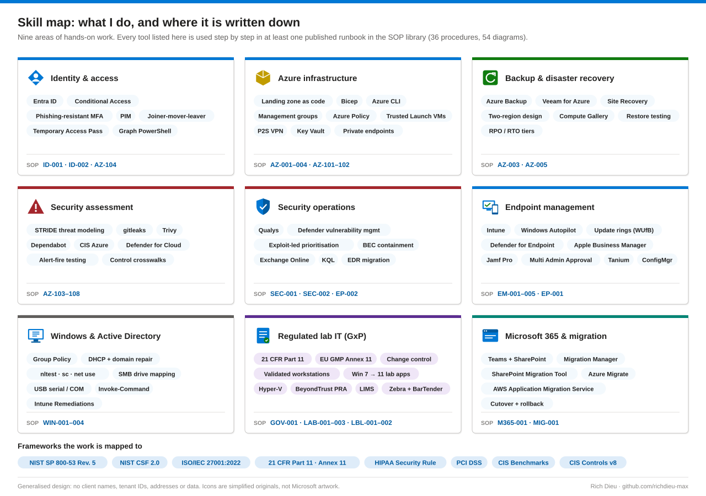

# SOP Library · Field Guide Series

**36 standard operating procedures · 54 architecture and flow diagrams · 12 technology families**

Runbooks from my work across Microsoft Azure, Entra ID, Intune, security operations, regulated (GxP) lab IT and Windows support. Every page reads directly on GitHub: what the procedure achieves, a diagram of how it fits together, prerequisites, the steps (portal first, then PowerShell / CLI, then at scale), how to verify it, how to roll it back, troubleshooting, and the controls it supports.

> **Sanitized reference edition.** Client names, hostnames, tenant IDs and ticket numbers are replaced with placeholders (Contoso, documentation IP ranges, sample change numbers). Microsoft's own built-in role, policy and app IDs are kept because the commands need them.

## Families

| Prefix | Family | Scope | SOPs |
|---|---|---|---|
| ID | [Identity & Access](#identity--access) | Entra ID policy, account lifecycle and privileged access | 2 |
| EM | [Endpoint Management](#endpoint-management) | Intune enrollment, configuration, updates and safeguards for Windows and macOS | 5 |
| EP | [Endpoint Agents & Protection](#endpoint-agents--protection) | Deploying and retiring endpoint agents ahead of EDR | 2 |
| SEC | [Security Operations](#security-operations) | Vulnerability remediation and incident response | 2 |
| GOV | [Governance & Compliance](#governance--compliance) | Change control and objective evidence for regulated (GxP) systems | 1 |
| AZ-0xx | [Microsoft Azure · Procedures](#microsoft-azure--procedures) | Hands-on builds: tenant, hardened VMs, cloning, VPN, backup and DR | 5 |
| AZ-1xx | [Microsoft Azure · Landing Zone Build & Assessment Series](#microsoft-azure--landing-zone-build--assessment-series) | Landing zone as code, customer stamps, and the security assessment of that build | 8 |
| M365 | [Microsoft 365](#microsoft-365) | Collaboration platform migrations | 1 |
| MIG | [Cloud Migration](#cloud-migration) | Moving on-premises servers to the cloud | 1 |
| LAB | [Regulated Lab IT](#regulated-lab-it) | GxP lab workstations, lab applications and compliance agents | 3 |
| LBL | [Label Printing](#label-printing) | Zebra label printers: drivers, DPI and network integration | 2 |
| WIN | [Windows Desktop Support](#windows-desktop-support) | Tier 1–3 Windows troubleshooting and command-line tooling | 4 |

## Catalog

### Identity & Access

| SOP | Runbook | What it covers |
|---|---|---|
| ID-001 | [Building a Conditional Access and MFA baseline in Microsoft Entra ID](identity-access/SOP-ID-001-conditional-access-mfa-baseline.md) | Replace security defaults with a named, testable Conditional Access set: emergency access, legacy auth blocked, MFA for all, phishing-resistant MFA for admins. |
| ID-002 | [Managing the joiner-mover-leaver account lifecycle in Microsoft Entra ID](identity-access/SOP-ID-002-joiner-mover-leaver-lifecycle.md) | Joiner-mover-leaver driven from the HR record: birthright access and a Temporary Access Pass on hire, access moved on role change, clean offboarding. |

### Endpoint Management

| SOP | Runbook | What it covers |
|---|---|---|
| EM-001 | [Deploy Microsoft Defender for Endpoint to macOS with Intune](endpoint-management/SOP-EM-001-defender-for-endpoint-macos-intune.md) | Defender for Endpoint on macOS five ways (Intune, Graph PowerShell, Settings Catalog, local script, Jamf Pro), verified down to mdatp health. |
| EM-002 | [Enrolling macOS devices into Microsoft Intune](endpoint-management/SOP-EM-002-macos-intune-enrollment.md) | macOS enrollment: Company Portal, Automated Device Enrollment through Apple Business Manager, direct enrollment, plus a readiness check script. |
| EM-003 | [Two-person control for Intune device wipe (Multi Admin Approval)](endpoint-management/SOP-EM-003-multi-admin-approval-wipe-retire-delete.md) | Two-person rule for Intune wipe, retire and delete, in the admin center or Graph PowerShell, with a request-notification flow. |
| EM-004 | [Provisioning Windows devices with Windows Autopilot and Intune](endpoint-management/SOP-EM-004-windows-autopilot-provisioning.md) | Windows Autopilot end to end: hardware hash, ZTDId dynamic group, deployment profile and Enrollment Status Page, sealed laptop to user. |
| EM-005 | [Managing Windows Update rings and patch compliance with Intune](endpoint-management/SOP-EM-005-windows-update-rings-patch-compliance.md) | Update rings with Windows Update for Business: pinned feature versions, expedited zero-day fixes, driver control, monthly patch compliance against an SLA. |

### Endpoint Agents & Protection

| SOP | Runbook | What it covers |
|---|---|---|
| EP-001 | [Deploying an endpoint management agent (Tanium Client example)](endpoint-agents/SOP-EP-001-tanium-client-deployment.md) | Install, register and verify an endpoint management agent (Tanium) manually, silently, remotely and at scale with Intune Win32 or ConfigMgr. |
| EP-002 | [Removing a legacy antivirus agent before EDR migration](endpoint-agents/SOP-EP-002-legacy-av-removal-edr-migration.md) | Remove a legacy antivirus agent (Trend Micro) before EDR migration, by console, vendor tool or scripted mass removal, then prove it is gone. |

### Security Operations

| SOP | Runbook | What it covers |
|---|---|---|
| SEC-001 | [Running a vulnerability remediation program with Qualys and Microsoft Defender](security-operations/SOP-SEC-001-vulnerability-remediation-qualys-defender.md) | Vulnerability remediation with Qualys and Microsoft Defender: one reconciled queue, exploit-led priorities, SLAs by tier, dated exceptions. |
| SEC-002 | [Containing a compromised Microsoft 365 account](security-operations/SOP-SEC-002-containing-compromised-m365-account.md) | Contain a compromised Microsoft 365 account: preserve evidence, contain in a fixed order across Entra ID and Exchange Online, scope, recover. |

### Governance & Compliance

| SOP | Runbook | What it covers |
|---|---|---|
| GOV-001 | [Change control and objective evidence for GxP and 21 CFR Part 11 systems](governance/SOP-GOV-001-gxp-change-control-and-objective-evidence.md) | Change control for GxP and 21 CFR Part 11 systems: classify, assess impact, plan test and rollback, e-signed Quality approval, objective evidence. |

### Microsoft Azure · Procedures

| SOP | Runbook | What it covers |
|---|---|---|
| AZ-001 | [Azure tenant foundation: day-zero identity and governance](azure-procedures/SOP-AZ-001-creating-securing-azure-tenant.md) | Create a tenant and apply a security and governance baseline four ways: portal, Graph + Az PowerShell, Azure CLI / Bicep, configuration as code. |
| AZ-002 | [Deploying a hardened Azure VM in a data-residency region](azure-procedures/SOP-AZ-002-hardened-azure-vm-data-residency-region.md) | Trusted Launch Windows Server VM with encryption at host, no public IP, backup and monitoring, kept in-region by Azure Policy. |
| AZ-003 | [Cloning an Azure virtual machine](azure-procedures/SOP-AZ-003-cloning-azure-virtual-machine.md) | Clone a VM: snapshot to managed disk to new VM via portal, PowerShell, CLI or Compute Gallery, with secure access and rollback. |
| AZ-004 | [Azure point-to-site VPN with Entra ID sign-in](azure-procedures/SOP-AZ-004-point-to-site-vpn-entra-id.md) | Point-to-site VPN with Entra ID sign-in: an MFA-protected OpenVPN tunnel into a private network, plus certificate auth and the user connection. |
| AZ-005 | [Two-region backup and disaster recovery design for Azure workloads](azure-procedures/SOP-AZ-005-multi-region-backup-disaster-recovery.md) | Two-region backup and DR for VMs and SQL with Azure Backup, Veeam for Azure and Site Recovery, proven by restore testing. |

### Microsoft Azure · Landing Zone Build & Assessment Series

| SOP | Runbook | What it covers |
|---|---|---|
| AZ-101 | [Building an Azure landing zone as code](azure-landing-zone-series/SOP-AZ-101-azure-landing-zone-as-code.md) | Landing zone as code: management groups, group-based RBAC, Policy guardrails, central logging with an immutable archive, hub network. |
| AZ-102 | [Deploying a repeatable customer stamp](azure-landing-zone-series/SOP-AZ-102-repeatable-customer-stamp.md) | A repeatable customer stamp: private spoke, Key Vault read by managed identity, customer-managed disk keys, geo-redundant backup. |
| AZ-103 | [Threat modeling an Azure build with STRIDE](azure-landing-zone-series/SOP-AZ-103-threat-modeling-azure-build-stride.md) | STRIDE threat model of the deployed build: trust boundaries, data flows and attack surface reviewed at every boundary. |
| AZ-104 | [Hardening identity and access in Azure](azure-landing-zone-series/SOP-AZ-104-hardening-identity-access-azure.md) | Identity hardening: Entra groups, roles at management group scope, PIM, Conditional Access and a role-to-permission matrix tested with real accounts. |
| AZ-105 | [Scanning for secrets and supply-chain risk](azure-landing-zone-series/SOP-AZ-105-scanning-secrets-supply-chain-risk.md) | Secrets and supply chain: gitleaks, Trivy and Dependabot across full history, a licence inventory and a Key Vault posture check. |
| AZ-106 | [Assessing network segmentation and container hosting](azure-landing-zone-series/SOP-AZ-106-network-segmentation-container-hosting.md) | Network segmentation and container hosting: effective routes, NSG rules, public exposure, host hardening, scored against CIS and Defender for Cloud. |
| AZ-107 | [Validating logging and proving every alert fires](azure-landing-zone-series/SOP-AZ-107-validating-logging-alerts-fire.md) | Logging validation: source inventory, retention, alerts on destructive actions, immutability, and a controlled test that fires every alert. |
| AZ-108 | [Mapping one build to many compliance frameworks](azure-landing-zone-series/SOP-AZ-108-mapping-build-many-compliance-frameworks.md) | One control matrix crosswalked to NIST CSF 2.0, SP 800-53 R5, ISO 27001:2022, HIPAA and a PCI DSS boundary, every row backed by hashed evidence. |

### Microsoft 365

| SOP | Runbook | What it covers |
|---|---|---|
| M365-001 | [Migrating file shares to Teams and SharePoint](microsoft-365/SOP-M365-001-file-shares-to-teams-sharepoint.md) | File shares to Teams and SharePoint: scan, clean up, migrate with Migration Manager or SPMT (GUI and PowerShell), then cut over. |

### Cloud Migration

| SOP | Runbook | What it covers |
|---|---|---|
| MIG-001 | [Lift-and-shift migration of a label printing server](cloud-migration/SOP-MIG-001-lift-and-shift-label-printing-server.md) | Rehost a BarTender label server with AWS Application Migration Service or Azure Migrate, or rebuild it, with tested cutover and rollback. |

### Regulated Lab IT

| SOP | Runbook | What it covers |
|---|---|---|
| LAB-001 | [Modernizing a Windows 7 lab application onto Windows 11](regulated-lab-it/SOP-LAB-001-windows-7-lab-application-to-windows-11.md) | Move an instrument-control application off Windows 7 onto Windows 11: compatibility mode, shims, isolated Hyper-V and more. |
| LAB-002 | [Installing, registering and patching a lab compliance data agent](regulated-lab-it/SOP-LAB-002-lab-compliance-data-agent.md) | Register, install, connect and hotfix a GxP data-capture agent interactively, silently, remotely (BeyondTrust PRA) and at scale. |
| LAB-003 | [Requesting and provisioning a regulated (GxP) lab workstation](regulated-lab-it/SOP-LAB-003-requesting-provisioning-gxp-lab-workstation.md) | A regulated lab workstation from funding to retirement: standard, qualified, break-fix and decommission paths through ITSM. |

### Label Printing

| SOP | Runbook | What it covers |
|---|---|---|
| LBL-001 | [Fixing undersized labels caused by a Zebra driver DPI mismatch](label-printing/SOP-LBL-001-zebra-dpi-mismatch-undersized-labels.md) | Fix undersized labels caused by a Zebra driver DPI mismatch via Print Management, PowerShell, PrintUI/pnputil or print-server policy. |
| LBL-002 | [Static IP reservation and network label printer integration](label-printing/SOP-LBL-002-static-ip-reservation-network-label-printer.md) | Give a network label printer a reserved address and connect it to Windows, BarTender and the LIMS, four ways. |

### Windows Desktop Support

| SOP | Runbook | What it covers |
|---|---|---|
| WIN-001 | [Troubleshooting USB serial (COM port) device connectivity on Windows](windows-support/SOP-WIN-001-usb-serial-com-port-troubleshooting.md) | USB-to-serial and COM port repair five ways: Device Manager, CMD, PowerShell with pnputil, a power-management fix, Intune Remediations. |
| WIN-002 | [Restoring the DHCP Client service and domain connectivity](windows-support/SOP-WIN-002-dhcp-client-and-domain-connectivity.md) | From "no network, no domain" back to working: Services and Event Viewer, sc / ipconfig / nltest, a PowerShell repair, a controlled rejoin. |
| WIN-003 | [Restoring mapped network drive access on Windows 11](windows-support/SOP-WIN-003-mapped-network-drive-access.md) | Restore mapped drives on Windows 11: Workstation service and SMB client, net use / cmdkey, SMB cmdlets, Group Policy or Intune at scale. |
| WIN-004 | [The Windows command-line toolkit for support engineers](windows-support/SOP-WIN-004-windows-command-line-toolkit.md) | The everyday Windows support commands in CMD and PowerShell, run remotely with Invoke-Command and at scale with Intune Remediations. |

## What every runbook contains

| Chapter | What you get |
|---|---|
| Diagram | The architecture or flow, drawn so the steps make sense at a glance |
| Before you start | Roles, licensing, access and the risks worth knowing first |
| Steps | The procedure in the portal or GUI, then as PowerShell / CLI / KQL, then at scale |
| Verify, rollback, troubleshooting | Checks that prove the result, the safe way back, symptom → cause → fix |
| Control mapping | The NIST SP 800-53, CSF 2.0, ISO 27001 or GxP controls it supports |

## Coverage by framework

| NIST SP 800-53 Rev. 5 family | Procedures |
|---|---|
| AC · Access Control | ID-001, ID-002, AZ-104, EM-003, AZ-004 |
| IA · Identification and Authentication | ID-001, AZ-001, AZ-004, AZ-104 |
| PS · Personnel Security | ID-002 |
| CM · Configuration Management | GOV-001, EM-002, EM-004, EM-005, LAB-001, LAB-003, AZ-101, AZ-102, EP-001 |
| SI · System and Information Integrity | EM-005, SEC-001, EM-001, EP-002, LAB-002 |
| RA · Risk Assessment | SEC-001, AZ-103 |
| IR · Incident Response | SEC-002 |
| AU · Audit and Accountability | AZ-107, SEC-002, GOV-001 |
| CP · Contingency Planning | AZ-005, AZ-003 |
| SC · System and Communications Protection | AZ-002, AZ-004, AZ-106, LBL-002 |
| SA / SR · Acquisition and Supply Chain | AZ-105, GOV-001 |
| CA · Assessment, Authorization and Monitoring | AZ-108, SEC-001 |

| Regulation or benchmark | Procedures |
|---|---|
| FDA 21 CFR Part 11 / EU GMP Annex 11 (GxP) | GOV-001, LAB-001, LAB-002, LAB-003, ID-001 |
| CIS Microsoft 365 / Intune benchmarks | ID-001, EM-002, EM-005 |
| CIS Critical Security Controls v8 (Control 7) | SEC-001, EM-005 |

## Related

- [endpoint-identity-runbooks](https://github.com/richdieu-max/endpoint-identity-runbooks): short-form versions of AZ-001, AZ-004, AZ-005, EM-001 and EM-003
- [azure-posture-check](https://github.com/richdieu-max/azure-posture-check): the read-only evidence script referenced by the AZ-1xx series
- [security-assessment-toolkit](https://github.com/richdieu-max/security-assessment-toolkit): the workbook behind AZ-103 to AZ-108

---

© Rich Dieu IT Solutions LLC · [richdieu.com](https://richdieu.com).
