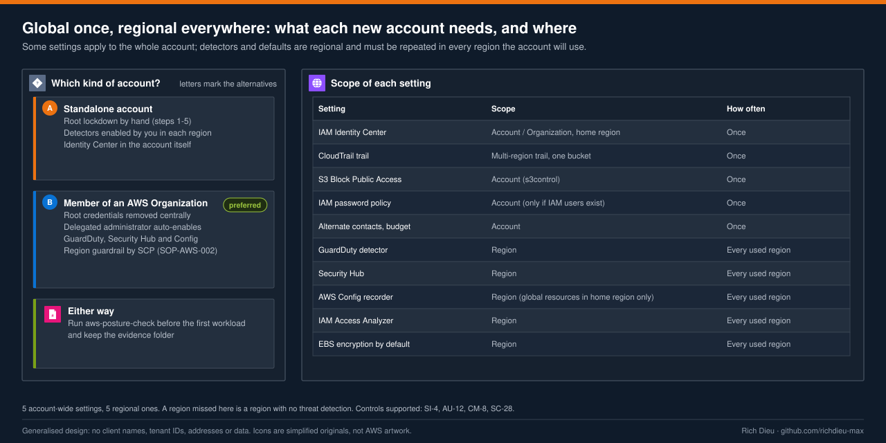

# SOP-AWS-001 · AWS account foundation: day-zero identity, logging and guardrails

Create an AWS account and apply a security baseline before the first workload lands. The baseline locks down the root user, gives people sign-in through IAM Identity Center, turns on account-wide logging and threat detection, and switches on the defaults AWS leaves off. It is the AWS counterpart of [SOP-AZ-001](../azure-procedures/SOP-AZ-001-creating-securing-azure-tenant.md).

**Family:** AWS procedures · **Covers:** a standalone account or the management account of a new AWS Organization, in the console and the AWS CLI, then verified with [aws-posture-check](https://github.com/richdieu-max/aws-posture-check) · **Does not cover:** multi-account landing zones (Control Tower account factory), SCP design beyond the region guardrail in [SOP-AWS-002](SOP-AWS-002-hardened-ec2-data-residency-region.md), or workload networking.

## Shape


| Layer | Setting | Stops |
|---|---|---|
| Root user | Two FIDO2 keys, no access keys, group mailbox, never used day to day | Account takeover through the one identity that cannot be restricted |
| People | IAM Identity Center users and groups, MFA on every sign-in, permission sets with 1 to 4 hour sessions | Long-lived IAM user passwords and access keys |
| Record | Multi-region CloudTrail to a dedicated, encrypted S3 bucket with log file validation | "Who did what" disappearing after 90 days |
| Detect | GuardDuty, Security Hub (AWS Foundational Security Best Practices and CIS), AWS Config, Access Analyzer | Threats and drift nobody looks at |
| Defaults | S3 Block Public Access (account), EBS encryption by default in every used region, a budget alarm | Public buckets, unencrypted volumes, surprise bills (often the first sign of stolen keys) |

## Before you start

| Item | Requirement |
|---|---|
| Root email | A distribution list or shared mailbox the security team controls (`aws-root+prd@example.com`), never a person's inbox |
| MFA | Two FIDO2 security keys for the root user, stored apart. AWS allows up to eight MFA devices per root user and IAM user |
| Contacts | Names, emails and phone numbers for the billing, operations and security alternate contacts |
| Home region | The region for IAM Identity Center and the CloudTrail bucket (for example `us-east-1`); decide it once |
| Change | Approved change `CHG0012345`; the account ID goes on every evidence item |

## Steps

### Root user (console, once)

1. **Sign up** with the group mailbox. Record the account ID.
2. **MFA.** Security credentials › Multi-factor authentication › **Assign MFA device** › Passkey or security key. Register the second key the same way.
3. **Access keys.** Confirm there are none. Never create one for root.
4. **Alternate contacts.** Account › Alternate contacts: billing, operations and **security**. AWS sends abuse and security notices to the security contact.
5. **Stop using root.** Store the keys and the mailbox credentials under dual control. In an Organization, also turn on **centralized root access** for member accounts so their root credentials can be removed.

### People (IAM Identity Center)

6. **Enable IAM Identity Center** in the home region (with AWS Organizations if this is a management account).
7. **Settings › Authentication › MFA:** prompt **every time they sign in**; allow authenticator apps and security keys; if a user has no device, **require them to register one at sign-in**.
8. **Permission sets:** `AdministratorAccess` with a 1-hour session for break-fix, `PowerUserAccess` or a custom set for day-to-day work, and `SecurityAudit` for reviewers.
9. **Groups:** `aws-admins`, `aws-operators` and `aws-auditors`. Assign each group its permission set on the account. Assign people to groups, never to accounts directly.

### Record, detect and default (CLI)

Run as an Identity Center administrator (`aws sso login --profile admin`). Repeat the regional commands for every region you will use.

```bash
ACCOUNT=111122223333; REGION=us-east-1; TRAIL_BUCKET=contoso-cloudtrail-$ACCOUNT

# CloudTrail: one multi-region trail with log file validation (bucket policy per the CloudTrail docs; SSE-KMS key optional)
aws cloudtrail create-trail --name account-trail --s3-bucket-name "$TRAIL_BUCKET" \
    --is-multi-region-trail --enable-log-file-validation --include-global-service-events
aws cloudtrail start-logging --name account-trail

# Detect
aws guardduty create-detector --enable --finding-publishing-frequency FIFTEEN_MINUTES --region "$REGION"
aws securityhub enable-security-hub --enable-default-standards --region "$REGION"
aws accessanalyzer create-analyzer --analyzer-name account --type ACCOUNT --region "$REGION"

# Defaults
aws s3control put-public-access-block --account-id "$ACCOUNT" --public-access-block-configuration \
    BlockPublicAcls=true,IgnorePublicAcls=true,BlockPublicPolicy=true,RestrictPublicBuckets=true
aws ec2 enable-ebs-encryption-by-default --region "$REGION"

# Only if IAM users must exist (break-glass or legacy tools)
aws iam update-account-password-policy --minimum-password-length 14 --password-reuse-prevention 24 \
    --require-symbols --require-numbers --require-uppercase-characters --require-lowercase-characters
```

10. **AWS Config.** In the console, use **Get started** (one-click setup) in each region to create the recorder, delivery channel and service-linked role. Record all resource types, plus global resources in the home region only.
11. **Budget.** Billing › Budgets › **Monthly cost budget** with alerts at 80% and 100% to the security and billing contacts. A sudden cost spike is often the first sign of stolen access keys mining crypto.



## Verify

```bash
aws-posture-check --profile auditor --regions us-east-1 --areas Identity Logging "Threat protection" Storage --fail-on fail
```

Expect PASS for root MFA, root access keys, CloudTrail, GuardDuty and account-level Block Public Access. Keep the evidence folder with the change record.

## Roll back

Nothing in this baseline needs undoing for a workload to run. If a detector or the trail must be removed, record the reason. Logging that is stopped and then started again leaves a gap that auditors will ask about.

## Troubleshooting

| Symptom | Cause and fix |
|---|---|
| `InsufficientS3BucketPolicyException` on `create-trail` | The bucket policy must let `cloudtrail.amazonaws.com` check the bucket ACL and write under `AWSLogs/<account-id>/`; apply the policy from the CloudTrail documentation first |
| Identity Center users get no MFA prompt | MFA setting is "only when sign-in context changes"; set "every time they sign in" |
| Security Hub shows Config-dependent controls as failed | AWS Config is not recording in that region (step 10) |
| GuardDuty on in one region only | Detectors are regional; repeat in every region in use, or use an Organization delegated administrator with auto-enable |

## Control mapping

| Framework | Reference | How this supports it |
|---|---|---|
| NIST SP 800-53 R5 | AC-2, AC-6(5), IA-2(1) | Root locked away; named people with MFA; privileged sessions short and group-assigned |
| | AU-2, AU-9, AU-11, AU-12 | Multi-region CloudTrail with integrity validation and long-term retention in S3 |
| | SI-4, CA-7, RA-5 | GuardDuty, Security Hub standards, AWS Config |
| | SC-7, SC-28 | Account-wide Block Public Access; EBS encryption by default |
| NIST CSF 2.0 | GV.RR-02, PR.AA-01, DE.CM-01 | Roles defined; identities managed; activity monitored |
| CIS AWS Foundations Benchmark | Sections 1 to 4 | Identity, storage, logging and monitoring recommendations covered by the steps above |
