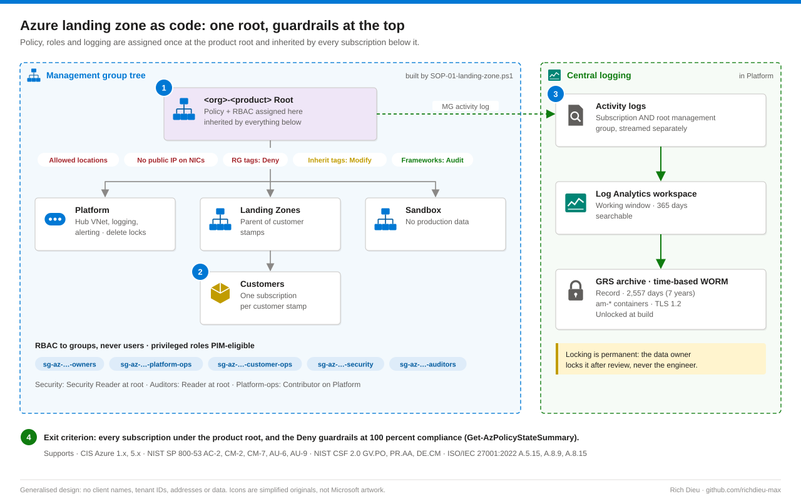

# SOP-AZ-101 · Building an Azure landing zone as code

Build the part of the tenant that exists before any workload: the management group tree, group-based RBAC, Azure Policy guardrails, central logging with an immutable archive and the hub network. Everything deployed later inherits these decisions, so every new customer starts compliant. Think of it as the building code and the lot, not the house.

**Family:** Azure landing zone series · **Covers:** the foundation built in the portal and from the PowerShell template, with its exit check · **Does not cover:** customer stamps (SOP-AZ-102) or PIM eligibility for Owner and Contributor (SOP-AZ-104).

## How it fits together



| Effect | What it does | Used here for |
|---|---|---|
| Deny | Refuses the request at Resource Manager; nothing is created | Allowed regions, no public IP on a NIC, required tags on resource groups |
| Modify | Changes the request on the way in; needs a managed identity on the assignment | Inherit tags from the resource group onto every resource |
| Audit | Lets the request through and records it as non-compliant | CIS, NIST SP 800-53, ISO 27001, HIPAA and PCI initiatives, which produce evidence |

Log Analytics keeps 365 days of searchable logs (the working window). A geo-redundant storage account with a time-based WORM policy keeps the regulatory record for seven years. Changes made at a management group go to that group's own activity log, which a subscription-level export never sees, so both are streamed.

## Before you start

| Item | Requirement |
|---|---|
| Management groups | Management Group Contributor at the tenant root, or Owner (no Global Administrator elevation needed if the root grant exists) |
| Move a subscription | Owner on the subscription and write on the target group; an ABAC condition on Owner can block it |
| Security groups | Groups Administrator in Entra ID (Azure Owner includes no directory role) |
| Policy and roles at the root | Owner, or Resource Policy Contributor plus User Access Administrator; Modify identities need Tag Contributor |
| Lock the log archive | Data owner only. Locking is permanent and never done by the engineer |
| Ask precisely | Name the step and role ("Owner on the subscription so the build can assign Tag Contributor to the policy identity"), not "admin access" |
| Inputs | Subscription and tenant IDs in the parameter file (never in a public repository); two allowed regions with the paired region; required tag names (for example Owner, DataClassification, Client); security mailbox |
| Tools | Az PowerShell 12 or later on PowerShell 7.4; `Test-…Access.ps1` ends READY; written change window from the data owner |
| Decisions | Two subscriptions (platform and customer) is cleaner, one is acceptable if written down; initiatives in **Audit**; immutability **unlocked** at build; naming `<product>-<workload>-<env>-<region>-<type>-<nn>` with tenant-wide objects prefixed `<org>-<product>` |

## Steps

The template is the version of record. Use the portal to learn, review, or rebuild one piece in an emergency.

### Portal

1. **Management group tree.** **Management groups › + Create**, ID `<org>-<product>` (the product root). Under it create `-platform`, `-landingzones` and `-sandbox`; under Landing Zones create `-customers`. Open Customers › **Add subscription** and check with **Expand / Collapse all**.
2. **Five security groups.** **Microsoft Entra ID › Groups › New group**, type Security, membership Assigned: `sg-az-<org>-<product>-owners`, `-platform-ops`, `-customer-ops`, `-security`, `-auditors`, each with an owner. The build never adds people; membership is the client's.
3. **Guardrails at the root.** **Policy › Assignments › Assign policy**, scope the product root: **Allowed locations** (your two regions), **Network interfaces should not have public IPs**, **Secure transfer to storage accounts should be enabled**. For each required tag assign **Require a tag on resource groups** (Deny) and **Inherit a tag from the resource group if missing** (Modify, tick **Create a Managed Identity** on Remediation). Then **Assign initiative** for CIS Azure Foundations, NIST SP 800-53 R5, ISO 27001, HIPAA HITRUST and PCI DSS v4, all in Audit. Deny on the resource group, not on every resource: a per-resource tag rule also blocks resources Azure creates for you, such as OS disks and private endpoint NICs.
4. **Central logging.** In the platform resource group create a Log Analytics workspace (Pay-as-you-go, 365 days). Create a storage account: Geo-redundant, minimum TLS 1.2, public blob access off, public network access off. Under **Data storage › Containers** create the `am-*` containers with a time-based retention policy of 2,557 days, protected append writes allowed. Leave it unlocked.
5. **Stream the activity log.** **Monitor › Activity log › Export Activity Logs › + Add diagnostic setting**: Administrative, Security, Policy, Alert and ServiceHealth to the workspace. The root management group setting is not in the portal; set it with the template.
6. **Hub network and locks.** Create the hub VNet with `snet-mgmt`, `snet-appgw` and the reserved `AzureFirewallSubnet` and `AzureBastionSubnet`. On the platform and hub resource groups add a **Delete** lock under **Settings › Locks**.

### Template

7. **Run `SOP-01-landing-zone.ps1`.** It is idempotent (a rerun converges, never duplicates) and every client-specific value lives in `tenant.parameters.json`. Keep it in source control beside the evidence it produced.

   ```powershell
   Connect-AzAccount -TenantId <tenant-id>
   ./SOP-01-landing-zone.ps1 -ParameterFile ./tenant.parameters.json -WhatIf   # list every change
   ./SOP-01-landing-zone.ps1 -ParameterFile ./tenant.parameters.json           # build
   Get-AzPolicyStateSummary -ManagementGroupName <org>-<product>               # exit check
   ```

   The management group diagnostic setting it adds:

   ```powershell
   $diag = @{ properties = @{ workspaceId = $law.ResourceId; logs = @(@{category='Administrative';enabled=$true},
     @{category='Policy';enabled=$true}, @{category='Security';enabled=$true}) } } | ConvertTo-Json -Depth 6
   Invoke-AzRestMethod -Method PUT -Path "$root/providers/Microsoft.Insights/diagnosticSettings/mg-activity-to-law?api-version=2020-01-01-preview" -Payload $diag
   ```

   When the platform and customer subscription IDs are the same, each per-subscription step runs once; record that as a scope decision in the design document.

## Verify

The exit criterion: every subscription is under the product root, and the Deny guardrails are at 100 percent compliance.

| Check | Pass |
|---|---|
| Tree | `Get-AzManagementGroup -GroupName <org>-<product> -Expand -Recurse` shows the five groups and the subscription under Customers |
| RBAC | Role assignments at the root are held by groups only (export and hash) |
| Policy | **Policy › Compliance** at the root: Deny assignments at 100 percent; initiatives exported to CSV |
| Archive | Containers show a time-based retention policy, unlocked |
| Evidence | Manifest records run ID, operator and UTC time (ALCOA+) |

## Rollback

Remove in reverse order: locks, resource groups, policy assignments, role assignments, then management groups (move the subscription back to the tenant root first). Never delete the archive storage account; an unlocked WORM policy still blocks deleting the data inside it until the retention ends.

## Troubleshooting

| Symptom | Cause and fix |
|---|---|
| Subscription move refused | Owner carries an ABAC condition or the target group denies writes; get an unconditioned Owner and rerun (the script warns and continues) |
| Group creation fails | No Entra directory role; ask for Groups Administrator for the build, or have the five groups created by name |
| `RequestDisallowedByPolicy` | Read the `policies` property of the activity log event before changing any guardrail; most often a required tag is missing on a new resource group. A Deny often looks like a region block or quota problem |
| Modify policy never adds tags | The assignment identity lacks Tag Contributor at the root, or no remediation task ran for existing resources |
| No management group events in the workspace | The root group diagnostic setting is missing; set it with the template |

## Control mapping

| Framework | Reference | How this supports it |
|---|---|---|
| CIS Azure Foundations | 1.x, 5.x | Identity and logging baselines assigned at the root |
| NIST SP 800-53 R5 | AC-2 | RBAC through named security groups, never individual users |
| | CM-2, CM-7 | Baseline set once by template; Deny guardrails restrict regions and public IPs |
| | AU-6, AU-9 | Activity logs centralised for review; WORM archive protects the record |
| NIST CSF 2.0 | GV.PO, PR.AA, DE.CM | Policy at the root, group-based access, continuous monitoring through central logs |
| ISO/IEC 27001:2022 | A.5.15, A.8.9, A.8.15 | Access control, configuration management, logging |
