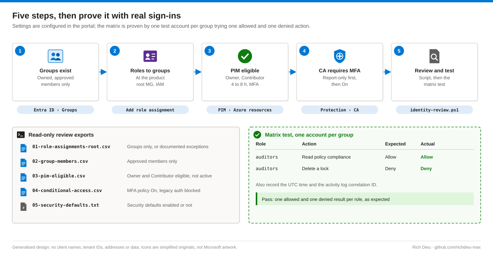

# SOP-AZ-104 · Hardening identity and access in Azure

Put every Azure role on a security group at management group scope, make privileged roles eligible through Privileged Identity Management (PIM), enforce MFA with Conditional Access, and prove the role-to-permission matrix with real sign-ins. Most cloud breaches start with an identity, not a network: when groups hold roles, removing a person from one group removes everything they had.

**Family:** Azure landing zone series · **Covers:** the five engagement security groups, group-based Azure roles, PIM eligibility, an MFA Conditional Access policy, a read-only identity review and the matrix test · **Does not cover:** deciding group membership, which is the client's decision.

## How it fits together

Think of a badge, a door list and a visitor pass. A person has a badge (their named account), the door list names teams, not people (groups hold roles), and anyone who needs the server room asks for a visitor pass that expires at the end of the day (PIM activation). No user holds a role directly, and privileged roles exist only while someone is using them.


| Group (`sg-az-<org>-<product>-*`) | Role and scope | Standing or eligible |
|---|---|---|
| `-owners` | Owner at the product root | Eligible (PIM), 4 hours |
| `-platform-ops` | Contributor on Platform; Resource Policy Contributor at the root if the client asks in writing | Standing |
| `-customer-ops` | Contributor on Customers | Eligible (PIM), 8 hours |
| `-security` | Security Reader and Reader at the root | Standing |
| `-auditors` | Reader at the root | Standing |

## Before you start

| Item | Requirement |
|---|---|
| Create groups | Groups Administrator. Membership is the client's decision, approved in writing |
| Assign Azure roles | User Access Administrator or Owner at the scope; assign to groups only |
| PIM role settings | Privileged Role Administrator; Entra ID P2 licence |
| Conditional Access | Conditional Access Administrator; Entra ID P1 licence |
| Read for review | Reader plus Security Reader and Directory Readers; no write needed |
| Licensing | P1 and P2 confirmed, or recorded as findings. Without P2, eligible assignments fail: record the missing licence as a finding and do not quietly fall back to standing Owner |
| Break-glass | Two break-glass accounts exist, excluded from Conditional Access and monitored |
| Test accounts | Approved for the matrix test, one per group |

## Steps



1. **Check the groups exist and are owned.** Go to **Microsoft Entra ID › Groups › All groups** and search `sg-az-`. Each group should have an owner and only the members the client approved.
2. **Assign Azure roles to groups only.** Open the product root management group › **Access control (IAM) › Add › Add role assignment**. Pick the role, then **Members › Assign access to: User, group, or service principal** and select the group. Readers and auditors get standing Reader; platform operators get Resource Policy Contributor only on the client's written request.
3. **Make privileged roles eligible.** **Privileged Identity Management › Azure resources**: select the management group, then **Roles › Add assignments**. Role Owner (or Contributor), member the owners group, **Assignment type: Eligible**. In **Settings** for the role: maximum activation 4 to 8 hours, require MFA and justification, require approval for Owner.
4. **Enforce MFA with Conditional Access.** **Entra ID › Protection › Conditional Access › Create new policy**. Users: all users, excluding the two break-glass accounts. Target resources: all cloud apps. Grant: **Require multifactor authentication**. Start in **Report-only**, review sign-in logs for a week, then switch to **On**. Report-only shows who would have been blocked without blocking anyone, so a week of logs catches service accounts and old clients before they break. Add a second policy that blocks legacy authentication.
5. **Review standing privilege.** Run `SOP-04-identity-review.ps1` (read-only). It exports role assignments, group members, PIM eligibility and Conditional Access, and warns on any user holding Owner or User Access Administrator directly. Each warning is a finding unless it is a documented, time-limited exception, for example the engineer's access during the build, removed at hand-over.

   ```powershell
   param([string]$RootMg = '<org>-<product>', [string]$Out = './identity-review')
   $root = "/providers/Microsoft.Management/managementGroups/$RootMg"
   $ra = Get-AzRoleAssignment -Scope $root |
       Select-Object DisplayName, SignInName, ObjectType, RoleDefinitionName, Scope
   $ra | Export-Csv "$Out/01-role-assignments-root.csv" -NoTypeInformation
   $ra | Where-Object { $_.ObjectType -eq 'User' -and
         $_.RoleDefinitionName -in 'Owner','User Access Administrator' } |
       ForEach-Object { Write-Warning "Standing privileged user: $($_.SignInName) holds $($_.RoleDefinitionName)" }
   # ... 02 group members, 03 PIM eligible (P2), 04 Conditional Access, 05 security defaults ...
   ```

6. **Test the matrix.** Sign in as one test account per group; try one action the role allows and one it does not. Record expected, actual, UTC time and the activity log correlation ID.

   ```csv
   Role,Account,Action,Expected,Actual,UtcTime,CorrelationId
   auditors,test-auditor,Read policy compliance,Allow,Allow,2026-10-15T14:02:11Z,<id>
   auditors,test-auditor,Delete a lock,Deny,Deny (AuthorizationFailed),2026-10-15T14:03:40Z,<id>
   ```

## Verify

| Check | Pass |
|---|---|
| Role assignment export | Groups only, or documented exceptions |
| PIM export | Owner and Contributor listed as eligible, not active |
| Conditional Access export | MFA policy On and legacy authentication blocked |
| Matrix log | One allowed and one denied result per role |

## Troubleshooting

| Symptom | Cause and fix |
|---|---|
| PIM assignment fails with `AadPremiumLicenseRequired` | No P2 licence. Record a finding; do not substitute standing Owner |
| Conditional Access blade says you do not have access | Reader is not enough. Ask for Security Reader or Conditional Access Administrator |
| Group change does not take effect | Tokens are cached; sign out and in again, or wait for the token lifetime |

## Control mapping

| Framework | Reference | How this supports it |
|---|---|---|
| NIST SP 800-53 R5 | AC-2, AC-5, AC-6 | Group-based roles, separated by job function, with no standing privileged user |
| | IA-2, IA-5 | Named accounts with MFA enforced by Conditional Access |
| ISO/IEC 27001:2022 | A.5.15, A.5.18, A.8.2, A.8.5 | Access control, access rights, privileged access and secure authentication |
| HIPAA Security Rule | 164.312(a)(1), 164.312(d) | Access control; person or entity authentication |
| CIS Azure Foundations | 1.x | Identity and access management recommendations |
