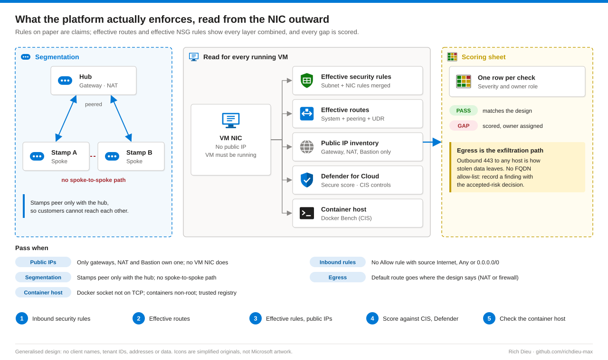

# SOP-AZ-106 · Assessing network segmentation and container hosting

Review multi-tenant segmentation, effective routes and NSG rules, public exposure and container host hardening, and score every gap against CIS Azure Foundations and Defender for Cloud. The goal is evidence of what the platform actually enforces, not what the design says it should.

**Family:** Azure landing zone series · **Covers:** inbound rules, effective routes and effective security rules per VM NIC, public IP inventory, Defender for Cloud and CIS scoring, Docker Bench on the container host · **Does not cover:** changing any rule; every step is read-only.

## How it fits together

An NSG rule on paper is a claim. What reaches a VM is decided by the rules on its subnet and its NIC combined, the routes from its own network, any peering and any user-defined route. Azure computes both views for a running VM, and those effective views are the evidence. The design diagram is the map; effective routes and effective security rules are the road as it is paved today. Inspect the road.



| Check | Pass when |
|---|---|
| Public IPs | Only gateways, NAT and Bastion own one; no VM NIC does |
| Inbound rules | No Allow rule with source Internet, Any or 0.0.0.0/0 |
| Segmentation | Stamps peer only with the hub; no spoke-to-spoke path |
| Egress | Default route goes where the design says (NAT or firewall) |
| Container host | Docker socket not on TCP; containers non-root; trusted registry |

## Before you start

| Item | Requirement |
|---|---|
| Read networks and NSGs | Reader at the product root; effective routes are a read action |
| Defender recommendations | Security Reader, with Defender plans enabled |
| Docker Bench | Shell on the host, with the client's approval; runs read-only checks |
| VMs running | Effective routes and effective security rules are only computed for a running VM. Schedule the review when the VMs are up |
| Design document | Lists the intended exceptions (NAT and gateway public IPs) |
| Scoring sheet | Prepared before the review |

## Steps

1. **Read the inbound rules.** Open each NSG › **Settings › Inbound security rules**. Every Allow rule should name a narrow source (a subnet, never Internet or Any) and one port. A deny-internet rule should sit above the default rules. A typical app NSG allows SSH from the hub management subnet, the app port from the gateway, and an explicit internet deny at priority 4000.
2. **Read the effective routes.** Open the VM's NIC › **Help › Effective routes**. Check the spoke range, the peered hub range and the default route. A 0.0.0.0/0 to Internet means egress leaves through the NAT gateway; if the design calls for a firewall, this row should point to a virtual appliance. Outbound 443 to any host is how stolen data leaves: if there is no FQDN allow-list, record it as a finding with the accepted-risk decision.
3. **Read the effective security rules and public exposure.** On the same NIC open **Effective security rules**, which merges subnet and NIC rules. Open **Public IP addresses** filtered to the product's resource groups; each must belong to a gateway, NAT gateway or Bastion.
4. **Score against CIS and Defender.** Open **Microsoft Defender for Cloud › Recommendations** and **Regulatory compliance › CIS Azure Foundations**. Copy every unhealthy item touching network, storage, identity or compute into the scoring sheet with severity and owner role.
5. **Check the container host.** Run Docker Bench for Security (CIS Docker Benchmark) on the host. Confirm the daemon socket is not exposed over TCP, containers run as non-root, and images come from a trusted registry.

`SOP-06-network-review.ps1` collects steps 1 to 4 in one read-only pass, writing a numbered CSV or JSON file per check:

```powershell
param([string]$ResourceGroupLike = '<product>-*', [string]$Out = './network-review')
$rgs = (Get-AzResourceGroup | Where-Object ResourceGroupName -like $ResourceGroupLike).ResourceGroupName
# Inbound rules open to the world
Get-AzNetworkSecurityGroup | Where-Object ResourceGroupName -in $rgs | ForEach-Object {
  $n = $_.Name
  $_.SecurityRules | Where-Object { $_.Direction -eq 'Inbound' -and $_.Access -eq 'Allow' -and
    ($_.SourceAddressPrefix -in '*','Internet','0.0.0.0/0') } |
  Select-Object @{n='Nsg';e={$n}}, Name, Priority, DestinationPortRange
} | Export-Csv "$Out/02-open-inbound.csv" -NoTypeInformation
# Effective routes and effective NSG per VM NIC (what the platform actually enforces)
Get-AzNetworkInterface | Where-Object ResourceGroupName -in $rgs | ForEach-Object {
  Get-AzEffectiveRouteTable -NetworkInterfaceName $_.Name -ResourceGroupName $_.ResourceGroupName |
    Export-Csv "$Out/03-routes-$($_.Name).csv" -NoTypeInformation
  Get-AzEffectiveNetworkSecurityGroup -NetworkInterfaceName $_.Name -ResourceGroupName $_.ResourceGroupName |
    ConvertTo-Json -Depth 8 | Set-Content "$Out/04-effective-nsg-$($_.Name).json"
}
```

The same script exports `01-public-ips.csv` (each public IP and its owner) and `05-defender-unhealthy.csv` (secure score and unhealthy recommendations), and carries the Docker Bench command for the host as a comment.

## Verify

| Check | Pass |
|---|---|
| Public exposure | `01-public-ips.csv` lists only gateway, NAT or Bastion owners |
| Open inbound | `02-open-inbound.csv` is empty |
| Effective views | Effective route and NSG exports exist for every VM NIC and are hashed |
| Scoring | Every Defender or CIS gap has a score and an owner role |

## Troubleshooting

| Symptom | Cause and fix |
|---|---|
| Effective routes stay on Loading | The VM is deallocated. Start it or review when it runs |
| Public IP on a NIC despite the policy | Created before the policy, or an exemption exists. Check the assignment exemptions |
| Defender shows no recommendations | Plans not enabled or the scan has not run yet. Allow 24 hours after enabling |

## Control mapping

| Framework | Reference | How this supports it |
|---|---|---|
| CIS Azure Foundations | 6.x, 7.x | Networking and VM checks scored from Defender for Cloud |
| NIST SP 800-53 R5 | SC-7, SC-7(5) Boundary protection, deny by default | No inbound from the internet; explicit deny above the defaults |
| | CM-7 Least functionality | Public IPs only on gateways, NAT and Bastion |
| | AC-4 Information flow enforcement | Stamps isolated from each other; egress path checked against the design |
| ISO/IEC 27001:2022 | A.8.20, A.8.22 | Network security; segregation of networks |
| PCI DSS v4 (boundary) | 1.3, 1.4 | Network access to and from the environment restricted and controlled |
