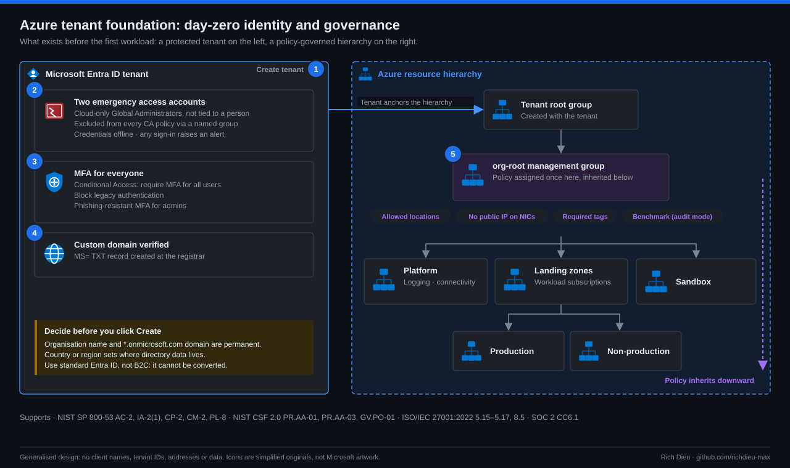

# SOP-AZ-001 · Azure tenant foundation: day-zero identity and governance

Create a Microsoft Entra tenant and put the controls in place that have to exist **before** the first resource is deployed: emergency access, MFA, a verified domain, and a management group hierarchy carrying policy.

**Family:** Microsoft Azure · **Covers:** tenant creation in the portal, then the same baseline with Microsoft Graph and Az PowerShell, with Azure CLI and Bicep, and as configuration as code, plus verification, rollback and troubleshooting · **Does not cover:** the full Conditional Access set (SOP-ID-001) or the landing zone build (SOP-AZ-101) · Also published, with the same diagram, in [endpoint-identity-runbooks](https://github.com/richdieu-max/endpoint-identity-runbooks).

<!-- tags:start (generated by tools/catalog/build.py: edit tools/catalog/catalog.json or the Control mapping table, then rebuild) -->
> - **Status:** Production · **Topics:** [Microsoft Azure](../README.md#topic-azure) · [Identity, sign-in and MFA](../README.md#topic-identity) · [Compliance and audit evidence](../README.md#topic-compliance) · [Automation and infrastructure as code](../README.md#topic-automation)
> - **Keywords:** Entra tenant · management groups · Azure Policy · break-glass accounts · Bicep · day-zero baseline
> - **NIST SP 800-53 Rev. 5:** `AC-2` Account management · `CM-2` Baseline configuration · `CP-2` Contingency plan · `IA-2, IA-2(1)` Identification and authentication (users) · `PL-8` Security and privacy architectures
> - **NIST CSF 2.0:** `PR.AA-01, PR.AA-03` Protect: Identity management, authentication and access control · `GV.PO-01` Govern: Policy
> - **Also maps to:** ISO/IEC 27001:2022 · SOC 2 (see [Control mapping](#control-mapping))
<!-- tags:end -->

## Decide before you click Create

The organisation name and the initial `*.onmicrosoft.com` domain are permanent, and the country or region sets where directory data lives. Choose standard **Microsoft Entra ID**, not B2C; a B2C tenant cannot be converted. For US government workloads, build in Azure Government instead.


## Target end state



## Steps (portal)

1. **Create the tenant.** Azure portal → Microsoft Entra ID → Manage tenants → Create → Microsoft Entra ID. Enter organisation name, initial domain and country. Record the tenant ID. Use a private browser window if you are signed in to another tenant.
2. **Emergency access accounts.** Two cloud-only accounts on the `onmicrosoft.com` domain, Global Administrator, long random passwords (or FIDO2 keys), not tied to one person, excluded from every Conditional Access policy through a named exclusion group, credentials stored offline. Alert on any sign-in by these accounts.
3. **MFA.** Turn on Security Defaults for a small tenant. For anything larger, use Conditional Access: require MFA for all users, block legacy authentication, require phishing-resistant MFA for admins. Never leave a gap between turning Security Defaults off and turning CA on.
4. **Custom domain.** Entra ID → Custom domain names → Add → create the `MS=` TXT record at the registrar → Verify once DNS propagates.
5. **Management groups and policy.** Create the hierarchy above, move subscriptions under it, and assign policy at the org root: allowed locations, no public IP on NICs, required tags, plus a benchmark initiative (Microsoft cloud security benchmark or CIS) in audit mode to score against.


## Steps (Microsoft Graph and Az PowerShell)

Tenant creation itself is portal only. Everything after it can be scripted. Run from a secured admin workstation, as the first Global Administrator, with PowerShell 7 and the `Microsoft.Graph` and `Az` modules.

```powershell
Connect-MgGraph -TenantId <tenant-id> -Scopes 'User.ReadWrite.All','Group.ReadWrite.All',
    'RoleManagement.ReadWrite.Directory','Domain.ReadWrite.All','Policy.ReadWrite.ConditionalAccess','Policy.Read.All'
$initial = (Get-MgDomain | Where-Object IsInitial).Id          # contoso.onmicrosoft.com
$gaRole  = '62e90394-69f5-4237-9190-012177145e10'               # Global Administrator (built-in role ID)

# 1. Exclusion group and two emergency access accounts
$bg = New-MgGroup -DisplayName 'CA-Exclude-BreakGlass' -MailEnabled:$false -MailNickname 'ca-exclude-breakglass' -SecurityEnabled
foreach ($n in '01','02') {
    $pw = [Convert]::ToBase64String([Security.Cryptography.RandomNumberGenerator]::GetBytes(30))
    $u  = New-MgUser -DisplayName "Emergency access $n" -UserPrincipalName "breakglass-$n@$initial" `
            -MailNickname "breakglass-$n" -AccountEnabled -UsageLocation US `
            -PasswordProfile @{ Password = $pw; ForceChangePasswordNextSignIn = $false }
    New-MgRoleManagementDirectoryRoleAssignment -PrincipalId $u.Id -RoleDefinitionId $gaRole -DirectoryScopeId '/'
    New-MgGroupMember -GroupId $bg.Id -DirectoryObjectId $u.Id
    # Write $pw to the sealed offline record for this account now; it is not stored anywhere else
    Remove-Variable pw
}

# 2. MFA for everyone, report-only first (the full CA001 to CA008 set is SOP-ID-001)
New-MgIdentityConditionalAccessPolicy -BodyParameter @{
    displayName   = 'CA003-AllUsers-AllApps-RequireMFA'
    state         = 'enabledForReportingButNotEnforced'
    conditions    = @{ users = @{ includeUsers = @('All'); excludeGroups = @($bg.Id) }
                       applications = @{ includeApplications = @('All') }; clientAppTypes = @('all') }
    grantControls = @{ operator = 'OR'; builtInControls = @('mfa') }
}

# 3. Custom domain: create, publish the TXT record, then verify
New-MgDomain -Id 'contoso.com'
Get-MgDomainVerificationDnsRecord -DomainId 'contoso.com' | Where-Object RecordType -eq 'Txt'
Confirm-MgDomain -DomainId 'contoso.com'        # after DNS propagates
```

```powershell
Connect-AzAccount -Tenant <tenant-id>
$root = 'org-root'
New-AzManagementGroup -GroupName $root -DisplayName 'Org root'
foreach ($g in 'platform','landingzones','sandbox') {
    New-AzManagementGroup -GroupName $g -DisplayName $g -ParentId "/providers/Microsoft.Management/managementGroups/$root"
}
foreach ($g in 'production','nonproduction') {
    New-AzManagementGroup -GroupName $g -DisplayName $g -ParentId '/providers/Microsoft.Management/managementGroups/landingzones'
}
New-AzManagementGroupSubscription -GroupName 'production' -SubscriptionId <subscription-id>

$scope = "/providers/Microsoft.Management/managementGroups/$root"
New-AzPolicyAssignment -Name 'allowed-locations' -Scope $scope `
    -PolicyDefinition (Get-AzPolicyDefinition -Name 'e56962a6-4747-49cd-b67b-bf8b01975c4c') `
    -PolicyParameterObject @{ listOfAllowedLocations = @('eastus2','centralus') }
New-AzPolicyAssignment -Name 'deny-nic-public-ip' -Scope $scope `
    -PolicyDefinition (Get-AzPolicyDefinition -Name '83a86a26-fd1f-447c-b59d-e51f44264114')
New-AzPolicyAssignment -Name 'require-owner-tag' -Scope $scope `
    -PolicyDefinition (Get-AzPolicyDefinition -Name '871b6d14-10aa-478d-b590-94f262ecfa99') `
    -PolicyParameterObject @{ tagName = 'Owner' }
New-AzPolicyAssignment -Name 'mcsb-audit' -Scope $scope `
    -PolicySetDefinition (Get-AzPolicySetDefinition -Name '1f3afdf9-d0c9-4c3d-847f-89da613e70a8')
```

## Steps (Azure CLI and Bicep)

The same hierarchy and policy, for teams that keep Azure changes in Bicep. Identity steps stay in Graph (above) or Terraform (below).

```bash
az login --tenant <tenant-id>
az account management-group create --name org-root --display-name "Org root"
for g in platform landingzones sandbox; do az account management-group create --name $g --parent org-root; done
for g in production nonproduction; do az account management-group create --name $g --parent landingzones; done
az account management-group subscription add --name production --subscription <subscription-id>

az deployment mg create --management-group-id org-root --location eastus2 \
  --template-file baseline.bicep --parameters allowedLocations='["eastus2","centralus"]'
```

```bicep
// baseline.bicep: policy at the org root, inherited by everything below
targetScope = 'managementGroup'
param allowedLocations array

var builtIn = '/providers/Microsoft.Authorization/policyDefinitions/'

resource allowedLoc 'Microsoft.Authorization/policyAssignments@2024-04-01' = {
  name: 'allowed-locations'
  properties: {
    displayName: 'Allowed locations'
    policyDefinitionId: '${builtIn}e56962a6-4747-49cd-b67b-bf8b01975c4c'
    parameters: { listOfAllowedLocations: { value: allowedLocations } }
  }
}
resource noPublicIp 'Microsoft.Authorization/policyAssignments@2024-04-01' = {
  name: 'deny-nic-public-ip'
  properties: {
    displayName: 'Network interfaces should not have public IPs'
    policyDefinitionId: '${builtIn}83a86a26-fd1f-447c-b59d-e51f44264114'
  }
}
resource ownerTag 'Microsoft.Authorization/policyAssignments@2024-04-01' = {
  name: 'require-owner-tag'
  properties: {
    displayName: 'Require an Owner tag on resources'
    policyDefinitionId: '${builtIn}871b6d14-10aa-478d-b590-94f262ecfa99'
    parameters: { tagName: { value: 'Owner' } }
  }
}
resource mcsb 'Microsoft.Authorization/policyAssignments@2024-04-01' = {
  name: 'mcsb-audit'
  properties: {
    displayName: 'Microsoft cloud security benchmark (audit)'
    policyDefinitionId: '/providers/Microsoft.Authorization/policySetDefinitions/1f3afdf9-d0c9-4c3d-847f-89da613e70a8'
  }
}
```

Run `az deployment mg what-if` with the same arguments before every change.

## Configuration as code

Once the tenant exists, keep the Entra side in Terraform (`azuread` provider) and the Azure side in Bicep or Terraform (`azurerm`), in one repository with pull-request review:

- **In code:** the break-glass exclusion group, Conditional Access policies, named locations, management groups and policy assignments.
- **Not in code:** the emergency account passwords and FIDO2 keys (offline only), and tenant creation.
- **Drift:** a scheduled pipeline runs `terraform plan -detailed-exitcode` and `az deployment mg what-if`; any change made outside code fails the run and raises a ticket.
- **Approval:** merges to the main branch are the change record; the pipeline identity holds only the roles the plan needs.

## Evidence this produces

| Evidence | Where |
|---|---|
| Tenant creation | Entra ID → Audit logs, activity "Create tenant" |
| Who holds Global Administrator | Entra ID → Roles and administrators → Global Administrator → Assignments |
| MFA enforcement | Entra ID → Security → Conditional Access → Policies (or Security Defaults setting) |
| Domain verification | Entra ID → Custom domain names → Status: Verified |
| Policy at the root | Management groups → org root → Policies, and the compliance view |

## Verify

```powershell
# Exactly the expected Global Administrators
Get-MgRoleManagementDirectoryRoleAssignment -Filter "roleDefinitionId eq '62e90394-69f5-4237-9190-012177145e10'" -ExpandProperty Principal |
    ForEach-Object { $_.Principal.AdditionalProperties.userPrincipalName }
# Security defaults off only if Conditional Access is enforcing
(Get-MgPolicyIdentitySecurityDefaultEnforcementPolicy).IsEnabled
Get-MgIdentityConditionalAccessPolicy | Select-Object DisplayName, State
Get-MgDomain | Select-Object Id, IsVerified, IsDefault
Get-AzPolicyAssignment -Scope '/providers/Microsoft.Management/managementGroups/org-root' | Select-Object Name
```

| Check | Pass |
|---|---|
| Emergency access | Both accounts sign in with their offline credential in a supervised test; the sign-in alert fires within minutes |
| Global Administrators | The two emergency accounts plus named admins only, ideally eligible through PIM rather than permanent |
| MFA | Security defaults on, or Conditional Access MFA enforced for all users; never both off |
| Domain | Custom domain verified |
| Policy | All four assignments at `org-root`; a test deployment to a disallowed region is denied |

## Roll back

- **Tenant:** creation cannot be undone quickly. Deleting a tenant requires removing every subscription, user, app and license first, so decide the values in "Decide before you click Create".
- **Conditional Access:** set a policy back to report-only (`Update-MgIdentityConditionalAccessPolicy -State enabledForReportingButNotEnforced`); turn security defaults back on if no MFA policy is enforcing.
- **Policy:** `Remove-AzPolicyAssignment -Name <name> -Scope <scope>` (or `az policy assignment delete`), and delete it from the Bicep file too, because a deployment adds and updates assignments but never removes them. Removing a deny assignment changes no existing resource.
- **Management groups:** move subscriptions back to the tenant root group, then delete empty groups.

## Troubleshooting

| Symptom | Cause and fix |
|---|---|
| Cannot see or create management groups at the root | Even a Global Administrator needs Azure RBAC there. Turn on **Access management for Azure resources** in Entra ID › Properties, assign the role, then turn it off again |
| `Confirm-MgDomain` fails | The TXT record has not propagated, or it was added to the wrong zone; check with `Resolve-DnsName contoso.com -Type TXT` |
| Allowed locations blocks a global service | Some resources (for example Traffic Manager) deploy to `global`; include `global` in the list, or exempt the resource group with a dated exemption |
| Emergency account sign-in blocked by Conditional Access | The account is not in the exclusion group, or a new policy forgot the exclusion; check the sign-in log for the policy name |
| `New-MgDomain` says the domain exists | The domain is verified in another tenant; release it there first |

## Control mapping

These steps **support** the controls below; they do not satisfy a framework on their own.

| Framework | Reference | How this supports it |
|---|---|---|
| NIST SP 800-53 R5 | AC-2, IA-2, IA-2(1) | Managed accounts, unique identities, MFA |
| | CP-2 | Emergency access path documented and tested |
| | CM-2, PL-8 | Policy baseline and governance hierarchy before workloads exist |
| NIST CSF 2.0 | PR.AA-01, PR.AA-03, GV.PO-01 | Identities managed; users authenticated; policy established |
| ISO/IEC 27001:2022 | 5.15, 5.16, 5.17, 8.5 | Access control; identity management; authentication information; secure authentication |
| SOC 2 | CC6.1 | Logical access security over the cloud environment |
