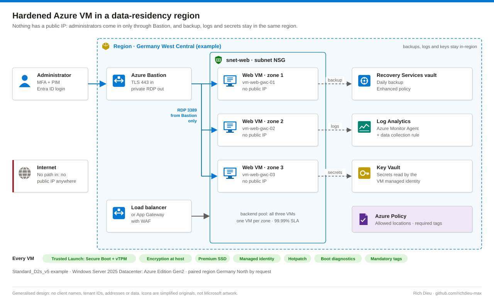
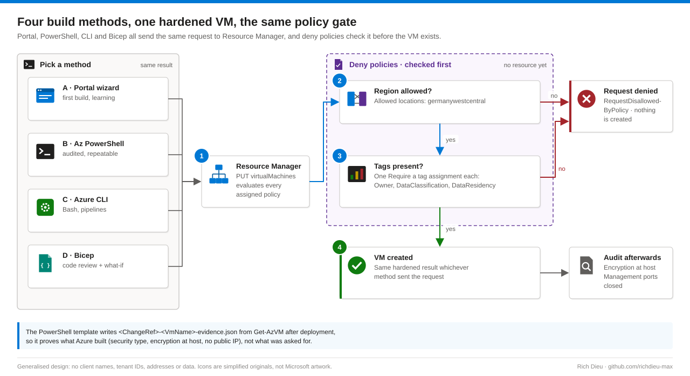

# SOP-AZ-002 · Deploying a hardened Azure VM in a data-residency region

Build a production Windows Server web VM with Trusted Launch, encryption at host, no public IP, backup and monitoring, and keep it and everything that supports it inside one approved region with Azure Policy. Azure's defaults make the first VM work, not pass an audit: the default Networking tab opens RDP to the whole internet.

**Family:** Azure procedures · **Covers:** the portal wizard tab by tab, the same build in Az PowerShell, Azure CLI and Bicep, region and tag guardrails, verification and rollback · **Does not cover:** data sovereignty (customer-managed keys in Managed HSM, confidential computing, sovereign clouds and legal review), or DR replication design.

## Shape



The worked example uses Germany West Central (`germanywestcentral`), with one VM per availability zone for the 99.99% multi-zone SLA. Region choice is necessary but not sufficient: backups, logs, diagnostic storage and DR replicas must stay in-region too, and an Allowed locations policy must stop anyone deploying elsewhere. Residency is not sovereignty: a German region keeps data stored in Germany but does not change which laws can compel the provider.

| Layer | Controls | Stops |
|---|---|---|
| Azure Policy | Allowed regions, required tags, deny | Wrong region, untagged, public IP |
| Network | NSG, no public IP, Bastion only | RDP and SSH scans |
| Disk encryption | SSE always on, encryption at host, optional CMK | Disks or caches read off the host |
| Boot integrity | Trusted Launch: Secure Boot and vTPM | Bootkits |
| Identity | Managed identity, Entra login, PIM | Secrets in code or on disk |
| Operate | Backup, AMA monitoring, hotpatch | No backup, no logs, no patches |

Every managed disk already has AES-256 server-side encryption (SSE). Encryption at host adds the temp disk and OS/data disk caches. Azure Disk Encryption (BitLocker in the guest) has an announced retirement; use encryption at host instead.

## Before you start

| Item | Requirement |
|---|---|
| Build the VM | Virtual Machine Contributor on `rg-web-prod-gwc` (no access into the VM or the VNet) |
| Place the NIC | Network Contributor on the VNet or subnet, or a custom role with `subnets/join/action`, usually from the network team |
| Encryption at host | Contributor on the subscription, once, to register the `EncryptionAtHost` feature |
| Backup and monitoring | Backup Contributor on the vault; Monitoring Contributor (RG) plus Log Analytics Contributor (workspace) |
| Sign in | Virtual Machine Administrator Login or User Login (needed even for Owners); Reader on the VM, NIC and Bastion to connect |
| Guardrails | Resource Policy Contributor at management group or subscription, held by the platform team, not the VM builder |
| Privilege | VM and Network Contributor as eligible PIM assignments with MFA, a ticket number and a short duration |
| Ready in region | Approved change (`CHG0012345`); VNet `vnet-prod-gwc` with `snet-web` (for example `10.20.1.0/24`) and an NSG; `AzureBastionSubnet` with Bastion; vCPU quota; Recovery Services vault, Log Analytics workspace and a data collection rule in the same region |
| Admin password | Generated and stored in Key Vault, never in tickets or documents |
| Plan | Names like `vm-web-gwc-01` (Windows computer name max 15 characters); size such as `Standard_D2s_v5`; Windows Server 2025 Datacenter: Azure Edition Gen2; platform-managed keys unless CMK is required |

## Steps

Open **Virtual machines › + Create › Azure virtual machine**. Do not use **Review + create** early: it accepts every default on the tabs you skipped.

### Basics, Disks and Networking

1. **Basics.** Subscription and `rg-web-prod-gwc`; name `vm-web-gwc-01` (permanent); region **(Europe) Germany West Central**; **Availability zone**, Zone 1 (2 and 3 for the next VMs); security type **Trusted launch virtual machines** with Secure Boot, vTPM and integrity monitoring on; image **Windows Server 2025 Datacenter: Azure Edition - x64 Gen2**; Spot off. A non-obvious admin username and a 20+ character password from Key Vault. **Public inbound ports: None.** Tick Azure Hybrid Benefit only if you own eligible licences.
2. **Encryption at host.** Tick it. If the portal says the feature is not registered, register it once:

   ```powershell
   Register-AzProviderFeature -FeatureName EncryptionAtHost -ProviderNamespace Microsoft.Compute
   Get-AzProviderFeature -FeatureName EncryptionAtHost -ProviderNamespace Microsoft.Compute  # wait for Registered
   Register-AzResourceProvider -ProviderNamespace Microsoft.Compute
   ```

3. **Disks.** OS disk 127 GiB Premium SSD (LRS), **Delete with VM**, platform-managed key (or your disk encryption set). Add a data disk (for example 256 GiB Premium SSD, caching Read-only) to keep content off `C:`; record the LUN-to-drive mapping.
4. **Networking.** `vnet-prod-gwc` / `snet-web`, **Public IP: None**. NIC NSG **None** when the subnet has an NSG (one rule set per subnet), or **Advanced** with an existing NSG. Never leave **Basic** with RDP allowed. Tick **Delete NIC when VM is deleted** and accelerated networking; add to the load balancer or Application Gateway backend pool.

### Management, Monitoring, Advanced and Tags

5. **Management.** Confirm Defender for Servers Plan 2 protects the subscription. Tick **Enable system assigned managed identity** and grant it only what it needs (for example Key Vault Secrets User on one vault). Tick **Login with Microsoft Entra ID** and assign Virtual Machine Administrator Login to the admin group. Auto-shutdown off for production.
6. **Backup.** Tick **Enable backup** with the in-region vault and an **Enhanced** policy (required for Trusted Launch), for example daily at 23:00, 30 daily and 12 monthly points. Enable Site Recovery only to a second region your residency rules allow.
7. **Updates and monitoring.** Periodic assessment on, hotpatch on, patch orchestration Azure-orchestrated, Reboot if required. Recommended alert rules on; boot diagnostics with managed storage; leave legacy guest diagnostics off and use the Azure Monitor Agent with a data collection rule.
8. **Advanced.** Add Azure Monitor Agent and Network Watcher Agent (or let policy deploy them). Leave custom data and user data empty: both are readable through the instance metadata service, so never put secrets there.
9. **Tags and create.** `Environment=Production`, `Owner=web-platform-team`, `CostCenter=CC-1234`, `DataClassification=Confidential`, `DataResidency=DE`, `ComplianceScope=GDPR;ISO27001;SOC2`, `ChangeRef=CHG0012345` on all resources. Wait for **Validation passed**, check the cost estimate, **Create** (3 to 8 minutes).

### Scripted builds and guardrails



10. **Script it.** `New-HardenedAzVm.ps1` builds the same VM with every choice explicit, refuses regions outside the allowed list, supports `-WhatIf` and writes `<ChangeRef>-<VmName>-evidence.json` read back from `Get-AzVM`, which proves what Azure built rather than what was asked for. Run with `-WhatIf`, then for real, then repeat for zones 2 and 3. The CLI equivalent:

    ```bash
    az vm create -g $RG -n $VM -l $LOC --zone 1 --size Standard_D2s_v5 \
      --image MicrosoftWindowsServer:WindowsServer:2025-datacenter-azure-edition:latest \
      --security-type TrustedLaunch --enable-secure-boot true --enable-vtpm true \
      --encryption-at-host true --storage-sku Premium_LRS --os-disk-delete-option Delete \
      --subnet $SUBNET_ID --public-ip-address "" --nsg "" --accelerated-networking true \
      --assign-identity '[system]' --admin-username azlocaladmin --admin-password "$ADMIN_PW" \
      --patch-mode AutomaticByPlatform --enable-hotpatching true \
      --tags Environment=Production Owner=web-platform-team DataResidency=DE ChangeRef=$CHG
    ```

    Read the password from Key Vault at run time and clear the variable afterwards. For Bicep, preview with `az deployment group what-if`, then `az deployment group create`.
11. **Assign guardrails.** At the workload's management group or subscription: **Allowed locations** (Deny, definition `e56962a6-4747-49cd-b67b-bf8b01975c4c`), **Require a tag on resources** (Deny, one per mandatory tag), **Virtual machines and virtual machine scale sets should have encryption at host enabled** (Audit or Deny) and **Management ports should be closed on your virtual machines** (Audit).

## Verify

| Check | Pass |
|---|---|
| Placement | Running; region, zone and size as planned |
| Boot integrity | Trusted Launch with Secure Boot and vTPM; `Confirm-SecureBootUEFI` True, `Get-Tpm` shows a TPM |
| Encryption | Encryption at host Enabled on the Disks blade |
| Network | No public IP on the NIC; NSG denies Internet inbound; Bastion RDP works, direct RDP fails |
| Operations | Backup item Protected with first backup done; healthy in Defender for Cloud; `Get-MpComputerStatus` real-time protection on |
| Logs | Heartbeat in Log Analytics within 15 minutes |
| Governance | All mandatory tags present; policy compliance Compliant; private IP in the CMDB with owner and vault |

```kql
Heartbeat
| where Computer startswith "vm-web-gwc"
| summarize LastSeen = max(TimeGenerated) by Computer, Category, OSType
```

## Rollback

| Situation | Action |
|---|---|
| Validation failed | Nothing created; fix the reported setting and retry |
| Partial deployment | Delete the VM (disks and NIC follow with Delete with VM); sweep with `Get-AzResource -TagName ChangeRef -TagValue CHG0012345` |
| Built but must be removed | Stop protection in the vault (retain or delete data per policy), delete the VM, remove it from the pool and CMDB |
| Wrong region | VMs cannot move regions in place: redeploy (or use Azure Resource Mover), then delete the original and its backups per data-handling rules |

## Troubleshooting

| Symptom | Cause and fix |
|---|---|
| `RequestDisallowedByPolicy` | A region, tag or encryption policy denied it; the error names the assignment. Correct the value rather than requesting an exemption |
| "Encryption at host is not registered" | Register the feature, then re-register `Microsoft.Compute` |
| `SkuNotAvailable` / `ZonalAllocationFailed` | Size not offered or out of capacity in that zone; try another zone or size, check `Get-AzComputeResourceSku` |
| Trusted Launch greyed out | Gen1 image or unsupported size; pick a Gen2 image and a supported family |
| Bastion connection fails | Subnet NSG must allow 3389 from the `AzureBastionSubnet` range; user needs Reader on VM, NIC and Bastion |
| Enable backup fails | Trusted Launch needs an Enhanced policy, and the vault must be in the same region |
| No data in Log Analytics | AMA installed without a DCR association, or the managed identity is missing |

## Control mapping

| Framework | Reference | How this supports it |
|---|---|---|
| NIST SP 800-53 R5 | SC · System and communications protection | No public IP, Bastion-only admin access, encryption at host on top of SSE |
| Tagged compliance scope (example) | `ComplianceScope=GDPR;ISO27001;SOC2`, `DataResidency=DE` | Allowed locations policy keeps the VM, backups and logs in the approved region; the tags record the scope for reporting |
