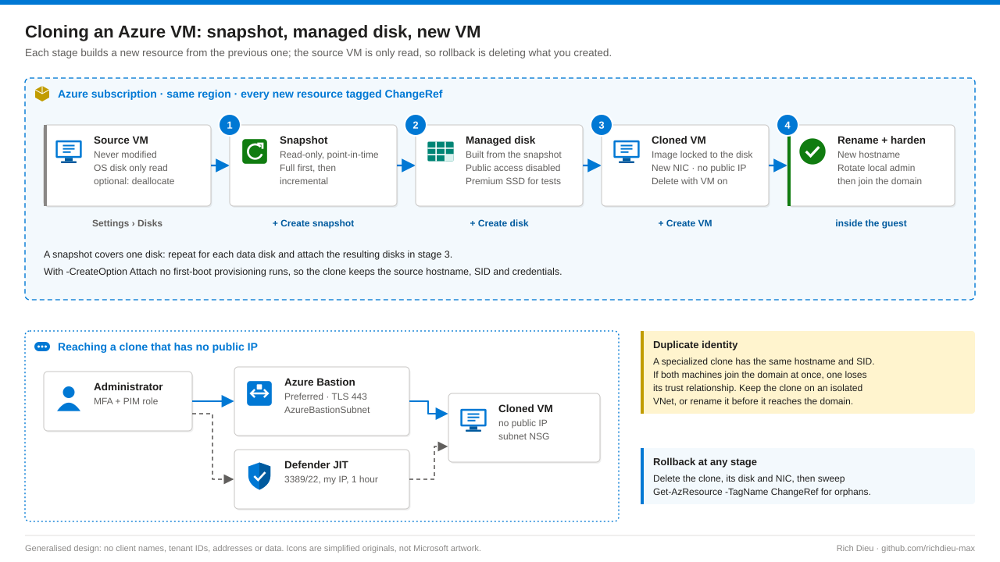

# SOP-AZ-003 · Cloning an Azure virtual machine

Copy an Azure VM by snapshotting its OS disk, building a managed disk from the snapshot and creating a new VM around that disk, with no public IP and a tagged trail for rollback. Azure has no single Clone button because a VM is a bundle of resources: think of the VM as the recipe card and the OS disk as the meal; you copy the meal and write a new card.

**Family:** Azure procedures · **Covers:** specialized clones in the portal, Az PowerShell and Azure CLI, plus outlines of Compute Gallery images and restore from backup, secure access, rename and rollback · **Does not cover:** building a new VM from a marketplace image (see SOP-AZ-002).

## Flow



| Resource | What it is | Bootable? |
|---|---|---|
| Snapshot | Read-only, point-in-time copy of one managed disk. Full holds a complete copy; incremental holds changed blocks only | No |
| Managed disk | Azure-managed block volume, can be created from a snapshot | Yes, as an OS disk |
| Virtual machine | Compute definition plus NIC, disks, identity, extensions and tags | It is what boots |

**Specialized versus generalized.** Methods A to C and E make a specialized clone: same computer name, local accounts, SID, apps and domain trust secret. Good for test copies, upgrade rehearsals and forensic copies. If the source and clone both join the same domain, one loses its trust relationship. Method D generalizes the OS with Sysprep so every VM gets a fresh identity.

**Consistency.** A snapshot of a running VM is crash-consistent, like pulling the power cord. Stopping (deallocating) the source first gives a clean disk. For databases that cannot stop, use Azure Backup or VM restore points (application-consistent, through VSS).

| Method | Identity | Consistency | Typical use |
|---|---|---|---|
| A portal, B PowerShell, C CLI | Specialized | Crash-consistent (clean if stopped) | Test copy, upgrade rehearsal |
| D Compute Gallery | Generalized (new SID) | Clean (sysprepped) | Fleet, scale sets, golden image |
| E Backup / restore point | Specialized | Application-consistent | DR drill, point-in-time copy |

## Before you start

| Item | Requirement |
|---|---|
| Read the source | Reader on the source resource group |
| Snapshot | Disk Snapshot Contributor; also `Microsoft.Compute/disks/beginGetAccess/action` on the source disk (Contributor has it) |
| Disk, VM and NIC | Virtual Machine Contributor and Network Contributor (or Contributor) on the target resource group; the NIC needs `subnets/join/action` |
| Connect | Reader on the VM, NIC and Bastion (plus Virtual Machine Administrator Login for Entra sign-in); JIT needs the `jitNetworkAccessPolicies/initiate/action` permission and Defender for Servers Plan 2 |
| Privilege | Roles eligible in PIM, activated for a few hours with MFA and a ticket |
| Change | Approved change number, applied as a `ChangeRef` tag on every new resource |
| Ready | Quota for one more VM of the size; the source's local admin credentials (the clone inherits them); Bastion in the target VNet or JIT enabled |
| CMK | If the source disk uses a customer-managed key, the clone's region must reach the same Key Vault and disk encryption set |
| Decide | Name `<source>-CLONE` or `<source>-TEST`; isolated VNet for test copies of domain members; size and tier (B-series and Standard SSD to save money); Delete with VM on disk and NIC |

## Steps

### Method A · portal

1. **Snapshot.** Sign in with MFA and activate your PIM role. Open **Virtual machines › <source VM>**; recommended: **Stop** and wait for Stopped (deallocated). Under **Settings › Disks** open the OS disk, then **+ Create snapshot**: name `<VM>-SNAPSHOT`, type **Full**, storage Standard HDD, tags including `ChangeRef`. **Review + create › Create**; confirm Provisioning state Succeeded and Completion 100. Repeat for each data disk (`<VM>-DATAsnap-1` …).
2. **Managed disk.** From the snapshot select **+ Create disk**: name `<CLONE>-OSdisk`, same region, the clone's zone, Premium SSD for production-like tests. On **Networking** choose **Disable public access** or a private endpoint, since disks can otherwise be exported by SAS URL. Tag and create.
3. **VM.** Open the disk, **+ Create VM** (image locked to your disk). Unique name, same region and zone, size as planned; credentials are inherited; **Public inbound ports: None**. Disks: **Delete with VM**, attach cloned data disks. Networking: planned VNet and subnet, **Public IP: None**, **Delete public IP and NIC when VM is deleted**, NIC NSG None if the subnet has one. Enable boot diagnostics, periodic assessment, and auto-shutdown for non-production. Tags `ChangeRef`, `Owner`, `Environment`, `Purpose`; **Review + create › Create**.

### Method B and C · scripted

4. **Run the template.** `Clone-AzVm.ps1` runs all three stages, tags everything, disables public disk access, keeps Trusted Launch, never creates a public IP and writes `<ChangeRef>-clone-evidence.json`. It attaches the disk with `-CreateOption Attach`, so no first-boot provisioning runs: that is why the clone keeps the source hostname and credentials. Run with `-WhatIf` first (it previews stopping the source).

   ```powershell
   .\Clone-AzVm.ps1 -SubscriptionId '<sub-guid>' -SourceResourceGroup 'rg-app-prod' -SourceVmName 'APPVM01' `
     -TargetResourceGroup 'rg-app-test' -CloneVmName 'APPVM01-TEST' -VnetResourceGroup 'rg-net' `
     -VnetName 'vnet-test' -SubnetName 'snet-workload' -ChangeRef 'CHG0012345' -DiskSku StandardSSD_LRS -StopSource -WhatIf
   ```

   The Azure CLI does the same with `az snapshot create`, `az disk create --public-network-access Disabled --network-access-policy DenyAll` and `az vm create --attach-os-disk … --public-ip-address "" --nsg ""`.

### Method D and E · other routes

5. **Golden image (D).** Clone first so you never sysprep the original (Sysprep is one-way). In the clone run `sysprep.exe /generalize /oobe /shutdown` (Linux: `waagent -deprovision+user`), then **Capture › Share image to Azure compute gallery › Generalized**, or `Set-AzVM -Generalized` and `New-AzGalleryImageVersion`. Each VM deployed from the gallery gets new credentials and identity.
6. **Restore (E).** From the Recovery Services vault, **Backup › Restore VM › Create new** from any retained recovery point; `New-AzRestorePoint` gives the same without a vault.

### Connect, rename and harden

7. **Connect without a public IP.** Preferred: **VM › Connect › Bastion** with the source's local admin credentials. Alternative: **Defender for Cloud › Workload protections › Just-in-time VM access › Request access**, My IP, 1 hour, port 3389.
8. **Rename and harden.** Inside the clone, on an isolated network first:

   ```powershell
   Rename-Computer -NewName 'APPVM01-TEST' -Restart
   # If the source was domain-joined:
   Remove-Computer -UnjoinDomainCredential (Get-Credential) -WorkgroupName TEMP -Restart -Force
   Add-Computer -DomainName corp.example.com -Credential (Get-Credential) -Restart
   Set-LocalUser -Name 'localadmin' -Password (Read-Host -AsSecureString 'New password')
   ```

   Update application config that references the old hostname, onboard to Azure Update Manager, and delete the snapshot if it has no further value (snapshots bill until deleted).

## Verify

| Check | Pass |
|---|---|
| Resources | Running; size, zone, disk and NIC as planned |
| Exposure | No public IP on the VM or NIC |
| Boot | Boot diagnostics screenshot shows the login screen |
| Protection | Listed as protected in Defender for Cloud; Defender for Endpoint running (`Get-MpComputerStatus`) |
| Audit | Activity log shows snapshot, disk and VM create by the approved operator |
| Guest | OS version and patch level match the source; all drives present; critical services start; no new event log errors |

## Rollback

| Failure point | Action |
|---|---|
| Stage 1 snapshot | Delete the partial snapshot; restart the source if you stopped it |
| Stage 2 disk | Delete the failed disk; keep the snapshot only if retrying |
| Stage 3 VM | Delete the VM (disk and NIC follow with Delete with VM); sweep for orphans by `ChangeRef` |
| Post-deployment | Disconnect sessions, capture logs, delete the clone, open a problem record against the `ChangeRef` |

```powershell
Get-AzResource -TagName ChangeRef -TagValue 'CHG0012345' |
  Sort-Object { @('Microsoft.Compute/virtualMachines','Microsoft.Network/networkInterfaces',
                  'Microsoft.Compute/disks','Microsoft.Compute/snapshots').IndexOf($_.ResourceType) } |
  Remove-AzResource -Force -WhatIf      # remove -WhatIf to execute
```

Snapshots and disks bill for provisioned size whether or not a VM runs; deallocating stops compute charges only.

## Troubleshooting

| Symptom | Cause and fix |
|---|---|
| Clone will not boot (recovery screen) | CMK disk encryption set unreachable in the target region, or a Trusted Launch disk on a Standard VM; match the source security profile |
| Cannot connect via Bastion | Workload subnet NSG must allow 3389/22 from the `AzureBastionSubnet` range |
| JIT request denied | Defender for Servers Plan 2 not enabled, or requester lacks the initiate permission |
| "Trust relationship failed" | Both joined the domain with the same name and SID. Isolate, rename and rejoin the clone; repair the source with `Test-ComputerSecureChannel -Repair` |
| Application errors on the clone | Hard-coded hostnames, IPs or connection strings; search configs for the old name |

## Control mapping

| Framework | Reference | How this supports it |
|---|---|---|
| NIST SP 800-53 R5 | CP · Contingency planning | Restore and clone paths for DR drills and point-in-time copies; the source is never modified |
| CIS Azure benchmark | RDP/SSH not exposed to the internet | The clone has no public IP; access is through Bastion or time-limited JIT |
