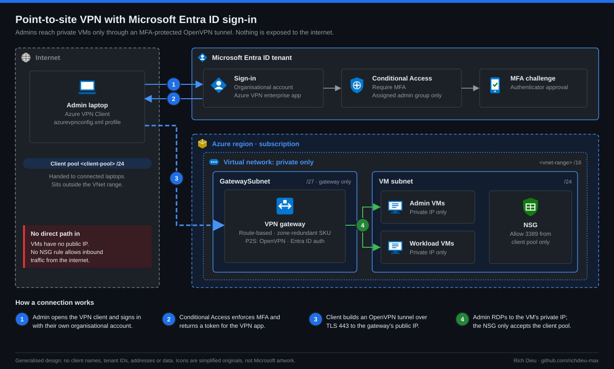

# SOP-AZ-004 · Azure point-to-site VPN with Entra ID sign-in

Give administrators RDP access to Azure VMs that have **no public IP**, through an OpenVPN (TLS over 443) tunnel where every connection signs in with an organisational account and MFA.

**Family:** Microsoft Azure · Also published, with the same diagram, in [endpoint-identity-runbooks](https://github.com/richdieu-max/endpoint-identity-runbooks).

<!-- tags:start (generated by tools/catalog/build.py: edit tools/catalog/catalog.json or the Control mapping table, then rebuild) -->
> - **Status:** Production · **Topics:** [Microsoft Azure](../README.md#topic-azure) · [Networking and VPN](../README.md#topic-network) · [Identity, sign-in and MFA](../README.md#topic-identity)
> - **Keywords:** point-to-site VPN · OpenVPN · Entra ID authentication · certificate authentication · VPN gateway · MFA
> - **NIST SP 800-53 Rev. 5:** `AC-17` Remote access · `AU-2` Event logging · `AU-12` Audit record generation · `CM-7` Least functionality · `IA-2, IA-2(1)` Identification and authentication (users) · `SC-7` Boundary protection · `SC-8` Transmission confidentiality and integrity
> - **NIST CSF 2.0:** `PR.AA-03` Protect: Identity management, authentication and access control · `PR.IR-01` Protect: Technology infrastructure resilience
> - **Also maps to:** ISO/IEC 27001:2022 (see [Control mapping](#control-mapping))
<!-- tags:end -->

**Covers:** the one-time gateway build, Entra ID and certificate authentication, the end-user connection, verification and rollback. **Does not cover:** site-to-site VPN or Azure Bastion.

## Shape



## Address plan

Pick three non-overlapping ranges that also do not overlap any on-premises or home network the users connect from:

| Range | Size | Use |
|---|---|---|
| `<vnet-range>` | /16 | The virtual network |
| `<vm-subnet>` | /24 inside the VNet | VMs |
| `GatewaySubnet` | /27 inside the VNet | Gateway only; nothing else goes here |
| `<client-pool>` | /24 **outside** the VNet | Addresses handed to connected laptops |


## Build (administrator, once)

1. **Virtual network.** Create the VNet with the VM subnet.
2. **GatewaySubnet.** Add a subnet with purpose **Virtual Network Gateway**. The name must be exactly `GatewaySubnet`.
3. **Gateway.** VPN gateway, route-based, an AZ SKU where the region supports it, active-active and BGP off unless needed, new public IP. Deployment takes 30–45 minutes.
4. **Point-to-site configuration.** Client address pool `<client-pool>`, tunnel type **OpenVPN (SSL)**, authentication **Microsoft Entra ID**. Tenant: `https://login.microsoftonline.com/<tenant-id>/`. Issuer: `https://sts.windows.net/<tenant-id>/` (same tenant ID, trailing slash kept). Audience: the Azure VPN Client application ID from Microsoft's current documentation.
5. **Admin consent.** A Global Administrator grants tenant-wide consent for the Azure VPN application; afterwards it appears under Enterprise applications. Assign it to a group if you want to restrict who can connect, and target it with a Conditional Access policy.
6. **Profile.** Download the VPN client package; distribute `azurevpnconfig.xml` from the `AzureVPN` folder over an access-controlled channel. Any change to the P2S settings means re-downloading and redistributing it.
7. **NSG.** Allow 3389 into the VM subnet **from the client pool only**. No inbound rule from the internet.

## Connect (each user, once per device)

Install **Azure VPN Client** from the Microsoft Store → **+ → Import** the profile → **Connect** → sign in and approve MFA. Status shows Connected, a client-pool address and a route to the VNet. Then RDP to the VM's private IP. Disconnect when finished.


## Certificate authentication (alternative or fallback)

Use certificates when a device cannot run the Azure VPN Client sign-in, or as a second authentication type on the same gateway (OpenVPN accepts Entra ID and certificate together). Certificates prove the **device**, not the person, so keep them for named admin laptops and pair them with the NSG scope above.

1. **Root certificate.** Issue it from the enterprise CA, or for a small estate create it on a secured admin workstation and keep its private key offline:

   ```powershell
   $root = New-SelfSignedCertificate -Type Custom -KeySpec Signature -Subject 'CN=P2S-Root-<env>' `
       -KeyExportPolicy Exportable -HashAlgorithm sha256 -KeyLength 2048 `
       -CertStoreLocation 'Cert:\CurrentUser\My' -KeyUsageProperty Sign -KeyUsage CertSign
   ```

2. **Client certificate** per device, signed by the root, with the client authentication EKU:

   ```powershell
   New-SelfSignedCertificate -Type Custom -DnsName 'P2S-Client' -KeySpec Signature -Subject 'CN=P2S-<device-name>' `
       -KeyExportPolicy Exportable -HashAlgorithm sha256 -KeyLength 2048 -CertStoreLocation 'Cert:\CurrentUser\My' `
       -Signer $root -TextExtension @('2.5.29.37={text}1.3.6.1.5.5.7.3.2')
   ```

   Export it as a password-protected `.pfx` and install it in the user's personal store on that device only.
3. **Upload the root's public key** (Base-64, no header lines) to the gateway:

   ```powershell
   $pub = [Convert]::ToBase64String($root.RawData)
   Add-AzVpnClientRootCertificate -ResourceGroupName <rg> -VirtualNetworkGatewayName <gw> `
       -VpnClientRootCertificateName 'P2S-Root-<env>' -PublicCertData $pub
   ```

   In the portal: Point-to-site configuration › Authentication type **Azure certificate** › Root certificates.
4. **Profile.** Download the VPN client package again; the certificate profile is separate from the Entra ID profile.
5. **Revoke** a lost or retired device by thumbprint, the same day:

   ```powershell
   Add-AzVpnClientRevokedCertificate -ResourceGroupName <rg> -VirtualNetworkGatewayName <gw> `
       -VpnClientRevokedCertificateName 'P2S-<device-name>' -Thumbprint '<client-thumbprint>'
   ```

## Verify

| Check | How | Pass |
|---|---|---|
| Gateway | `Get-AzVirtualNetworkGateway -ResourceGroupName <rg> -Name <gw>` | `ProvisioningState` Succeeded; `VpnClientConfiguration` shows OpenVPN, the client pool and the expected auth types |
| MFA on every connection | Entra admin center › Sign-in logs, application **Azure VPN** | Each connection shows MFA satisfied and the Conditional Access policy applied |
| Who is connected | `Get-AzVirtualNetworkGatewayVpnClientConnectionHealth -ResourceGroupName <rg> -VirtualNetworkGatewayName <gw>` | Only expected users, each with a client-pool address |
| Reach | From a connected laptop: `Test-NetConnection <vm-private-ip> -Port 3389` | `TcpTestSucceeded: True` |
| No other door | NSG effective security rules on the VM NIC; `Test-NetConnection` from an unconnected device | No inbound rule from the internet; the port is closed |
| Revocation (certificate auth) | Connect with a revoked certificate | Refused |

## Roll back

- **A P2S setting:** put the previous values back (pool, tunnel type, auth type) and redistribute the earlier profile. Users must re-import whenever the configuration changes.
- **One user or device:** remove the user from the assigned group (Entra ID), or revoke the device certificate (above).
- **The NSG rule:** remove the 3389 rule; VPN access then reaches nothing.
- **The gateway:** delete only under change, after all users are told. The public IP is released, and a rebuild takes 30 to 45 minutes plus profile redistribution.

## Troubleshooting

| Symptom | Cause and fix |
|---|---|
| AADSTS90008 / consent error | Admin consent not granted (step 5) |
| "Invalid IP or CIDR" on save | Tenant and Issuer contain different tenant IDs, or a placeholder was left in |
| VPN connected, RDP fails | Wrong private IP; VM stopped; NSG does not allow 3389 from the client pool |
| Profile stopped working | P2S settings changed; re-download and redistribute |
| Sign-in succeeds but connection is blocked | A Conditional Access policy requires a compliant device or a named location; the sign-in log names the policy |
| "A certificate chain processed, but terminated in a root certificate which is not trusted" | The root's public key is not uploaded, was pasted with header lines, or the client certificate was not signed by that root |
| Certificate profile cannot find a certificate | The client certificate is in the machine store, not the user's personal store, or it lacks the client authentication EKU |

## Control mapping

| Framework | Reference | How this supports it |
|---|---|---|
| NIST SP 800-53 R5 | AC-17 Remote access | Remote admin access only through an authenticated, encrypted tunnel |
| | IA-2, IA-2(1) | Unique organisational accounts with MFA |
| | SC-7 Boundary protection; CM-7 | VMs have no public IP; the gateway is the only internet-facing component |
| | SC-8 Transmission confidentiality | TLS-encrypted tunnel |
| | AU-2, AU-12 | Gateway diagnostic logs and sign-in logs record each connection |
| NIST CSF 2.0 | PR.AA-03, PR.IR-01 | Authenticated access; networks protected |
| ISO/IEC 27001:2022 | 8.5, 8.20, 8.24 | Secure authentication; network security; cryptography |
