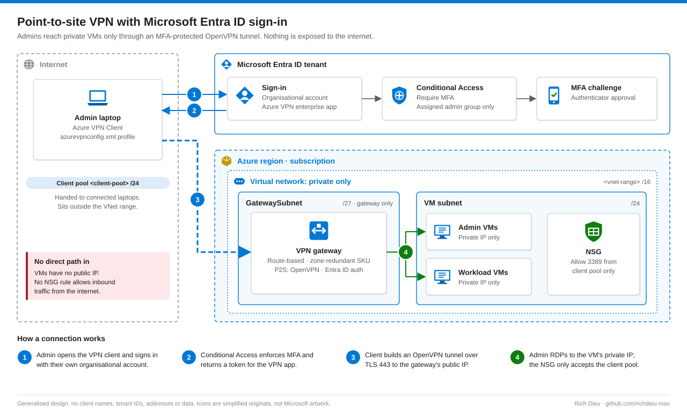

# SOP-AZ-004 · Azure point-to-site VPN with Entra ID sign-in

Give administrators RDP access to Azure VMs that have **no public IP**, through an OpenVPN (TLS over 443) tunnel where every connection signs in with an organisational account and MFA.

**Family:** Microsoft Azure · Also published, with the same diagram, in [endpoint-identity-runbooks](https://github.com/richdieu-max/endpoint-identity-runbooks).

**Covers:** the one-time gateway build and the end-user connection. **Does not cover:** site-to-site VPN or Azure Bastion.

## Shape

## Address plan

Pick three non-overlapping ranges that also do not overlap any on-premises or home network the users connect from:

| Range | Size | Use |
|---|---|---|
| `<vnet-range>` | /16 | The virtual network |
| `<vm-subnet>` | /24 inside the VNet | VMs |
| `GatewaySubnet` | /27 inside the VNet | Gateway only; nothing else goes here |
| `<client-pool>` | /24 **outside** the VNet | Addresses handed to connected laptops |

## Build (administrator, once)

1. **Virtual network.** Create the VNet with the VM subnet.
2. **GatewaySubnet.** Add a subnet with purpose **Virtual Network Gateway**. The name must be exactly `GatewaySubnet`.
3. **Gateway.** VPN gateway, route-based, an AZ SKU where the region supports it, active-active and BGP off unless needed, new public IP. Deployment takes 30–45 minutes.
4. **Point-to-site configuration.** Client address pool `<client-pool>`, tunnel type **OpenVPN (SSL)**, authentication **Microsoft Entra ID**. Tenant: `https://login.microsoftonline.com/<tenant-id>/`. Issuer: `https://sts.windows.net/<tenant-id>/` (same tenant ID, trailing slash kept). Audience: the Azure VPN Client application ID from Microsoft's current documentation.
5. **Admin consent.** A Global Administrator grants tenant-wide consent for the Azure VPN application; afterwards it appears under Enterprise applications. Assign it to a group if you want to restrict who can connect, and target it with a Conditional Access policy.
6. **Profile.** Download the VPN client package; distribute `azurevpnconfig.xml` from the `AzureVPN` folder over an access-controlled channel. Any change to the P2S settings means re-downloading and redistributing it.
7. **NSG.** Allow 3389 into the VM subnet **from the client pool only**. No inbound rule from the internet.

## Connect (each user, once per device)

Install **Azure VPN Client** from the Microsoft Store → **+ → Import** the profile → **Connect** → sign in and approve MFA. Status shows Connected, a client-pool address and a route to the VNet. Then RDP to the VM's private IP. Disconnect when finished.

## Troubleshooting

| Symptom | Cause and fix |
|---|---|
| AADSTS90008 / consent error | Admin consent not granted (step 5) |
| "Invalid IP or CIDR" on save | Tenant and Issuer contain different tenant IDs, or a placeholder was left in |
| VPN connected, RDP fails | Wrong private IP; VM stopped; NSG does not allow 3389 from the client pool |
| Profile stopped working | P2S settings changed; re-download and redistribute |

## Control mapping

| Framework | Reference | How this supports it |
|---|---|---|
| NIST SP 800-53 R5 | AC-17 Remote access | Remote admin access only through an authenticated, encrypted tunnel |
| | IA-2, IA-2(1) | Unique organisational accounts with MFA |
| | SC-7 Boundary protection; CM-7 | VMs have no public IP; the gateway is the only internet-facing component |
| | SC-8 Transmission confidentiality | TLS-encrypted tunnel |
| | AU-2, AU-12 | Gateway diagnostic logs and sign-in logs record each connection |
| NIST CSF 2.0 | PR.AA-03, PR.IR-01 | Authenticated access; networks protected |
| ISO/IEC 27001:2022 | 8.5, 8.20, 8.24 | Secure authentication; network security; cryptography |
