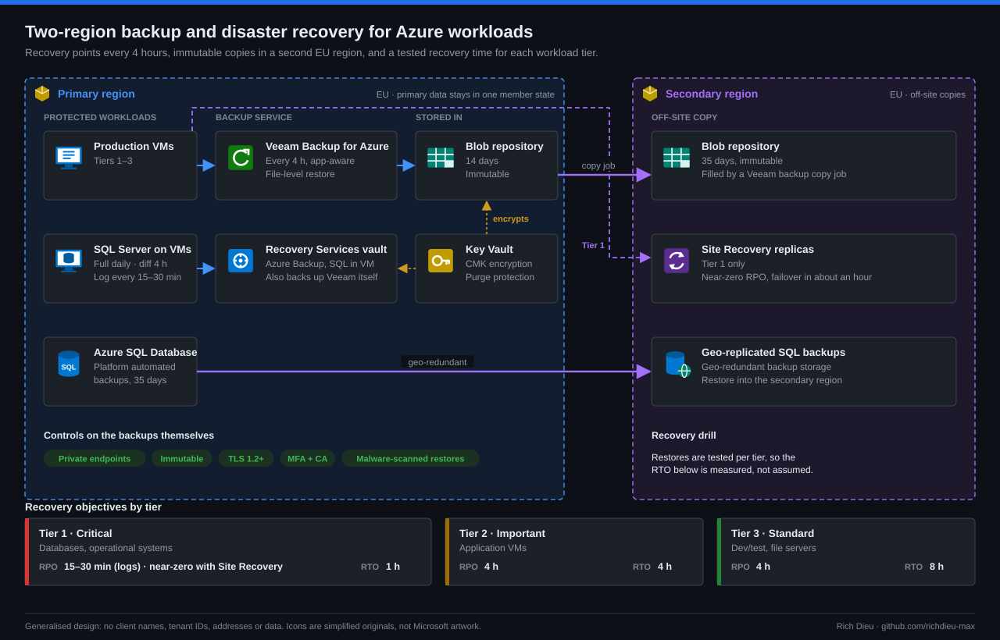
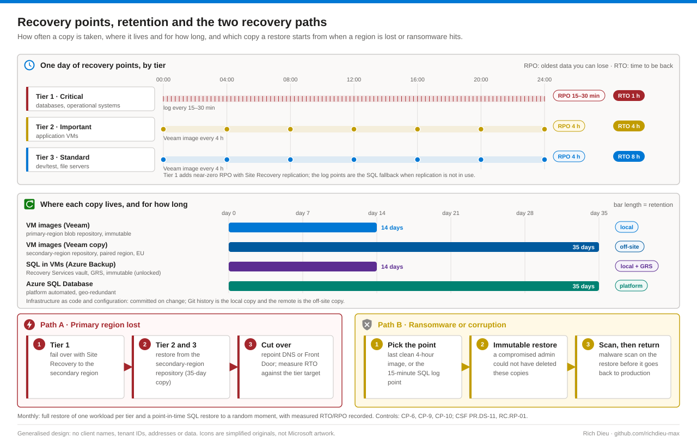

# SOP-AZ-005 · Two-region backup and disaster recovery design for Azure workloads

A backup architecture for EU-hosted Azure workloads that need recovery points more often than once a day, off-site copies in a second region, and recovery objectives an auditor can test.

**Family:** Microsoft Azure · Also published, with the same diagram, in [endpoint-identity-runbooks](https://github.com/richdieu-max/endpoint-identity-runbooks).

<!-- tags:start (generated by tools/catalog/build.py: edit tools/catalog/catalog.json or the Control mapping table, then rebuild) -->
> - **Status:** Production · **Topics:** [Microsoft Azure](../README.md#topic-azure) · [Backup and disaster recovery](../README.md#topic-backup-dr)
> - **Keywords:** Azure Backup · Site Recovery · Veeam · cross-region restore · immutable vault · RPO and RTO
> - **NIST SP 800-53 Rev. 5:** `CP-6` Alternate storage site · `CP-9` System backup · `CP-10` System recovery and reconstitution · `SC-12` Cryptographic key establishment and management · `SC-28` Protection of information at rest
> - **NIST CSF 2.0:** `PR.DS-11` Protect: Data security · `RC.RP-01` Recover: Incident recovery plan execution
> - **Also maps to:** ISO/IEC 27001:2022 · EU (see [Control mapping](#control-mapping))
<!-- tags:end -->

## Requirements it was designed to meet

- VM and application recovery points every 4 hours (native Azure VM backup policies are daily by default; enhanced policies go down to every 4 hours, but the design also needs application-aware processing and file-level restore).
- Two weeks of local retention, five weeks off-site.
- Data stays inside the EU; primary data inside one member state.
- A tested recovery time per workload tier.

## Architecture



Veeam Backup for Microsoft Azure writes to **Azure Blob storage repositories**, not to a Recovery Services vault. The vault holds the native Azure Backup items (SQL in VM) and the backup of the Veeam appliance itself.

## Policy

| Data | Frequency | Local | Off-site | Tool |
|---|---|---|---|---|
| VM images | Every 4 h | 14 days | 35 days | Veeam |
| SQL Server on VMs | Full daily, differential 4 h, log 15–30 min | 14 days | 35 days | Azure Backup |
| Azure SQL Database | Platform automated | 35 days | Geo-redundant | Azure SQL |
| Infrastructure as code and config | On change | Git history | Git remote | Git |

| Tier | Example workloads | RPO | RTO |
|---|---|---|---|
| 1 Critical | Databases, operational systems | 15–30 min (logs) / near-zero with Site Recovery | 1 h |
| 2 Important | Application VMs | 4 h | 4 h |
| 3 Standard | Dev/test, file servers | 4 h | 8 h |



## Security controls on the backups themselves

- Encryption at rest with customer-managed keys in Key Vault (soft delete and purge protection on); Veeam job-level encryption; TLS 1.2+ in transit.
- Private endpoints for every repository and vault; no public network access.
- Immutability on repositories and the vault, so a compromised admin cannot delete recovery points early.
- Veeam appliance runs with a managed identity holding only the roles it needs; MFA and Conditional Access on the console and on backup administrators.
- Restores scanned for malware before going back into production.

## Operations

| Cadence | Activity |
|---|---|
| Daily | Review job results; investigate any failure within 4 hours; backup logs flow to Log Analytics |
| Monthly | Full restore of one workload per tier; measure actual RTO/RPO against target; point-in-time SQL restore to a random moment |
| Quarterly | Capacity and cost, retention fit, regulatory changes; report to management |

## Recovery scenarios

- **Primary region lost:** fail Tier 1 over with Site Recovery; restore Tier 2–3 from the secondary repository; repoint DNS or Front Door.
- **Ransomware or corruption:** restore to the last clean 4-hour point (or 15-minute SQL log point) from immutable copies, with a malware scan on restore.

## Verify

Run monthly, per tier, and keep the output with the restore test record.

```powershell
$vault = Get-AzRecoveryServicesVault -ResourceGroupName <rg> -Name <vault>
# Anything that did not complete in the last 24 hours
Get-AzRecoveryServicesBackupJob -VaultId $vault.ID -From (Get-Date).AddDays(-1).ToUniversalTime() |
    Where-Object Status -ne 'Completed' | Select-Object WorkloadName, Operation, Status, StartTime
# Protection settings on the vault itself
Get-AzRecoveryServicesBackupProperty -Vault $vault | Select-Object BackupStorageRedundancy, CrossRegionRestore
```

```bash
az backup vault show -g <rg> -n <vault> --query "properties.securitySettings"                      # immutability state
az backup vault backup-properties show -g <rg> -n <vault> --query "[0].properties.softDeleteFeatureState"
```

| Check | Pass |
|---|---|
| Jobs | No failed or missed job older than 4 hours without a ticket |
| Off-site | Vault is geo-redundant with Cross Region Restore on; Veeam repositories in the secondary region hold the latest restore point |
| Immutability | Vault immutability **locked**; blob repositories have a time-based retention policy covering the retention period; soft delete on |
| Restore test | One workload per tier restored into an isolated network in the **secondary** region; measured RTO and data age (RPO) at or below the tier targets |
| SQL point in time | A restore to a random moment in the last 14 days returns the expected rows |
| Malware scan | The restored disk is scanned before anything is copied back |

Record per test: workload, tier, restore point used, start and finish times, measured RTO and RPO, result, deviations and who ran it.

## Roll back

This is a design runbook. Changes to it (a new tier, a retention change, a different tool) go through change control. Retention can be lengthened at any time; shortening it on a locked, immutable vault is not possible by design, so decide retention before locking.

## Troubleshooting

| Symptom | Cause and fix |
|---|---|
| Cross Region Restore not offered | The vault is locally or zone redundant. Redundancy can only be changed before items are protected: create a geo-redundant vault and move protection |
| SQL log backups fail with a broken log chain | Someone took a native full backup outside Azure Backup. Use `COPY_ONLY` for ad hoc backups, then trigger a full backup from the vault |
| Veeam jobs fail with authorization errors | The appliance's managed identity lost a role, or a new subscription was added without the role assignments |
| Site Recovery replication health "Critical" | Disk churn above the VM size's limit, or the cache storage account is unreachable through the private endpoint |
| Restore test exceeds its RTO | Restores run against archive tier or a small target VM size; keep the latest points in a warm tier for tier 1 and 2 |
| Cannot delete old recovery points | Immutability and soft delete are working as designed; wait for expiry |

## Control mapping

| Framework | Reference | How this supports it |
|---|---|---|
| NIST SP 800-53 R5 | CP-6, CP-9, CP-10 | Alternate storage site; system backup; recovery and reconstitution |
| | SC-12, SC-28 | Key management; protection of backup data at rest |
| NIST CSF 2.0 | PR.DS-11, RC.RP-01 | Backups created, protected and tested; recovery plan executed |
| ISO/IEC 27001:2022 | 8.13, 8.14, 5.30 | Information backup; redundancy; ICT readiness for business continuity |
| EU | GDPR Art. 32(1)(c); NIS2 Art. 21(2)(c) | Ability to restore availability in a timely manner; backup management and disaster recovery |
