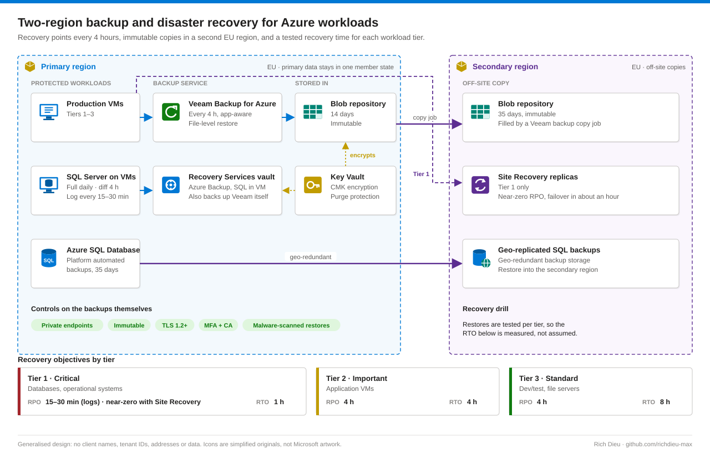

# SOP-AZ-005 · Two-region backup and disaster recovery design for Azure workloads

A backup architecture for EU-hosted Azure workloads that need recovery points more often than once a day, off-site copies in a second region, and recovery objectives an auditor can test.

**Family:** Microsoft Azure · Also published, with the same diagram, in [endpoint-identity-runbooks](https://github.com/richdieu-max/endpoint-identity-runbooks).

## Requirements it was designed to meet

- VM and application recovery points every 4 hours (native Azure VM backup policies are daily by default; enhanced policies go down to every 4 hours, but the design also needs application-aware processing and file-level restore).
- Two weeks of local retention, five weeks off-site.
- Data stays inside the EU; primary data inside one member state.
- A tested recovery time per workload tier.

## Architecture

Veeam Backup for Microsoft Azure writes to **Azure Blob storage repositories**, not to a Recovery Services vault. The vault holds the native Azure Backup items (SQL in VM) and the backup of the Veeam appliance itself.

## Policy

| Data | Frequency | Local | Off-site | Tool |
|---|---|---|---|---|
| VM images | Every 4 h | 14 days | 35 days | Veeam |
| SQL Server on VMs | Full daily, differential 4 h, log 15–30 min | 14 days | 35 days | Azure Backup |
| Azure SQL Database | Platform automated | 35 days | Geo-redundant | Azure SQL |
| Infrastructure as code and config | On change | Git history | Git remote | Git |

| Tier | Example workloads | RPO | RTO |
|---|---|---|---|
| 1 Critical | Databases, operational systems | 15–30 min (logs) / near-zero with Site Recovery | 1 h |
| 2 Important | Application VMs | 4 h | 4 h |
| 3 Standard | Dev/test, file servers | 4 h | 8 h |

## Security controls on the backups themselves

- Encryption at rest with customer-managed keys in Key Vault (soft delete and purge protection on); Veeam job-level encryption; TLS 1.2+ in transit.
- Private endpoints for every repository and vault; no public network access.
- Immutability on repositories and the vault, so a compromised admin cannot delete recovery points early.
- Veeam appliance runs with a managed identity holding only the roles it needs; MFA and Conditional Access on the console and on backup administrators.
- Restores scanned for malware before going back into production.

## Operations

| Cadence | Activity |
|---|---|
| Daily | Review job results; investigate any failure within 4 hours; backup logs flow to Log Analytics |
| Monthly | Full restore of one workload per tier; measure actual RTO/RPO against target; point-in-time SQL restore to a random moment |
| Quarterly | Capacity and cost, retention fit, regulatory changes; report to management |

## Recovery scenarios

- **Primary region lost:** fail Tier 1 over with Site Recovery; restore Tier 2–3 from the secondary repository; repoint DNS or Front Door.
- **Ransomware or corruption:** restore to the last clean 4-hour point (or 15-minute SQL log point) from immutable copies, with a malware scan on restore.

## Control mapping

| Framework | Reference | How this supports it |
|---|---|---|
| NIST SP 800-53 R5 | CP-6, CP-9, CP-10 | Alternate storage site; system backup; recovery and reconstitution |
| | SC-12, SC-28 | Key management; protection of backup data at rest |
| NIST CSF 2.0 | PR.DS-11, RC.RP-01 | Backups created, protected and tested; recovery plan executed |
| ISO/IEC 27001:2022 | 8.13, 8.14, 5.30 | Information backup; redundancy; ICT readiness for business continuity |
| EU | GDPR Art. 32(1)(c); NIS2 Art. 21(2)(c) | Ability to restore availability in a timely manner; backup management and disaster recovery |
