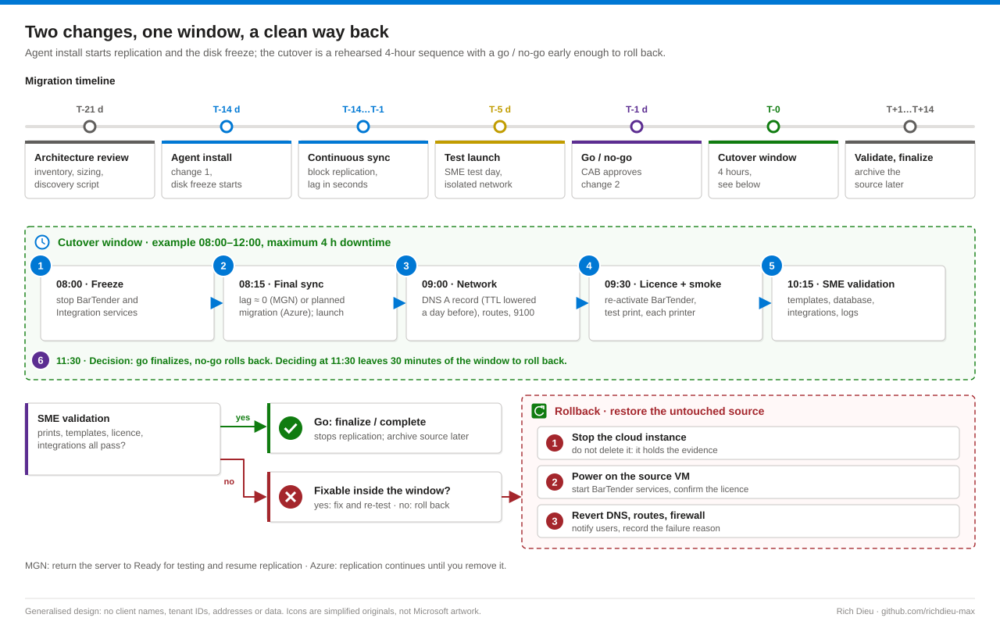

# SOP-MIG-001 · Lift-and-shift migration of a label printing server

Move a BarTender label printing server from an on-premises VMware host into AWS or Azure with minimum downtime, a tested cutover and a rollback that restores the untouched source. Labels on regulated products must still print exactly as validated, from the right template, on the right printer, with a valid licence.

**Family:** Cloud migration · **Covers:** rehost with AWS Application Migration Service (Method A), rehost with Azure Migrate (Method B), rebuild and replatform (Method C), dependency discovery, cutover, validation and rollback · **Does not cover:** building the landing zone or private connectivity, or printer addressing (see SOP-LBL-002).

## How it fits together


Of the "7 Rs", **rehost is the default for a validated label server**. MGN and Azure Migrate copy disk blocks (an initial sync, then only changed blocks) while the application runs, so the validated state is identical and re-testing focuses on what changed: the network path, the licence and the hardware the OS sees. A rebuild needs fuller re-validation.

A **test launch** boots a copy in an isolated network while replication continues; repeat it as often as needed. A **cutover** happens once, inside an approved window. Installing the agent starts a **disk-change freeze**: adding, removing or resizing source disks breaks or restarts replication, so any exception goes back through the change advisory board.

What breaks when a label server moves:

| Dependency | Why it breaks | Mitigation |
|---|---|---|
| Licensing | BarTender activation is tied to the machine; new virtual hardware and MAC can look like a different computer. Remote clients use the BarTender Licensing Service on TCP 5160 | Confirm with the vendor; deactivate before, reactivate after; open 5160 if clients use a remote licence server |
| Hard-coded IPs and UNC paths | Templates, Integration Builder, scripts and printer ports may point at 192.0.2.x or `\\fileserver\labels` | Discovery script; replace with DNS names before cutover |
| Printer connectivity | Jobs are rendered on the server and sent raw to TCP 9100, now across a VPN, Direct Connect or ExpressRoute | Routes and firewall for 9100 (plus SNMP 161/UDP); measure latency; print the largest real template |
| Identity | The cloud VM must reach a domain controller | Test logons on the test instance |
| Database | The BarTender System Database (SQL Server) is referenced by name | Use DNS, not IP; verify from the cloud subnet |

## Before you start

| Item | Requirement |
|---|---|
| Roles | Infrastructure lead (source, firewall, private link); migration team (replication, launches, cutover); labeling SME (validation, sign-off); security analyst (evidence); CAB (both changes, freeze exceptions) |
| AWS access | `AWSApplicationMigrationFullAccess` (first-time initialize also needs IAM rights to create service-linked roles); `AWSApplicationMigrationAgentInstallationPolicy` through short-lived credentials only; `AWSApplicationMigrationEC2Access` or scoped EC2 rights; `AWSApplicationMigrationReadOnlyAccess` for audit |
| Azure access | Owner, or Contributor + User Access Administrator, for first-time project and appliance setup; Contributor on the project and target RGs; `subnets/join/action` on the target VNet; a vCenter role with read, snapshot, disk and change-tracking privileges |
| Source and app | Local Administrator on the source; BarTender administrator; SQL `db_owner` (or sysadmin for restore) for Method C |
| Privilege | Elevate just in time: IAM Identity Center permission sets with short sessions, or Entra PIM activation per change with the change number as justification |
| Checklist | Architecture review (load balancer, B2B/EDI, VDI, NAS, DR dependencies documented); right-sizing (the reference source ran at about 92 % CPU on 2 vCPU / 8 GB, so the target went to 4 vCPU / 16 GB); licensing confirmed; full backup before agent install; private link carries DNS, AD, SQL and 9100; both changes raised; SME booked for a test day |
| Time and risk | 2–3 weeks elapsed, 4-hour cutover window · Medium: label printing outage if cutover fails |

## Steps

### Discover

1. **Inventory dependencies.** Run `Get-LabelServerDependencies.ps1` elevated on the source: it records printers, ports, mapped drives, services and scheduled tasks and searches BarTender configuration for literal IPs and UNC paths, writing JSON evidence. Re-point IP-based printer ports to DNS names (for example `prn-line1.contoso.com`).

### Method A · AWS Application Migration Service (MGN)

2. **Prepare MGN.** In the target Region open **Application Migration Service** and choose **Get started / Set up service**. Under **Settings › Replication template** choose the staging subnet, replication server type, EBS volume type and encryption key, and turn on **Use private IP for data replication**. The staging security group must allow TCP 1500 from the source; the source needs TCP 443 to the MGN endpoint and Amazon S3.
3. **Install the agent (change 1).** With short-lived credentials, run the installer from **Add source servers** elevated on the source and replicate all disks. The disk freeze starts; wait for **Ready for testing**.
   ```bat
   AwsReplicationWindowsInstaller.exe --region us-east-1 ^
     --aws-access-key-id <temporary-key-id> --aws-secret-access-key <temporary-secret> ^
     --aws-session-token <session-token>
   ```
4. **Launch settings and test.** In **Launch settings** set **Instance type right sizing** to Off and edit the launch template (for example `m5a.xlarge` for 4 vCPU / 16 GB, private subnet, security groups, tags, BYOL or license-included). **Test and cutover › Launch test instances** into a test subnet that cannot reach production printers, connect through Session Manager or a bastion, and run the validation list (expect a licence change). Then **Mark as "Ready for cutover"**, which terminates the test instance while replication continues.
5. **Cut over (change 2).** Stop BarTender services, wait for zero lag, **Launch cutover instances**, shut down (keep) the source, update DNS, re-activate the licence, validate. On success **Finalize cutover**, later **Mark as archived**. The same lifecycle is scriptable with `aws mgn` (`start-test`, `change-server-life-cycle-state`, `start-cutover`, `finalize-cutover`) or the `AWS.Tools.Mgn` module.

### Method B · Azure Migrate

6. **Project and discovery.** **Azure Migrate › Servers, databases and web apps › Create project** (for example RG `rg-migrate-labels`). Under **Discover**, deploy the appliance OVA on vCenter and register it with the project key; wait for the server in **Discovered servers**.
7. **Replicate.** **Migration and modernization › Replicate** from VMware vSphere: target RG (for example `rg-labels-dev`), VNet and subnet, disk encryption, Azure Hybrid Benefit where it applies, size (for example `Standard_D4s_v5`), tags. **Start replication** and track it under **Replicating machines**.
8. **Test, then migrate.** **Test migration** into an isolated test VNet, never production, connect with Azure Bastion, validate, then **Clean up test migration**. In the window stop BarTender services, **Migrate** with **Yes** to shut down the source (planned migration, no data loss), update DNS, re-activate the licence, validate, then **Complete migration** and enable Azure Backup and Update Manager. `Invoke-AzMigrateLabelServer.ps1` runs one stage per call so each stage ties to a change step:
   ```powershell
   $common = @{ SubscriptionId='<sub-guid>'; ProjectResourceGroup='rg-migrate-labels'; ProjectName='mig-labels'
                SourceVmName='SRV-LABEL-DEV01'; ChangeRef='CHG0012345' }
   .\Invoke-AzMigrateLabelServer.ps1 @common -Stage Replicate -TargetResourceGroupId '<rg-id>' -TargetVNetId '<vnet-id>' -WhatIf
   .\Invoke-AzMigrateLabelServer.ps1 @common -Stage Test -TestVNetId '<test-vnet-id>'
   .\Invoke-AzMigrateLabelServer.ps1 @common -Stage CleanupTest
   .\Invoke-AzMigrateLabelServer.ps1 @common -Stage Migrate    # inside the cutover window
   .\Invoke-AzMigrateLabelServer.ps1 @common -Stage Complete   # after SME sign-off
   ```

### Method C · Rebuild and replatform

9. **Only when the OS is out of support, drift is heavy or an upgrade is due.** Build from a hardened image, domain-joined, with backup and patching. Install SQL (or use managed SQL), .NET and **the same printer driver versions**: a different driver, DPI or font can shift barcodes and fail verification. Move the licence, restore the BarTender System Database, copy `.btw` documents, Librarian and Integration Builder content with `robocopy /MIR /COPYALL`, recreate printers on DNS-named ports, and compare output side by side.

### Cutover window (example 08:00–12:00)

10. **Run the sequence.** 08:00 freeze (announce, stop BarTender and Integration services) · 08:15 final sync and launch · 09:00 network (DNS A record to the cloud private IP, its TTL lowered a day earlier; routes and firewall for 9100; SQL and AD reachability) · 09:30 re-activate the licence and print a test label on each production printer · 10:15 SME validation · 11:30 decision: finalize, or roll back with 30 minutes left in the window.

## Verify

| Check | Pass |
|---|---|
| Printing | Labels print from dev, test and prod on every printer; the largest template prints at normal speed |
| Content | Templates and Librarian files open with revisions intact; integration triggers fire (file drop, web service); dev/test/prod separation unchanged |
| Licence | Shows active with the expected seat count |
| Identity and access | Domain logon and service accounts work (AC-2); only approved admin groups on the VM (AC-6) |
| Configuration and recovery | Configuration matches baseline (CM-2, CM-6); backups configured and one completed (CP-9) |
| Encryption and logs | Disks encrypted with managed keys (SC-12, SC-28); audit and BarTender print logs collected (AU-2) |

## Rollback



The source VM is never modified, only shut down, so rollback that starts before the decision deadline restores printing within minutes. Stop the cloud instance (do not delete it: it holds the evidence of what failed); power on the source, start BarTender services and confirm the licence (re-activate on the source if it moved); revert the DNS record and any printer route or firewall change; notify users and record the reason. In MGN the server can return to Ready for testing with replication resumed; in Azure, replication continues until you remove it.

## Troubleshooting

| Symptom | Cause and fix |
|---|---|
| MGN stuck in initial sync or "stalled" | TCP 1500 blocked from source to staging subnet, or 443 to MGN / S3. Check security groups, firewall and proxy |
| Azure "Initial replication failed" | Appliance cannot reach ESXi hosts on TCP 902, missing vCenter privileges, or disk layout changed. Fix and re-enable replication |
| Test instance does not boot | Driver or boot-mode issue. Check the serial console or boot diagnostics; confirm the OS is supported |
| BarTender reports licence invalid | Activation bound to old hardware. Deactivate on the source (or contact the vendor) and re-activate; open TCP 5160 for a licence server |
| Labels print slowly or time out | Latency over the VPN, MTU issues, or SNMP blocked. Measure RTT, check MTU / fragmentation, allow 161/UDP |
| Some printers unreachable | Ports still use IPs on a range not routed from the cloud. Re-point to DNS names; add routes |
| Templates or integrations cannot find files | Hard-coded UNC path or drive letter. Use the discovery output; update paths |
| Dev/test instance off when needed | Off-hours schedule (in the reference programme about 79 of 168 hours a week). Start it manually or request a documented exception |

## Control mapping

| Framework | Reference | How this supports it |
|---|---|---|
| NIST SP 800-53 R5 | AC-2, AC-6 | Who held migration roles and for how long (PIM or Identity Center logs); local admin membership on the new VM |
| | CM-2, CM-3, CM-6 | Both change records, the disk-freeze exception log, launch template or replication settings, post-migration configuration export |
| | CP-9, CP-10 | Pre-migration backup, retained source VM as the recovery path, cloud backup policy and first successful backup |
| | SC-12, SC-28 | KMS key or disk encryption set for replicated and final disks |
| | AU-2 | CloudTrail or Azure Activity Log for every migration action; Windows and BarTender logs forwarded to the SIEM |
