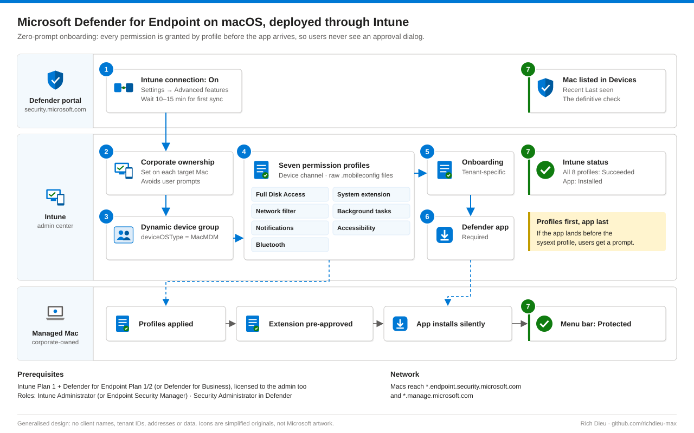

# SOP-EM-001 · Deploy Microsoft Defender for Endpoint to macOS with Intune

Onboard Intune-managed Macs to Defender for Endpoint with no user prompts: seven signed configuration profiles grant the permissions, one profile ties the agent to the tenant, and a required app assignment installs it.

**Family:** Endpoint Management · Also published, with the same diagram, in [endpoint-identity-runbooks](https://github.com/richdieu-max/endpoint-identity-runbooks).

**Applies to:** macOS 13 or later, enrolled in Intune (Company Portal or Automated Device Enrollment), management type `MacMDM`.
**Out of scope:** manual script installs, third-party MDMs, compliance policy and Conditional Access.

## The order matters



If the app lands before the system extension profile, the user is asked to approve the extension. Profiles first, app last.

## Prerequisites

| Item | Requirement |
|---|---|
| Licensing | Intune Plan 1 and Defender for Endpoint Plan 1 or 2 (or Defender for Business). The admin doing the work needs both licences assigned. |
| Roles | Intune Administrator (or Endpoint Security Manager) in Intune; Security Administrator in the Defender portal |
| Network | Devices reach `*.endpoint.security.microsoft.com` and `*.manage.microsoft.com` |

## Steps

### 1. Turn on the Defender ↔ Intune connector

Defender portal → **Settings → Endpoints → Advanced features** → **Microsoft Intune connection: On** → Save. Wait 10–15 minutes, then confirm in Intune under **Endpoint security → Microsoft Defender for Endpoint** that the connection shows **Enabled** with a recent sync. On the same page, allow Defender for Endpoint to enforce endpoint security configurations.

> "A Microsoft Intune license was not found" means the admin account itself has no Intune licence.

### 2. Set device ownership to Corporate

Intune → **Devices → All devices**, filter on macOS, open each target → **Properties → Device ownership: Corporate**. Personal-owned devices can prompt users to approve extensions and permissions.

### 3. Create the target group

Entra security group, membership **Dynamic Device**, rule:

```text
(device.deviceOSType -eq "MacMDM")
```

No spaces inside the quotes; `" MacMDM"` matches nothing. Allow up to 30 minutes for membership to evaluate.

### 4. Create the seven permission profiles

Download each file from Microsoft's [mdatp-xplat repository](https://github.com/microsoft/mdatp-xplat/tree/master/macos/mobileconfig/profiles) using **Download raw file** (saving from the folder listing gives you an HTML page, not the profile).

| File | Grants | Needed for |
|---|---|---|
| `fulldisk.mobileconfig` | Full Disk Access | Real-time protection, scanning |
| `sysext.mobileconfig` | System extension approval | EDR telemetry |
| `netfilter.mobileconfig` | Network content filter | Network protection |
| `background_services.mobileconfig` | Background task approval | Silent operation |
| `notif.mobileconfig` | Notifications | User alerts |
| `accessibility.mobileconfig` | Accessibility | Endpoint DLP |
| `bluetooth.mobileconfig` | Bluetooth | Device control |

Skip `kext.mobileconfig` (legacy kernel extension).

For each file: Intune → **Devices → macOS → Configuration → Create → Templates → Custom** → name it (`macOS - Defender - <purpose>`), **Deployment channel: Device channel**, upload the file, assign to the Mac group.

### 5. Create the onboarding profile

Defender portal → **Settings → Endpoints → Onboarding**: OS **macOS**, connectivity **Streamlined**, method **Mobile Device Management / Microsoft Intune** → download. In the `intune` folder, upload `WindowsDefenderATPOnboarding.xml` as an eighth custom profile, device channel, same group. (The file name says Windows for historical reasons; it is the macOS package.)

### 6. Assign the app as Required

Intune → **Apps → macOS → Create → Microsoft Defender for Endpoint (macOS)** → assign the Mac group under **Required**. "Available" makes it optional in Company Portal, which is wrong for a security agent.

## Verify

| Where | Pass |
|---|---|
| Intune app status | Target devices show **Installed** |
| Intune device configuration | All eight profiles **Succeeded** on each Mac |
| Defender portal → Assets → Devices | Each Mac listed with a recent Last seen. This is the definitive check. |
| On the Mac | System Settings → Device Management lists the eight profiles; the Defender menu-bar icon reports Protected |

Optional: run Microsoft's EICAR detection test.

## Troubleshooting

| Symptom | Fix |
|---|---|
| Dynamic group has 0 members | Check for spaces inside the quotes in the rule |
| Profile shows Error | Usually an HTML file saved instead of the raw profile, or User channel instead of Device channel |
| App installed, Mac missing from Defender portal | Onboarding profile not assigned or not applied |
| User asked to approve the system extension | `sysext` profile arrived after the app; check ownership is Corporate and profile assignment |
| Connector shows Unresponsive | Toggle the connection off, save, wait five minutes, toggle on |

## Operations

- Re-check the Microsoft profile repository quarterly and refresh profiles when they change.
- The onboarding package is tenant-specific. A tenant rebuild means offboarding and re-onboarding every Mac.

## Control mapping

| Framework | Reference | How this supports it |
|---|---|---|
| NIST SP 800-53 R5 | SI-3, SI-4 | Malicious code protection and endpoint monitoring on every managed Mac |
| | CM-2, CM-6 | Permissions and onboarding delivered as managed configuration, not by hand |
| NIST CSF 2.0 | DE.CM-09, PR.PS-01 | Endpoint monitoring; configuration management |
| ISO/IEC 27001:2022 | 8.7, 8.1 | Protection against malware; user endpoint devices |
