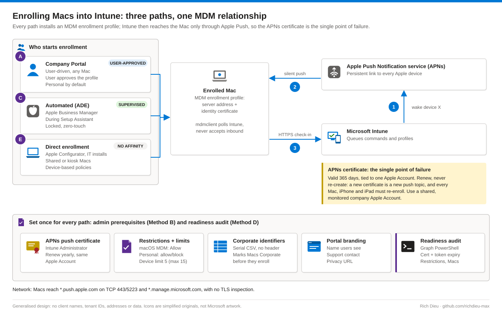

# SOP-EM-002 · Enrolling macOS devices into Microsoft Intune

Bring Macs under Intune management through Company Portal, Automated Device Enrollment (ADE) with Apple Business Manager, or direct enrollment. Everything Intune later does to a Mac, from compliance to Defender to a remote wipe, depends on enrolling it the right way the first time.

**Family:** Endpoint management · **Covers:** the APNs certificate, enrollment restrictions, corporate identifiers and branding, the Company Portal user walk-through, ADE token and profile, direct enrollment and a Graph PowerShell readiness audit · **Does not cover:** what is deployed after enrollment (see SOP-EM-001 for Defender for Endpoint).

## How it fits together



Intune never connects into a Mac. It asks the Apple Push Notification service (APNs) to wake the device, and the Mac's `mdmclient` calls Intune over HTTPS to collect commands. If the APNs certificate expires, Intune can no longer wake any Apple device.

| Path | Who starts it | Result | Best for |
|---|---|---|---|
| A · Company Portal | The user | User-approved, unsupervised, removable; Personal unless the serial is a corporate identifier | Existing Macs, BYOD |
| C · ADE | Apple Business Manager, during Setup Assistant | Supervised (macOS 11+), locked, zero-touch, always Corporate | New corporate Macs bought through Apple or an authorized reseller |
| E · Direct | IT, with an exported profile | No user affinity, device-based policies | Shared, lab or kiosk Macs |

Methods B (admin prerequisites) and D (readiness audit) support every path. Moving an existing Mac to ADE means erasing it.

## Before you start

| Item | Requirement |
|---|---|
| Roles | Intune Administrator for the APNs certificate only (eligible in PIM, activated for the yearly renewal); custom Intune role with Enrollment programs permissions for ADE; ABM Administrator or Device Enrollment Manager in ABM; Read Only Operator for the audit |
| Licensing | Intune licence for each user; MDM authority is Intune |
| Apple Account | Shared, monitored company Apple Account; renewal date in the team calendar |
| Network | Macs reach `*.push.apple.com` (TCP 443/5223) and `*.manage.microsoft.com` with no TLS inspection |
| End user | Work account, MFA method and the Mac's administrator password |
| Decisions | Allow or block personal Macs; user affinity for assigned ADE Macs, none for shared; locked enrollment for corporate ADE Macs |
| Risk | Low per Mac; an expired or re-created APNs certificate breaks all Apple management |

## Steps

### Method B · admin prerequisites (once, then yearly)

1. **APNs certificate.** **Devices › Enrollment › Apple › Apple MDM Push certificate**. Download the CSR, select **Create your MDM push Certificate**, sign in to the Apple Push Certificates Portal with the shared company Apple Account. Choose **Create a Certificate** the first time or **Renew** on the existing one, upload the CSR, download the `.pem`, upload it to Intune and confirm the new expiry. Always renew, never re-create: a new certificate is a new push topic and every Mac, iPhone and iPad must re-enroll.
2. **Restrictions and limits.** **Devices › Enrollment › Device platform restriction › macOS restrictions**: MDM Allow; Personally owned Allow or Block. **Device limit restriction**: default 5 per user, maximum 15.
3. **Corporate identifiers.** **Devices › Enrollment › Corporate device identifiers › Add**: upload a CSV of serials (no header row), for example `C02EXAMPLE01,MacBook Pro - Finance`.
4. **Branding.** **Tenant administration › Customization**: organization name, support contact and privacy URL shown in Company Portal.

### Method A · Company Portal (user, about 10 minutes)

5. **Install.** In Safari go to `aka.ms/EnrollMyMac`, run `CompanyPortal-Installer.pkg`, enter the Mac password, **Close**.
6. **Sign in and begin.** Sign in with the work account and MFA. On **Set up <organization> access** select **Begin**, not Postpone; review the privacy screen.
7. **Approve the profile.** **Download profile**, then **System Settings › General › Device Management › Management Profile › Install…** with the administrator password (macOS 13 and earlier: **Privacy & Security › Profiles**). This is the step users miss; macOS 11+ never installs an MDM profile silently. Back in Company Portal, three green checks, **Done**.

### Method C · Automated Device Enrollment

8. **Token.** **Devices › Enrollment › Apple › Enrollment program tokens › Add**, download the public key. In ABM, **Preferences › Your MDM Servers › Add** (for example `Contoso Intune`), upload the key, download the `.p7m`. Upload it to Intune with the ABM Apple Account; note the one-year expiry.
9. **Assign Macs.** In ABM set Default Device Assignment for Mac to the new server, or assign by serial or order number.
10. **Profile.** Open the token, **Sync**, then **Profiles › Create profile › macOS**: Enroll with User Affinity, Setup Assistant with modern authentication, Locked enrollment Yes, Await final configuration Yes, hide unneeded Setup Assistant screens. Set it as the default profile. Assign Company Portal as Required to macOS users.

### Method E · direct enrollment

11. **Shared Macs.** Create an Apple Configurator enrollment profile without user affinity (**Devices › Enrollment › Apple › Apple Configurator › Profiles**), **Export profile** (`.mobileconfig`), install and approve it in **Device Management** on the Mac, then target it with device-based policies.

### Method D · readiness audit

12. **Schedule the report.** `Get-MacEnrollmentReadiness.ps1` reads the APNs certificate (v1.0), ADE tokens and restrictions (beta) and every enrolled Mac, and writes CSV and JSON evidence. Run it weekly and alert on WARN or EXPIRED. The device CSV holds user names and serials: treat it as personal data.

```powershell
.\Get-MacEnrollmentReadiness.ps1 -WarnDays 45              # read-only report
.\Get-MacEnrollmentReadiness.ps1 -SyncAdeTokens -WhatIf    # preview the token sync
.\Get-MacEnrollmentReadiness.ps1 -SyncAdeTokens            # sync after a new ABM purchase
```

## Verify

| Check | Pass |
|---|---|
| `sudo profiles status -type enrollment` | `MDM enrollment: Yes (User Approved)`; `Enrolled via DEP: Yes` for ADE |
| System Settings › Device Management | Management Profile listed as verified |
| Intune › Devices › macOS | Correct primary user, ownership and a recent check-in |
| Device properties (ADE) | Enrollment type Apple automated device enrollment; Supervised: Yes |
| Readiness report | No WARN or EXPIRED rows; the Mac is in the device CSV |

## Rollback

**Retire** removes company data and profiles and keeps personal data; **Wipe** erases corporate ADE Macs being reassigned. A locked ADE profile is removable only by Intune or an erase. A restriction that blocked everyone is reverted; Macs already enrolled are not affected.

## Troubleshooting

Rule out tenant-wide causes (certificate, restrictions, limits) before debugging one Mac.

| Symptom | Cause and fix |
|---|---|
| "Couldn't add your device" | Platform or personal restriction, or device limit reached: adjust the restriction or delete stale records |
| All Apple devices stop checking in | APNs certificate expired or re-created under another Apple Account: renew with the original; if lost, devices re-enroll |
| Profile downloaded, Company Portal waits | User did not approve it in Device Management: walk them through step 7 |
| ADE Mac skips enrollment | Not assigned to the MDM server, token not synced or no profile: assign, sync, then erase or run `sudo profiles renew -type enrollment` |
| ADE token error | Token expired or ABM terms changed: renew in ABM, upload, sync |
| Corporate Mac shows Personal | Serial not registered before enrollment: change ownership and add the serial |
| Enrolled, no policies arrive | Network blocks APNs: open TCP 5223/443 to Apple; exempt Apple and Intune from TLS inspection |

## Control mapping

| Framework | Reference | How this supports it |
|---|---|---|
| NIST SP 800-53 R5 | CM-8 System component inventory | Every Mac enrolled with a known owner, ownership type and check-in date; weekly readiness report as evidence |
| | AC-6(5) Privileged accounts | Tenant-wide Intune Administrator activated just-in-time for the yearly APNs renewal only |
| | CM-3 Configuration change control | Restriction and limit changes affect every new enrollment and run under change control |
