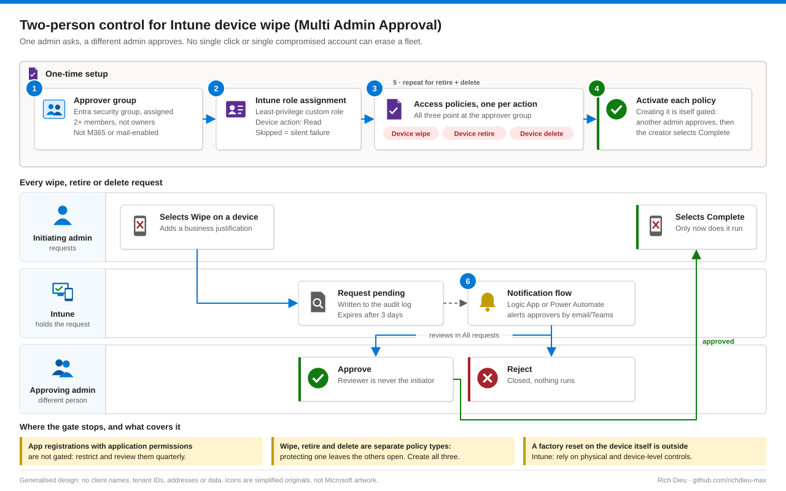

# SOP-EM-003 · Two-person control for Intune device wipe (Multi Admin Approval)

Require a second administrator to approve every device wipe, retire and delete in Intune, so one mistaken click or one compromised admin account cannot erase a fleet.

**Family:** Endpoint Management · Also published, with the same diagram, in [endpoint-identity-runbooks](https://github.com/richdieu-max/endpoint-identity-runbooks).

## What the control does, and where it stops

Multi Admin Approval (MAA) is a two-person rule: one initiator, one different approver. The initiator can never approve their own request, including Global Administrators.

| Limit | Consequence | Compensating control |
|---|---|---|
| App registrations using **application** permissions are not gated (no user behind the call) | The main residual risk: an app with Intune Graph permissions can wipe with no approval | Restrict and review those app registrations quarterly; govern them with Conditional Access for workload identities |
| Wipe, retire and delete are **separate policy types** | Protecting wipe leaves retire and delete open | Create all three policies |
| No native notification to approvers; requests expire after three days | Urgent wipes stall | Logic App or Power Automate flow on the Intune audit log that alerts the approver group |
| A factory reset on the device itself | Outside Intune | Physical and device-level controls |

## How it fits together

## Prerequisites

- Intune Plan 1 for every participating admin.
- At least two admin accounts; three or more so leave never blocks an emergency wipe.
- A decision on who holds approval authority.

## Steps

1. **Approver group.** Entra admin center → Groups → New group. Type **Security** (Microsoft 365 groups, distribution lists and mail-enabled security groups fail silently), membership Assigned, two or more **members** (owners cannot approve).
2. **Bridge the group to an Intune role.** Intune → Tenant administration → Roles. Assign the approver group to a least-privilege custom role with device-action **Read**. This is the most common silent failure: without the role assignment, members cannot approve.
3. **Wipe policy.** Tenant administration → Multi Admin Approval → Access policies → Create. Policy type **Device wipe**, platform resolves to all platforms, approvers = the group, submit with a justification.
4. **Activate it.** Creating the policy is itself a protected change. A *different* admin approves it under All requests; the creator then selects **Complete** under My requests. The gate is live only after Complete.
5. **Repeat for retire and delete.** Same group, same handshake.
6. **Notifications.** Flow on the Intune audit log that posts new MAA requests to the approvers by email or Teams. In a regulated environment, treat this as required.

## Daily use

The Wipe button now reads **Request for wipe**. The initiator adds a justification and submits; an approver reviews the device and the reason, adds notes, approves or rejects; after approval the initiator selects Complete and the wipe runs.

## Verify

- Wipe on a test device shows **Request for wipe**, not an immediate wipe.
- An initiator cannot approve their own request.
- An approver in the group, whose group holds the role, can approve.
- The audit log records initiator, approver, justification and timestamps.

## Review cadence

| Quarterly | Annually |
|---|---|
| Approver group membership; app registrations holding Intune device-management Graph permissions | Re-validate against current Intune MAA capability |

## Control mapping

A mapping means the control supports the objective; full coverage also needs the compensating controls above.

| Framework | Reference | How this supports it |
|---|---|---|
| NIST SP 800-53 R5 | AC-3(2) Dual authorization | A destructive action runs only after a second admin approves |
| | AC-5 Separation of duties | Request and approval are separate people |
| | AC-6(9), AU-2, AU-12 | Use of the privileged function is logged with who, why and when |
| | CM-5 Access restrictions for change | Dual authorization on a high-impact production change |
| NIST CSF 2.0 | PR.AA-05, GV.RR-02 | Least privilege and separation of duties; defined authority |
| ISO/IEC 27001:2022 | 5.3, 8.2, 8.15 | Segregation of duties; privileged access rights; logging |

In regulated life-sciences environments the approval record also supports the authority-check and audit-trail expectations of 21 CFR Part 11 §11.10(d) and (e) and ALCOA+. MAA governs admin actions; it is not an electronic-records system and does not establish Part 11 compliance on its own.
