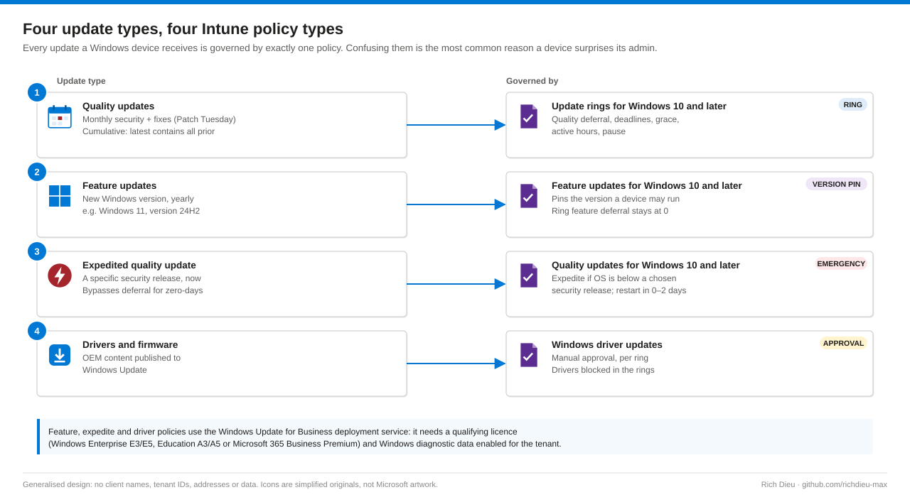
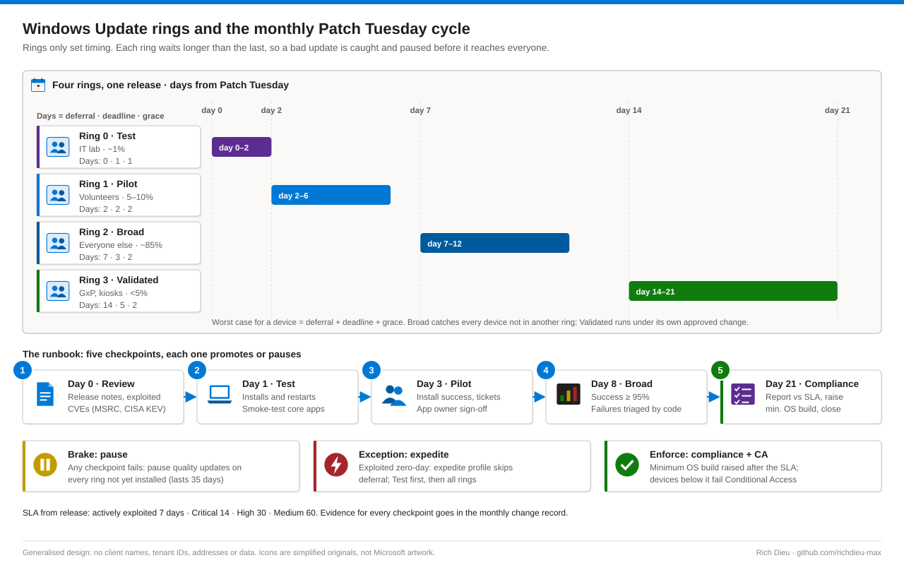

# SOP-EM-005 · Managing Windows Update rings and patch compliance with Intune

Control when each Windows device takes Microsoft's updates, which Windows version it runs, and prove every month that it installed them within an SLA. Four rings with increasing deferral give IT time to see a bad update on a few devices and pause it before it reaches everyone.

**Family:** Endpoint management · **Covers:** update rings, a pinned feature version, an emergency expedite profile, manual driver approval, the Patch Tuesday runbook, compliance reporting in Intune and Log Analytics, pause and rollback · **Does not cover:** WSUS or Configuration Manager software updates, or Windows Autopatch (devices registered with Autopatch are excluded from these rings).

## How it fits together



A ring does not choose updates; it sets timing. **Deferral** delays the offer (counted from release), **deadline** limits how long the user may postpone the restart (counted from the offer), and **grace** protects a device that was offline past its deadline. The worst case for a device is deferral + deadline + grace days after release.



| Setting | Ring 0 Test | Ring 1 Pilot | Ring 2 Broad | Ring 3 Validated |
|---|---|---|---|---|
| Members | IT lab, ~1% | Volunteers, 5–10% | Everyone else, ~85% | GxP lab, manufacturing, kiosks, <5% |
| Quality deferral / deadline / grace | 0 / 1 / 1 | 2 / 2 / 2 | 7 / 3 / 2 | 14 / 5 / 2 |
| Feature deadline | 2 | 5 | 7 | 14 |
| Feature deferral · uninstall period | 0 · 10 | 0 · 10 | 0 · 10 | 0 · 30 |
| Update behaviour | Auto install and restart | Auto install at maintenance time | Auto install at maintenance time | Auto install at maintenance time |
| Active hours · auto restart before deadline | n/a · Yes | 08:00–18:00 · No | 08:00–18:00 · No | Per site shift pattern · No |

All rings: General Availability Channel, Microsoft product updates Allow, Windows drivers Block, pre-release builds Not configured. Feature deferral stays at 0 so that one feature update policy alone decides the version; every device must be in exactly one.

## Before you start

| Item | Requirement |
|---|---|
| Roles | Policy and Profile Manager (or Intune Administrator) to build, pause and approve drivers; Intune Administrator for Windows data; Log Analytics Contributor for WUfB reports; Read Only Operator for reviews |
| Licensing | Rings: Windows 10/11 Pro, Enterprise, Education. Feature, expedite and driver policies need the deployment service licence (Windows Enterprise E3/E5, Education A3/A5 or M365 Business Premium) |
| Devices | Entra joined or hybrid joined and enrolled in Intune; Allow Telemetry Required or higher |
| Change | Approved change for the build and a standing change for the monthly cycle; business owner sign-off for the validated ring |
| Groups | `WU-Ring0-Test`, `WU-Ring1-Pilot`, `WU-Ring2-Broad`, `WU-Ring3-Validated`; Autopatch devices excluded |
| Conflicts | Inventory of GPOs setting automatic updates, WSUS location or deferrals, and any third-party patch agent |
| SLA | Actively exploited 7 days · Critical 14 · High 30 · Medium 60, agreed with vulnerability management (SOP-SEC-001) |
| Risk | Moderate: a bad update reaches every ring that is not paused. High for feature upgrades, expedite and automatic driver approval |

## Steps

### Build

1. **Clear conflicts.** Unlink Windows Update GPOs for devices moving to Intune or set them Not Configured, especially **Specify intranet Microsoft update service location**. For co-managed devices move the Windows Update policies workload to Pilot Intune, then Intune. **Tenant administration › Connectors and tokens › Windows data**: turn on **Enable features that require Windows diagnostic data in processor configuration**.
2. **Ring 0.** **Devices › Windows updates › Update rings › Create profile**, `WU-Ring0-Test`, with the values above and the change number in the description. **Use deadline settings** Allow. Assign to `WU-Ring0-Test`. Build the other rings the same way; Broad includes a dynamic group of Windows devices and excludes the other three ring groups.
3. **Pin the version.** **Feature updates › Create profile**, `WU-Feature-Win11-24H2`, Windows 11 version 24H2. Test as soon as possible; production gradually or from a date after Pilot sign-off. Decide what happens to devices not capable of Windows 11 and track them for replacement.
4. **Expedite template.** **Quality updates › Create profile**, `WU-Expedite-Template`, restart enforced after 1 day (0–2). Save without assignments.
5. **Drivers.** **Driver updates › Create profile**, `WU-Drivers-Manual`, Manually approve and deploy. Assign to Test and Pilot first; approve firmware and BIOS only after OEM release notes and a Test install.
6. **Go live.** After one clean Patch Tuesday on Ring 0, assign Pilot; two weeks later Broad and Validated (Validated under its own change). Every device reports Succeeded within 24 hours of check-in. Export every profile and attach it to the change.
7. **Tie to Conditional Access.** In the Windows compliance policy set **Minimum OS version** to the build of the release past its SLA (for example `10.0.26100.xxxx`), non-compliant after a grace matching the SLA. Raise it only after the SLA has expired and Broad reports above 95%; devices below it fail CA006 (SOP-ID-001).

### Operate the monthly cycle

8. **Day 0 · Review.** Release notes, release health, CVEs marked Exploitation Detected, CISA KEV; decide on expedite.
9. **Day 1 · Test.** Installed and restarted; smoke-test Office, VPN, line-of-business and label printing.
10. **Day 3 · Pilot.** Install success, tickets tagged patch, app owner sign-off.
11. **Day 8 · Broad.** Success at least 95%, top failure codes triaged, offline devices listed.
12. **Day 14 · Validated and day 21 · Compliance.** Lab owner approval and install in the maintenance window; report against the SLA, raise the minimum build, record exceptions, close the change. A failed checkpoint means pausing every ring that has not installed yet.
13. **Expedite a zero-day.** Record an emergency change, set the template to the release containing the fix, assign to Test, then after 2–4 hours of successful installs add Pilot, Broad and Validated (with the lab owner's approval). Remove assignments once installed above target.

### Report

14. **Export for review** with read-only Graph scopes, and track the KPI in Log Analytics: the percentage of devices active in the last 14 days that have the release now past its SLA, per ring and severity.

```powershell
Connect-MgGraph -Scopes "DeviceManagementConfiguration.Read.All","DeviceManagementManagedDevices.Read.All" -NoWelcome
$rings = Get-MgDeviceManagementDeviceConfiguration -All |
  Where-Object { $_.AdditionalProperties.'@odata.type' -eq '#microsoft.graph.windowsUpdateForBusinessConfiguration' }
```

```kql
UCClientUpdateStatus
| where TimeGenerated > ago(2d)
| where UpdateCategory == "WindowsQualityUpdate"
| summarize arg_max(TimeGenerated, *) by AzureADDeviceId
| summarize Devices = count() by ClientState, ClientSubstate
```

## Verify

| Check | Pass |
|---|---|
| Ring membership | Sum of ring devices equals Windows devices minus Autopatch |
| Feature update report | No device shows Not in scope |
| Registry on a sample device | No `WUServer` under the Policies key; ring values under PolicyManager Update |
| Settings › Windows Update › view policies | Deferral and deadline match the ring |
| Feature and expedite reports | Devices listed within 48 hours |
| Monthly KPI | ≥ 98% for exploited and critical, ≥ 95% for high and medium |
| Change repository | Ring and feature exports dated this change |

## Rollback

| Situation | Action |
|---|---|
| Bad quality update seen in Test or Pilot | Each later ring › **Pause › Quality updates** (lasts 35 days, then resumes automatically) |
| Already installed | Ring › **Uninstall › Quality updates** (latest update only), then pause |
| Feature update breaks an app | Ring › **Uninstall › Feature updates** within the uninstall period; keep the older version in the feature profile |
| Faulty driver | Pause or decline in the driver policy; roll back on the device or with OEM tooling |

Every pause has an owner and review date in the change record, and the monthly report lists paused rings. **Resume** after the fix is published.

## Troubleshooting

Work from the policy source to the device to the update itself; collect the log before changing anything.

| Symptom | Cause and fix |
|---|---|
| Ring says Succeeded, last month's update missing | A GPO points the device at WSUS (`WUServer`): remove it, `gpupdate /force`, rescan |
| Settings greyed out, different deferrals | GPO and MDM set the same setting: remove the GPO; check the co-management workload |
| Pending restart for weeks | No quality deadline, or it did not reach the device: set **Use deadline settings** |
| Feature update never offered | Not in a feature profile, ineligible hardware, or safeguard hold |
| Expedite Not applicable | Already at the build, or diagnostic data off |
| 0x80070070 | Low disk space: free space and retry (SOP-WIN-004) |
| Offline over 14 days | Contact the owner; exclude from the KPI |

```powershell
Get-ItemProperty 'HKLM:\SOFTWARE\Policies\Microsoft\Windows\WindowsUpdate' -ErrorAction SilentlyContinue |
  Select-Object WUServer, WUStatusServer, DisableDualScan
Get-WindowsUpdateLog
```

## Control mapping

| Framework | Reference | How this supports it |
|---|---|---|
| NIST SP 800-53 R5 | SI-2, SI-2(2), SI-2(3) | Flaw remediation on a timed ring schedule with automated status and SLA by severity |
| | CM-3, CM-8, RA-5 | Ring changes under change control; device inventory per ring; exploited CVEs drive the expedite decision |
| CIS Controls v8 | 7.3, 7.4, 7.7 | Automated OS and application patching; remediation of detected vulnerabilities |
| CIS Microsoft Intune for Windows Benchmark | Windows Update section | Deferral, deadline and pre-release settings |
| FDA 21 CFR Part 11 / GAMP 5 | §11.10(k) | Validated ring with documented change control and objective evidence |
