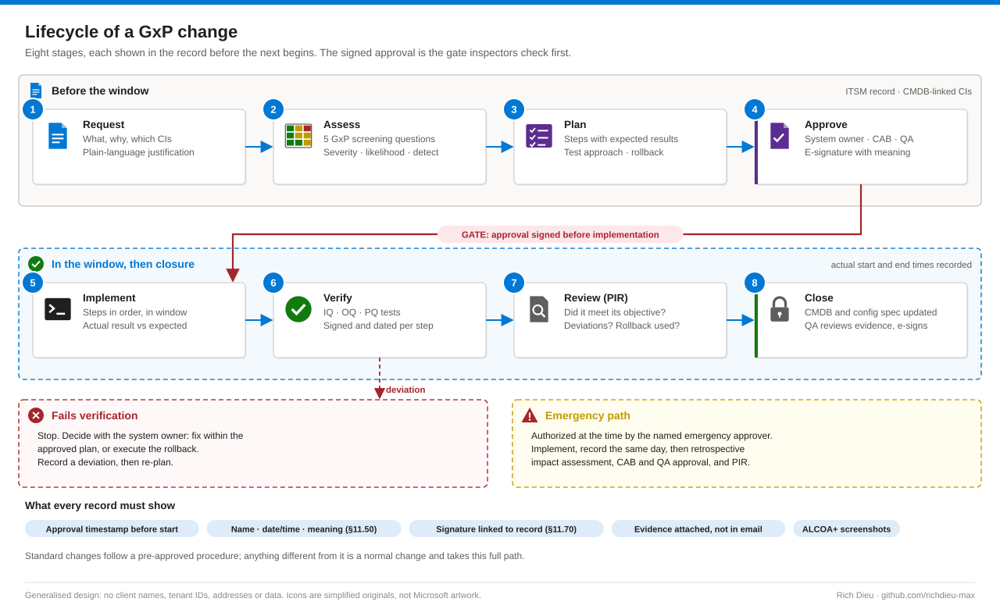

# SOP-GOV-001 · Change control and objective evidence for GxP and 21 CFR Part 11 systems

Classify a change, assess its GxP impact, plan the test and the rollback, get Quality approval with an electronic signature, implement in a window, capture evidence an inspector would accept, and close the record with the system still in its validated state. Without this, the organization can no longer prove that the data the system produced since the change is trustworthy.

**Family:** Governance & compliance · **Covers:** the eight-stage change lifecycle, GxP impact and risk assessment, Part 11 approvals, IQ/OQ/PQ and ALCOA+ evidence, emergency changes, deviations and CAPA · **Does not cover:** the technical procedure for a specific change (a Windows 7 to Windows 11 lab workstation upgrade is SOP-LAB-001).

## Flow



The stages are the same in any ITSM tool; the terms here are ServiceNow's (Change Request, CI, CAB, Post-Implementation Review).

## Before you start

| Item | Requirement |
|---|---|
| Roles | Requester (what and why, linked CIs); change owner (plan, tests, rollback, evidence; admin rights for the window only); system owner (business impact, window); QA/CSV reviewer (approves with a Part 11-compliant signature); CAB (technical risk); independent tester where required |
| Segregation of duties | The implementer is not the only approver and never approves their own test results. In a small team, document the compensating control, for example QA reviews the evidence before closure |
| CMDB and baseline | The system is a CI with GxP classification, GAMP category, owner and validation documents linked; the validated configuration (OS build, application, drivers, network, accounts) is known |
| Rollback route | Confirmed: known-good image, snapshot, backup, or documented reinstall media and settings |
| Window and evidence store | Window agreed with the lab, instruments idle; a controlled folder or ITSM attachment area ready |

| Class | Definition | Approval |
|---|---|---|
| Standard | Pre-approved, low-risk, repeatable, with a documented procedure | CAB/QA once; each instance logged. Any difference makes it normal |
| Normal | Anything not pre-approved: lab workstation OS upgrade, instrument driver, static IP change, agent install | Change owner › system owner › CAB › QA (if GxP impact) |
| Emergency | Needed now to restore service or close an actively exploited risk | Emergency CAB, expedited; retrospective QA approval within the agreed period |

## Steps

### Request, assess, plan

1. **Request.** A reviewer who has never seen the system should understand the change from the short description alone: *Upgrade lab workstation LAB-WS-014 (test frame control) from Windows 7 to Windows 11 Enterprise*, not *Upgrade PC*. Link the CIs and related records (domain removal, reimage, network, previous validation report).
2. **Screen for GxP impact.** Record answers to all five questions, even when every answer is No: does the system create, modify, store, transmit or report GxP records; could the change affect their accuracy, completeness or availability, including audit trails; could it affect a validated function; does it change security, access, e-signatures, time sync or backups; does it change the OS, a driver or firmware under the validated application?
3. **Rate the risk.** Severity × likelihood, adjusted by detectability, sets the test depth. High: scripted, pre-approved steps, independently executed and signed. Medium: scripted for critical functions, exploratory for the rest. Low: unscripted or leveraged vendor evidence, summarised with outcome. Record a one-paragraph rationale agreed with QA.
4. **Plan.** Numbered steps with expected results and the evidence each produces; baseline capture; test scripts or charters traced to requirements; rollback trigger, steps, duration and decision owner; communications. Walk through or test the rollback before the window.

### Approve

5. **Electronic signature.** Use the tool's approval mechanism or the validated quality system. The signature shows printed name, date and time, and meaning (§11.50), is linked to its record (§11.70), is unique to one person (§11.100) and uses two components with re-authentication (§11.200). An email saying "approved" pasted into a work note is not an approval.

### Implement and verify, inside the window

6. **Start and baseline.** Confirm the approval is signed; record the actual start time; capture the pre-change evidence as planned.
7. **Execute.** Run the steps in order, recording each actual result next to the expected one. If a step misses, stop and decide with the system owner: fix within the plan, or roll back. Anything outside the plan is a deviation.
8. **Test and release.** Testers sign and date each step as executed. Return the system to use only when the system owner confirms; record the actual end time.

Every screenshot shows hostname, date and time, user and the relevant version, named `<CHANGE>_<STAGE-STEP>_<HOSTNAME>_<YYYYMMDD-HHMM>.<ext>` (for example `CHG0012345_OQ-03_LAB-WS-014_20261012-1042.png`). Keep this header visible beside the application while capturing, and save its output as evidence:

```powershell
# Prints the identifying details an inspector looks for; keep the window in frame
$os = Get-CimInstance Win32_OperatingSystem
[pscustomobject]@{
  Hostname   = $env:COMPUTERNAME
  User       = "$env:USERDOMAIN\$env:USERNAME"
  DateTime   = (Get-Date -Format "yyyy-MM-dd HH:mm:ss K")
  OS         = "$($os.Caption) $($os.Version) build $($os.BuildNumber)"
  TimeSource = (w32tm /query /source)
} | Format-List
```

The clock is part of the evidence: confirm the time source (`w32tm /query /status`) in the baseline, and configure NTP on a PC removed from the domain.

| Stage | Evidence for a workstation OS upgrade |
|---|---|
| IQ | OS edition and build; application and driver versions; hostname; domain or workgroup; time source; security agents reporting |
| OQ | Application starts and talks to the instrument; user roles enforced; audit trail records actions and historical entries stay readable; data saves to the right place |
| PQ | A representative run matches the reference system within tolerance. Where a lab has paired systems, change the idle one and keep the other as the reference |

### Review and close

9. **PIR.** Did the change meet its objective; any deviations or incidents; was the rollback needed?
10. **Close.** Attach all evidence to the record, not email; update the CMDB and configuration specification. QA reviews the evidence itself, not a summary, and signs with the meaning *Evidence reviewed; system in validated state*.

### Emergency changes, deviations and CAPA

- **Emergency.** Record who authorized it, when and how; take what baseline you can; log each action with a time; raise the record the same day marked Emergency and linked to the incident; then retrospective impact assessment, verification, CAB and QA approval and PIR. A refused retrospective approval becomes a deviation.
- **Deviation.** Raised for a failed step, a step out of order, an unplanned step, missing evidence or work outside the window. A missing screenshot is recorded as a gap, never recreated and passed off as original.
- **CAPA.** Investigate the root cause, correct this instance, remove the cause, check the same risk elsewhere, and check effectiveness after 3–6 months. Periodic review (every one to three years by risk) samples the change records.

## Verify

| Check | Pass |
|---|---|
| Approval before implementation | Approval timestamp precedes actual start, or emergency authorization recorded |
| Signature meaning | Each approval shows name, date/time and meaning |
| Evidence complete and identifying | Every planned item present and named per convention; samples show hostname, time, user, version |
| Deviations | Closed, or open with a CAPA owner and due date |
| Configuration documents | CMDB and configuration specification reflect the new state, version incremented |
| Audit trail | Entries before and after the change both readable |

## Rollback

The plan names the trigger, steps, duration and decision owner. A failed verification means: roll back, record a deviation, re-plan. In the worked example, rollback was restoring the Windows 7 image captured before domain removal.

## Troubleshooting

| Symptom | Cause and fix |
|---|---|
| Implemented before approval | Absent approver under window pressure: delegated approvers in the tool; emergency path only for genuine emergencies |
| Evidence does not identify the system | Cropped screenshots: evidence header script and mandatory hostname/time fields |
| Screenshots dated after the change | Collected at closure: capture at each step; reviewer checks timestamps against the window |
| "No GxP impact" with no rationale | Screening skipped: make the five questions mandatory fields |
| Rollback never tested | Restore test on a spare or the twin before the window, evidence attached |
| One person requested, implemented and approved | Independent QA evidence review before closure; documented compensating control |
| Audit trail reset after reinstall | Database recreated: plan audit-trail migration; OQ test that historical entries remain |

## Control mapping

| Framework | Reference | How this supports it |
|---|---|---|
| FDA 21 CFR Part 11 | §11.10(a), (d), (e), (k) | Validation kept true across change; limited access; audit trails preserved; controlled documentation |
| | §11.50, §11.70, §11.100, §11.200 | Approvals show name, time and meaning, are linked, unique and two-component |
| EU GMP Annex 11 | Change and configuration management, periodic evaluation | Lifecycle, evidence and periodic review |
| NIST SP 800-53 R5 | CM-3, CM-4, CM-5, SA-10 | Change control; impact analysis; access restrictions for change |
| ISO/IEC 27001:2022 | Annex A 8.32 | Change management |
| ISPE GAMP 5 (2nd ed.) · FDA CSA | Risk-based assurance | Risk sets scripted versus unscripted testing |
