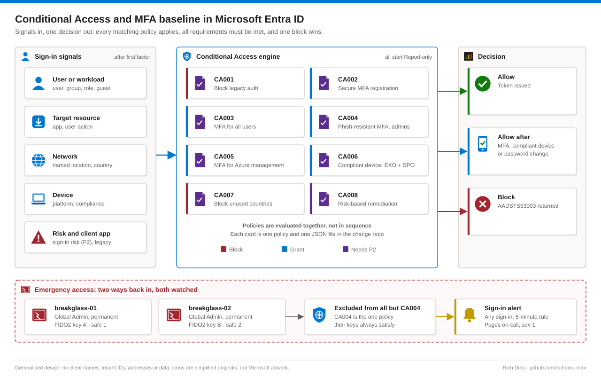
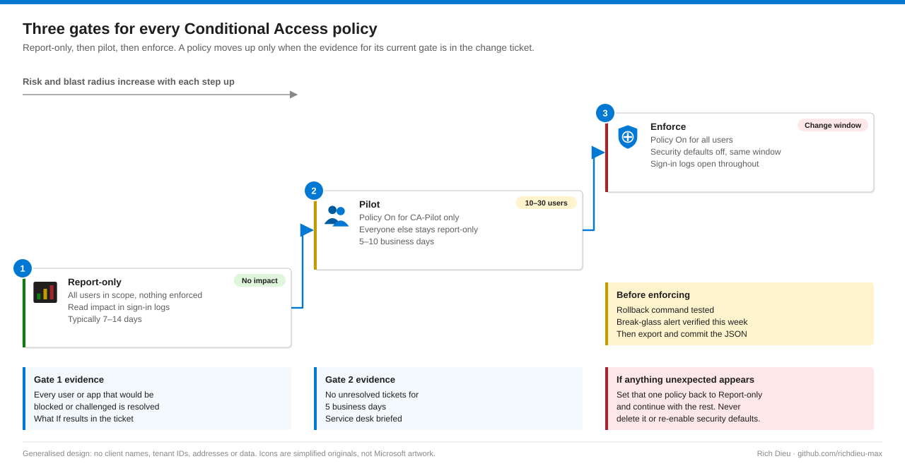

# SOP-ID-001 · Building a Conditional Access and MFA baseline in Microsoft Entra ID

Replace security defaults with a named, testable set of eight Conditional Access policies: emergency access accounts, legacy authentication blocked, MFA for every user, phishing-resistant MFA for administrators and compliant devices for sensitive apps. Every policy goes report-only first, then pilot, then enforced.

**Family:** Identity and access · **Covers:** emergency access accounts, the CA001–CA008 baseline built in the portal or with Microsoft Graph PowerShell, staged rollout and cut-over from security defaults · **Does not cover:** workload identity policies or device enrollment itself (see SOP-EM-002).

## How it fits together



Policies do not run in order: every matching policy applies, all their requirements must be met, and one block wins. Security defaults and Conditional Access are mutually exclusive, so the baseline is built in report-only and security defaults are switched off in the same change window as enforcement, never on its own.

| Policy | Users (include / exclude) | Target and conditions | Grant / session |
|---|---|---|---|
| CA001-AllUsers-LegacyAuth-Block | All users / BG accounts | All resources · client apps Exchange ActiveSync, Other clients | Block |
| CA002-AllUsers-SecurityInfo-Register | All users / BG, guests | User action Register security information · any location, exclude trusted | Auth strength MFA |
| CA003-AllUsers-AllApps-RequireMFA | All users / BG, directory sync account | All resources | Auth strength MFA |
| CA004-Admins-AllApps-PhishResistant | 14 privileged directory roles (BG accounts included via role) | All resources | Phishing-resistant MFA · sign-in frequency 4 h |
| CA005-AllUsers-AzureMgmt-RequireMFA | All users / BG | Windows Azure Service Management API | Auth strength MFA · sign-in frequency every time |
| CA006-AllUsers-Sensitive-Compliant | All users / BG, guests | Exchange Online, SharePoint Online · Windows, macOS, iOS, Android | Require compliant device |
| CA007-AllUsers-BlockedCountries-Block | All users / BG, travel exception group | All resources · location Blocked countries | Block |
| CA008-AllUsers-Risk-Remediate (P2) | All users / BG | Sign-in risk High; separate policy for user risk High | MFA · secure password change |

CA004 targets directory roles rather than a group, so anyone activated into a role through PIM is covered at once. The emergency accounts hold Global Administrator and are deliberately caught by CA004, the one policy their FIDO2 keys can always satisfy.

## Before you start

| Item | Requirement |
|---|---|
| Roles | Conditional Access Administrator (through PIM, change window only); Privileged Role Administrator + User Administrator for the break-glass accounts; Authentication Policy Administrator for FIDO2 and Authenticator; Global Reader or Security Reader for reviews |
| Licensing | Entra ID P1 for every protected user (M365 E3, E5, Business Premium). CA008 needs Entra ID P2 |
| Logging | Sign-in and audit logs exported to a Log Analytics workspace, retained at least 90 days |
| Inventory | Non-interactive service accounts and integrations; legacy-protocol use in the last 30 days |
| Readiness | Authenticator and FIDO2 / passkeys enabled; every admin owns a phishing-resistant credential before CA004 is enforced; Intune compliance reporting for CA006 platforms |
| Pilot and comms | Group `CA-Pilot` (10–30 users across departments); user communications drafted; approved change ticket with a maintenance window |
| Risk | High if enforced untested (CA004, CA006, turning security defaults off); low in report-only |

## Steps

### Build (every policy saved as Report-only)

1. **Emergency access accounts.** Entra ID › **Users › New user › Create new user**: `breakglass-01@<tenant>.onmicrosoft.com` and `breakglass-02`, cloud-only. **Assigned roles › Add assignments › Global Administrator**, Active, permanent. Register a FIDO2 key for each at `https://aka.ms/mysecurityinfo` on a clean workstation; store key A and key B in separate safes with separate custodians. Record accounts, custodians and safes in the identity runbook, never passwords.
2. **Named locations.** **Conditional Access › Named locations › + IP ranges location**: `Office egress`, marked trusted (for reporting, not to skip MFA). **+ Countries location**: `Blocked countries`. Create `CA-Exclude-TravelException`; every membership needs an end date.
3. **CA001.** **Policies › + New policy**. Include All users, exclude both break-glass accounts. All resources. **Conditions › Client apps**: only Exchange ActiveSync and Other clients. **Grant › Block access**. **Enable policy › Report-only › Create**.
4. **CA003.** Include All users; exclude the break-glass accounts and the directory sync account. All resources. **Grant › Require authentication strength › Multifactor authentication**.
5. **CA004.** **Users › Select users and groups › Directory roles**, tick the 14 privileged roles. Do not exclude the break-glass accounts. **Phishing-resistant MFA**; **Session › Sign-in frequency** 4 hours.
6. **CA002, CA005, CA006, CA007.** Build to the table above. Then compare with **+ New policy from template › Secure foundation**: differences are either deliberate (document them) or mistakes (fix them).
7. **Break-glass alert.** Workspace › **Alerts › Create › Alert rule › Custom log search**, every 5 minutes over 5 minutes, threshold greater than 0, severity 1, paging the on-call identity engineer and the security mailbox.

```kql
SigninLogs
| where UserPrincipalName in~ ("breakglass-01@contoso.onmicrosoft.com",
                               "breakglass-02@contoso.onmicrosoft.com")
| project TimeGenerated, UserPrincipalName, ResultType, ResultDescription,
          IPAddress, Location, AppDisplayName, ConditionalAccessStatus
```

### Method of record: Graph PowerShell

Connect with `Policy.Read.All`, `Policy.ReadWrite.ConditionalAccess` and `Application.Read.All`, export the current policies to JSON, then create each policy from a peer-reviewed definition. The exported JSON in the change repository is the version of record.

```powershell
$ca001 = @{
  displayName   = "CA001-AllUsers-LegacyAuth-Block"
  state         = "enabledForReportingButNotEnforced"   # report-only
  conditions    = @{
    users          = @{ includeUsers = @("All"); excludeUsers = $bg }
    applications   = @{ includeApplications = @("All") }
    clientAppTypes = @("exchangeActiveSync","other") }
  grantControls = @{ operator = "OR"; builtInControls = @("block") }
}
New-MgIdentityConditionalAccessPolicy -BodyParameter $ca001
```

### Roll out



8. **Report-only (7–14 days).** Read each sign-in's **Report-only** tab, the **Insights and reporting** workbook, or query results `reportOnlyFailure` and `reportOnlyInterrupted` per policy. Resolve each would-be failure. A scanner using Authenticated SMTP is fixed by moving it to an SMTP relay connector or High Volume Email, not by an exclusion.
9. **Pilot (5–10 business days).** Policy On for `CA-Pilot` only. Run **What If** for a standard user, pilot user, admin, each break-glass account, a guest and the sync account; paste results into the ticket.
10. **Enforce in one change window.** Confirm gate evidence and this week's break-glass alert test. Activate the role through PIM, keep a test-user browser profile and the sign-in logs open. Switch CA001, CA002, CA003, CA005 to On; **Entra ID › Overview › Properties › Manage security defaults › Disabled**. Test a user (expect MFA) and an admin with a FIDO2 key. Then CA004, CA006, CA007, re-testing after each. CA008 stays report-only unless P2 is licensed and reviewed. Export all policies and commit.

## Verify

| Check | Pass |
|---|---|
| Entra ID › Properties | Security defaults Disabled; eight CA policies listed |
| `Get-MgIdentityConditionalAccessPolicy \| select DisplayName,State` | CA001–CA007 `enabled`; CA008 per decision |
| What If as breakglass-01 | Only CA004 applies |
| Sign-in logs, client app Other clients, 24 h | All Failure, error 53003 |
| Authentication requirement, interactive sign-ins | Multifactor authentication |
| Admin portal sign-ins | FIDO2, passkey or Windows Hello for every admin |
| Quarterly break-glass test sign-in | Alert received within 10 minutes |
| Change repository | JSON export dated today, matches portal |

## Rollback

Return the one policy to report-only, never delete it or re-enable security defaults: `Update-MgIdentityConditionalAccessPolicy -ConditionalAccessPolicyId $p.Id -State "enabledForReportingButNotEnforced"`. New sign-ins change at once; existing tokens on refresh. If all admins are locked out, sign in as breakglass-01 with key A, fix the policy and record the use. A deleted policy is restored from its JSON export (remove `id`, `createdDateTime`, `modifiedDateTime`, `templateId`), recreated in report-only first.

## Troubleshooting

Start from the sign-in log entry (Correlation ID, error code, Conditional Access tab, Authentication details), then confirm the fix with What If.

| Symptom | Cause and fix |
|---|---|
| Error 53003 | Blocked by CA: legacy client or blocked country (CA001, CA007) |
| 50076 / 50079 | MFA required: register or complete MFA |
| 53000 / 530003; "You can't get there from here" on a personal Mac | CA006 needs a compliant device: enroll it (SOP-EM-002) or use a managed device |
| 53004 | CA002 blocked registration from an untrusted network: issue a Temporary Access Pass (one-time, 8 hours) |
| "Your sign-in method isn't allowed" in admin portals | CA004 needs phishing-resistant MFA; user tried push. Use or register the FIDO2 key or passkey |
| Service account fails after CA003 | Replace with a workload identity (certificate); exclusion only as a dated exception |
| Thousands of report-only failures for CA006 | Devices not enrolled or not yet evaluated: expand enrollment before enforcing |

## Control mapping

| Framework | Reference | How this supports it |
|---|---|---|
| NIST SP 800-53 R5 | AC-2, AC-7 | Account management; legacy and blocked-country sign-ins denied |
| | IA-2(1)(2), IA-2(6) | MFA for privileged and non-privileged accounts; phishing-resistant MFA for admins |
| | AC-17, SC-23 | Remote access and session authenticity through sign-in frequency controls |
| CIS Microsoft 365 Foundations | 5.2.2.x | MFA for admins and all users, legacy auth blocked, sign-in frequency |
| CISA SCuBA (Entra ID) | MS.AAD.1, MS.AAD.3, MS.AAD.7 | Legacy authentication, strong authentication, privileged access |
| FDA 21 CFR Part 11 | §11.10(d), §11.300 | Access limited to authorised individuals; controls on identification codes and passwords |
