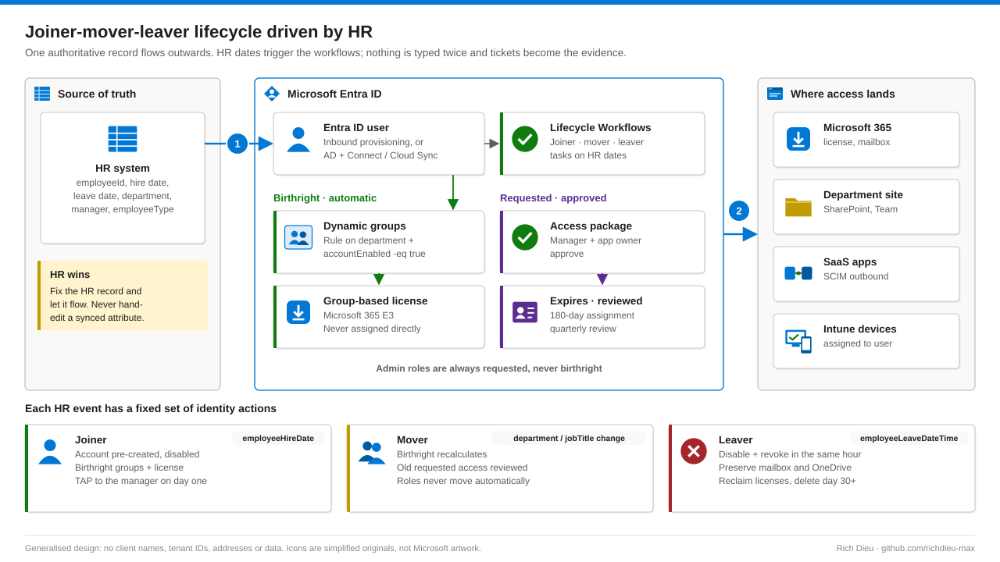
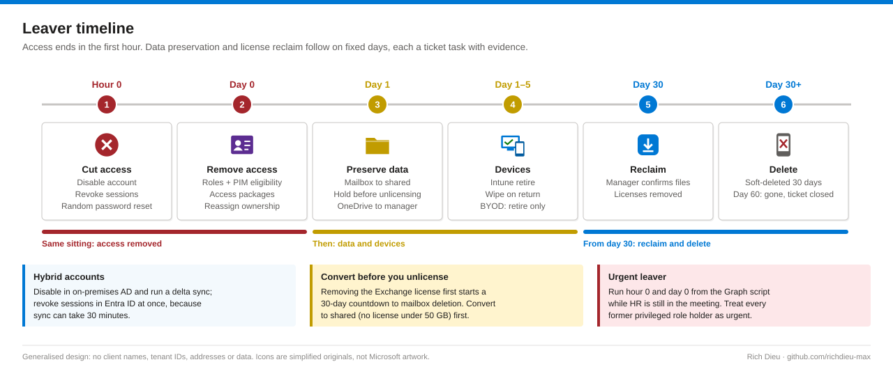

# SOP-ID-002 · Managing the joiner-mover-leaver account lifecycle in Microsoft Entra ID

Drive every account from the HR record: provision on hire with birthright access and a Temporary Access Pass, move access when the job changes, and on departure disable, revoke, recover data and reclaim licenses on a fixed timeline. Account management controls in every framework, from NIST AC-2 to SOX IT general controls, are tested at exactly these three moments.

**Family:** Identity and access · **Covers:** HR-driven attributes, birthright dynamic groups and licensing, manual and Lifecycle Workflow joiner, mover and leaver steps, the urgent leaver script and the quarterly stale-account review · **Does not cover:** Teams chat retention (governed by the tenant Purview policy) or device wipe approval (SOP-EM-003).

## How it fits together



The account follows the person, not the ticket. If HR and the directory disagree, HR wins: fix the HR record and let it flow, never hand-edit a synced attribute. Where users still sign in to on-premises AD, AD stays the identity source and HR feeds AD; cloud-only tenants are fed directly by HR-driven or API-driven inbound provisioning.

| Attribute | Purpose | Standard |
|---|---|---|
| `employeeId` | Joins HR record to account; never reused | HR employee number, immutable |
| `employeeHireDate` | Triggers joiner workflows | UTC date-time from HR |
| `employeeLeaveDateTime` | Triggers leaver workflows | UTC; needs `User-LifeCycleInfo.ReadWrite.All` or Lifecycle Workflows Administrator to write |
| `department`, `jobTitle`, `companyName` | Dynamic group rules; mover detection | HR code lists, not free text |
| `manager` | Approvals, TAP delivery, OneDrive access on leave | Reference to the manager's account |
| `employeeType` | Employees, contractors, interns | Employee, Contractor, Intern |

**Birthright** access (email, Teams, department site, standard license) follows attributes and disappears when they change. **Requested** access (a finance app, a project site, any admin role) comes from an access package with approval and an expiry. Admin roles are always requested, never birthright.

## Before you start

| Item | Requirement |
|---|---|
| Roles | User Administrator (Privileged Authentication Administrator for admins); Lifecycle Workflows Administrator; Identity Governance Administrator; Groups + License Administrator; Authentication Administrator for TAP; Exchange Administrator; Intune Administrator; delegated OU rights in AD for hybrid |
| Licensing | Entra ID P1 for dynamic groups, group licensing and sign-in activity. Lifecycle Workflows and full entitlement management need Entra ID Governance; access reviews and core access packages also come with P2 |
| HR agreement | Written JML standard: who triggers each event, notice periods, same-day leaver definition |
| Data | HR feed populating `employeeId`, `employeeHireDate`, `department`, `manager` and the leave date; attribute standard checked against a 50-account sample |
| Readiness | TAP enabled in the Authentication methods policy; retention decisions recorded with Legal / Records; ServiceNow New hire, Role change and Termination items carry leave date and time, manager and urgent flag; logs in Log Analytics for 90 days |
| Risk | Disable and revoke cut access at once (confirm with HR first). Removing licenses before converting the mailbox starts its deletion clock. Deletion is recoverable for 30 days only |

## Steps

### Birthright access

1. **Department dynamic group.** **Groups › All groups › New group**, Security, `GRP-Dept-Finance`, membership **Dynamic User**. **Validate Rules** against three members and one non-member before saving.

```text
(user.department -eq "Finance") -and (user.accountEnabled -eq true) -and (user.employeeType -eq "Employee")
```

   Every rule tests `accountEnabled`, so a disabled leaver drops out of every birthright group, losing licenses and site access without anyone touching the account.
2. **Group-based licensing.** **Billing › Licenses › All products › Microsoft 365 E3 › Assign** to `GRP-AllEmployees`; turn off unused service plans. Check **Licensed groups** for errors, then remove direct assignments. Map `usageLocation` from HR country first: licensing fails silently without it.

### Joiner

3. **Pre-hire check.** Verify the HR-created account (never create a second one): attributes populated, dynamic groups listed, license shows **Inherited**. Leave it disabled until the start date unless pre-hire access is approved.
4. **Day one.** Enable the account, then **Authentication methods › Add authentication method › Temporary Access Pass**, 8 hours, one-time use. Give it to the manager by phone or in person, never by email. The starter registers Authenticator or a passkey at `https://aka.ms/mysecurityinfo`, then signs in to Windows (SOP-EM-004). Record that a pass was issued, not its value.

### Mover

5. **Role change.** Confirm the new `department` and `jobTitle` have flowed (raise it with HR if not). Check old group gone, new one present. In **Entitlement management › Access packages**, ask the old manager what to keep and remove the rest. Check **Roles and administrators** and PIM eligibility: roles never move automatically. Movers who keep old access are the most common AC-2 audit finding.

### Leaver



6. **Hour 0, cut access.** Untick **Account enabled** (hybrid: disable in AD and run a delta sync). **Revoke sessions › Yes**. Reset the password to a random value nobody records. Note each time in the ticket.
7. **Day 0, remove access.** Remove active roles and PIM eligible assignments; remove access package assignments; reassign ownership of groups, enterprise apps and app registrations before removing the user. In Intune, retire each corporate device (wipe under SOP-EM-003); BYOD is retired, never wiped.
8. **Day 1, preserve data.** **Exchange admin center › Recipients › Mailboxes › Others › Convert to shared mailbox**, Full Access to the manager if HR agrees. Litigation hold on before any license removal if in scope. **Active users › OneDrive › Get access to files** for the manager. Never forward mail to a personal address.
9. **Day 30 onward.** Manager confirms files moved; remove licenses; delete the account (soft-deleted for 30 days).

### Automate the normal, script the urgent

10. **Lifecycle Workflows.** **ID Governance › Lifecycle workflows › Create workflow** from templates: WF-J1 pre-hire (hire date minus 7: TAP to manager), WF-J2 day one (enable, welcome, groups), WF-M1 job change (email both managers, ServiceNow review task), WF-L1 last day (disable, remove groups and Teams), WF-L2 post-offboarding (leave date plus 30: remove licenses, delete). Set a scope rule (an empty scope means every user), leave the schedule off, **Run on demand** for one test user, then enable. Workflows do not convert mailboxes, grant OneDrive access, retire devices or remove PIM eligibility: keep those as day-1 ticket tasks or a custom task extension.
11. **Urgent leaver.** A termination for cause runs the Graph script in the same hour, with PIM-activated roles and HR on the call. It writes a transcript, then removes roles, PIM eligibility (`adminRemove` schedule requests) and assigned cloud groups. Mail-enabled and distribution groups need Exchange Online or AD.

```powershell
Start-Transcript -Path ".\leaver-$(Get-Date -Format yyyyMMdd-HHmm).log"
if ($user.OnPremisesSyncEnabled) {
  Write-Warning "Hybrid account: disable in AD now and run a delta sync"
} else {
  Update-MgUser -UserId $user.Id -AccountEnabled:$false
}
Revoke-MgUserSignInSession -UserId $user.Id
Update-MgUser -UserId $user.Id -EmployeeLeaveDateTime (Get-Date).ToUniversalTime()  # lets WF-L2 run on day 30
```

12. **Quarterly review.** Export enabled members with no successful sign-in in 90 days (`signInActivity`, needs P1 and `AuditLog.Read.All`), no `employeeId`, or a past leave date. Each finding is kept (owner justifies, next review date), disabled (missed leaver, plus an HR data defect) or remediated (service or shared account to workload identity or shared mailbox). No response in 14 days means disable by default. Attach the CSV, decisions and an audit log extract to the review ticket.

## Verify

| Check | Pass |
|---|---|
| Joiner attributes | All populated from HR, no blanks |
| User › Groups and Licenses | Department and All employees groups; license inherited, no Direct |
| Leaver account | Account enabled: No; hybrid disabled in AD and synced |
| Audit log | Invalidate all refresh tokens within the hour 0 window |
| PIM › Assignments by user | None active, none eligible |
| `Get-Mailbox $upn \| fl RecipientTypeDetails,LitigationHoldEnabled` | SharedMailbox; hold as decided |
| Intune devices by user | None compliant and active |
| Lifecycle workflows › Workflow history | No failed tasks in the last 7 days |

## Rollback

| Situation | Action |
|---|---|
| Wrong person disabled | Re-enable (AD for hybrid); re-add requested access from the ticket. Birthright returns automatically |
| Deleted too early | Within 30 days: **Users › Deleted users › Restore user** or `Restore-MgDirectoryDeletedItem -DirectoryObjectId <id>` |
| HR changed the leave date | Update `employeeLeaveDateTime`; if WF-L1 already ran, re-enable and restore. Record HR's confirmation |
| Rule error removed a department | Revert the rule from the change record; **Pause processing** while fixing |

## Troubleshooting

| Symptom | Cause and fix |
|---|---|
| Leaver still reads mail on a phone | Sessions not revoked: revoke; continuous access evaluation applies within minutes |
| Hybrid leaver re-enabled after minutes | Still enabled in AD and sync overwrote it: disable in AD, delta sync |
| Workflow never ran for a user | Hire or leave date empty, or user outside scope: check attributes, **Run on demand**, fix the scope |
| No license on day one | `usageLocation` blank or group license in error |
| Mover keeps old department site | Access granted directly: grant sites only through birthright groups or access packages |
| Manager cannot open leaver's OneDrive | Manager attribute empty or retention expired: assign as SharePoint admin; increase retention |
| TAP rejected | Expired, used, or TAP not enabled for the user: issue a new pass, check the policy target group |

## Control mapping

| Framework | Reference | How this supports it |
|---|---|---|
| NIST SP 800-53 R5 | AC-2, AC-2(3), AC-2(4) | HR-driven account management; leavers disabled on time; actions audited |
| | AC-6 | Birthright plus approved, expiring requested access |
| | PS-4, PS-5 | Termination and transfer actions on a fixed timeline |
| SOX IT general controls | Logical access | Provisioning, timely termination, periodic access review |
| FDA 21 CFR Part 11 | §11.10(d), §11.300(b) | Access limited to authorised individuals; periodic checking of identification codes |
| ISO/IEC 27001:2022 | 5.16, 5.18, 6.5 | Identity management; access rights; responsibilities after termination or change |
