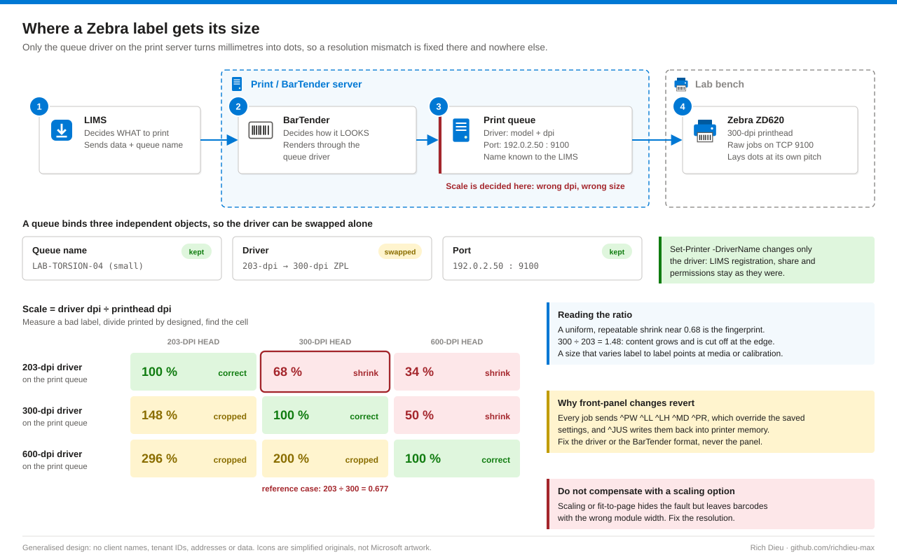
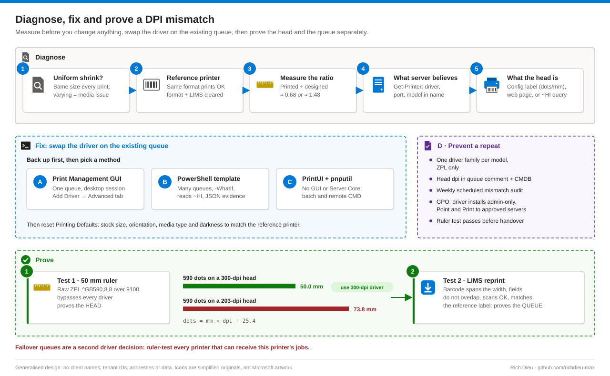

# SOP-LBL-001 · Fixing undersized labels caused by a Zebra driver DPI mismatch

Diagnose and correct a print queue whose driver resolution does not match the printhead, so labels print at 100 % again without re-registering the printer in the LIMS. A 203-dpi driver on a 300-dpi head shrinks every label to 68 %; the fix belongs on the print server, not on the printer panel.

**Family:** Label printing · **Covers:** diagnosis, four remediation methods (Print Management GUI, PowerShell template, PrintUI/pnputil, server standards with Group Policy), the 50 mm ruler test, rollback and failover parity · **Does not cover:** printer addressing (see SOP-LBL-002) or BarTender format design.

## How it fits together



A Windows print queue binds three independent objects: the **driver** (installed once per server), the **port** (Standard TCP/IP port holding the printer IP and raw port 9100) and the **queue name** the LIMS knows. Because they are independent, you can replace the driver without touching the name, port or permissions. Seagull and ZDesigner drivers both embed the resolution in the model name, so the queue's driver name tells you what the server believes. In the reference case the queue used a ZT620 (203 dpi) driver while the device at the port address was a ZD620 with a 300-dpi head; the fault was born when a relocation repointed the port but left the driver unchanged.



## Before you start

| Item | Requirement |
|---|---|
| Driver install | Local Administrators on the print / BarTender server (driver installation is admin-only since the 2021 Point and Print hardening). Use a separate admin account, checked out just in time from your PAM vault or Windows LAPS |
| Queue change | Manage Printers on the queue |
| Remote session | Remote Desktop Users, through the site's privileged remote access path (for example BeyondTrust PRA or a jump host) |
| Raw ZPL test | Network path from the server to the printer on TCP 9100 (no authentication exists on 9100, which is why printer VLANs should be segmented) |
| Method D | Edit rights on the target GPO, delegated on the server OU |
| Change | Approved change or incident (for example `CHG0012345`) and a maintenance window agreed with the lab: the swap briefly interrupts spooled jobs |
| Driver package | Extracted on the server, for example `C:\Drivers\ZD620\`. Seagull preferred on BarTender servers, ZDesigner acceptable, **ZPL variant only** |
| People | Someone at the printer with a ruler or calipers and a known-good reference label; the failover queue for this printer identified |
| Time and risk | About 30 minutes including tests · Low: queue name and port are preserved |

## Steps

### Diagnose

1. **Characterise the symptom.** Collect several defective labels. A uniform, repeatable shrink points at the driver; drifting position or random cropping points at media calibration.
2. **Compare with a reference.** Print the same label method on a known-good printer with the same stock. If it is correct, the format and the LIMS are cleared.
3. **Measure the ratio.** Divide a reference feature (barcode width, border) on the bad label by the good one. About 0.68 means a 203-dpi job on a 300-dpi head; about 1.48 means a 300-dpi job on a 203-dpi head (enlarged and cropped).
4. **Record what the server believes.**
   ```powershell
   Get-Printer -Name 'LAB-TORSION-04 (small)' | Format-List Name, DriverName, PortName, PrinterStatus
   Get-PrinterPort -Name (Get-Printer -Name 'LAB-TORSION-04 (small)').PortName |
     Format-List Name, PrinterHostAddress, PortNumber, SNMPEnabled
   ```
5. **Record what the printer is.** Identify the physical unit at that IP. A model mismatch between driver name and device (ZT620 against ZD620) is the first red flag.
6. **Confirm the head resolution** from any of: the configuration label (on a ZD620 hold **FEED + CANCEL** for two seconds; 8 dots/mm = 203 dpi, 12 = 300 dpi), the printer web page at `http://<printer-IP>`, or a `~HI` host identification query on port 9100, whose third reply field is dots per millimetre.

### Fix (pick one method; back up first)

7. **Method A · Print Management GUI.** In `printmanagement.msc`, right-click the server › **Export printers to a file…** and screenshot the queue's Advanced and Ports tabs. Right-click **Drivers › Add Driver…**, x64, **Have Disk…**, browse to the `.inf`, choose the matching model and resolution in the ZPL variant (for example `ZD620-300dpi (ZPL)`, never EPL). Then queue **Properties › Advanced › Driver**, select the new driver and **Apply**. Confirm the Ports tab still ticks the same port and the queue name is unchanged.
8. **Method B · PowerShell template.** `Repair-ZebraQueueDpi.ps1` reads the queue and port, asks the printer for its resolution with `~HI`, backs up the queue, finds or stages the matching ZPL driver (refusing EPL), runs `Set-Printer -DriverName`, optionally prints the ruler label and writes JSON evidence. Run it with `-WhatIf` first:
   ```powershell
   .\Repair-ZebraQueueDpi.ps1 -PrinterName 'LAB-TORSION-04 (small)' -ExpectedAddress '192.0.2.50' `
      -ModelPattern 'ZD620' -DriverInfFolder 'C:\Drivers\ZD620' -ChangeRef 'CHG0012345' -WhatIf
   .\Repair-ZebraQueueDpi.ps1 -PrinterName 'LAB-TORSION-04 (small)' -ExpectedAddress '192.0.2.50' `
      -ModelPattern 'ZD620' -ChangeRef 'CHG0012345' -SendRulerTest
   ```
   `Set-Printer` replaces only the driver reference; deleting and re-creating the queue would also fix the resolution but changes its identity and can break registrations and permissions.
9. **Method C · PrintUI and pnputil** (CMD, batch, Server Core). Back up with `PrintUIEntry /Ss`, stage with `pnputil /add-driver "C:\Drivers\ZD620\*.inf" /subdirs /install`, install with `PrintUIEntry /ia /m "ZDesigner ZD620-300dpi ZPL" /f <inf>`, point the queue with `PrintUIEntry /Xs /n "<queue>" DriverName "<model>"` and read back with `/Xg`. The model string must match the INF character for character. Before any bulk change, `PrintBrm.exe -B -F C:\Temp\server.printerExport` backs up every queue, driver and port.
10. **Reset Printing Defaults.** A newly assigned driver starts at factory defaults. Under **Advanced › Printing Defaults…** set stock size (for example 2.0 × 1.0 in), orientation, media type and darkness to match the reference printer. Do not use scaling or "fit to page" to compensate: barcodes end up with the wrong module width.

### Prevent (Method D)

11. **Server standards.** One driver family per model (Seagull on BarTender servers), head resolution in the queue comment (`Set-Printer -Comment 'ZD620 · 300 dpi · 2x1 in stock'`) and on the asset label, a Print Management custom filter on Driver Name "contains 203", a weekly scheduled audit comparing driver dpi with `~HI` results, and no queue released after a move until the ruler test passes.
12. **Group Policy.** Under **Computer Configuration › Administrative Templates › Printers** enable **Limits print driver installation to Administrators**; configure **Point and Print Restrictions** and **Package Point and print - Approved servers** with your print servers (for example `srv-print-01.contoso.com`); deploy shared queues through Group Policy Preferences or **Deploy with Group Policy…** so workstations always use the server driver. Confirm with `gpresult /h C:\Temp\gp.html`.

## Verify

| Check | Pass |
|---|---|
| Test 1 · 50 mm ruler (proves the head) | Raw ZPL `^XA^FO30,30^GB590,8,8^FS^FO30,60^A0N,40,40^FDLINE = 50MM IF 300DPI^FS^XZ` sent to 192.0.2.50:9100 prints a 50.0 mm bar (300 dpi). About 73.8 mm means a 203-dpi head. Dots = mm × dpi ÷ 25.4 |
| Test 2 · LIMS reprint (proves the queue) | Barcode spans the intended width, no overlapping fields, label sits within the stock, scans with the lab handheld, outline matches the reference label |
| Final queue state | `Get-Printer` shows the new driver, the original port, status Normal |
| Failover parity | Every queue that can receive this printer's jobs (redirects, LIMS fallbacks, pooled ports) passes the ruler test against its own printer |
| Evidence | Before/after screenshots or evidence JSON, photos of the configuration label (12 dots/mm), the ruler label with a ruler and the LIMS label beside the reference, acceptance by role in the ticket |

## Rollback

The old driver stays in the driver store, so the swap is reversible. GUI: reselect the previous driver on the Advanced tab, or **Import printers from a file…**. PowerShell: `Set-Printer -DriverName` with `DriverBefore` from the evidence JSON. PrintUI: `PrintUIEntry /Sr /n "<queue>" /a "C:\Temp\CHG0012345-queue.dat"`. Whole server: `PrintBrm -R -F C:\Temp\server.printerExport`. Rollback restores the defect, so use it only if the new driver causes a worse problem, and open a problem record.

## Troubleshooting

| Symptom | Cause and fix |
|---|---|
| Uniform shrink to about 68 % | 203-dpi driver on a 300-dpi head. Install and assign the 300-dpi ZPL driver |
| Content too large, cropped right and bottom | 300-dpi driver on a 203-dpi head (ratio about 1.48). Assign the 203-dpi driver |
| Correct size but shifted, or across two labels | Printing defaults reset by the new driver, or media not calibrated. Set stock in Printing Defaults; on a ZD620 hold **PAUSE + CANCEL** for two seconds for SmartCal |
| Front-panel changes revert | Job commands (`^PW`, `^LL`, `^MD`, `^JUS`) override saved settings. Fix the driver or the BarTender format |
| "The specified driver does not exist in the driver store" | INF not staged, or model name does not match the INF. Stage with `pnputil /add-driver … /install`, copy the model string from the INF |
| Ruler test prints nothing | Port 9100 blocked, wrong IP or printer paused. `Test-NetConnection 192.0.2.50 -Port 9100` |
| Ruler label prints garbage text | Printer in EPL or line-print mode. Check the command language on the configuration label; restore ZPL |
| `~HI` gets no reply | Host queries ignored or 9100 filtered. Fall back to the configuration label |

## Control mapping

| Framework | Reference | How this supports it |
|---|---|---|
| NIST SP 800-53 R5 | CM-3 Configuration change control | Driver swap runs under an approved change with before/after evidence |
| | CM-2, CM-6 | One driver family and resolution recorded per queue; scheduled mismatch audit |
| | CM-11 User-installed software; CM-5 | Driver installation restricted to administrators by Group Policy |
| | AC-6 Least privilege; AC-17 | Admin rights checked out for the change only, sessions through the privileged access path |
| | CP-10 Recovery | Exported queue configuration and stored settings allow rollback |
| | SC-7 Boundary protection | Unauthenticated port 9100 kept inside segmented printer VLANs |
