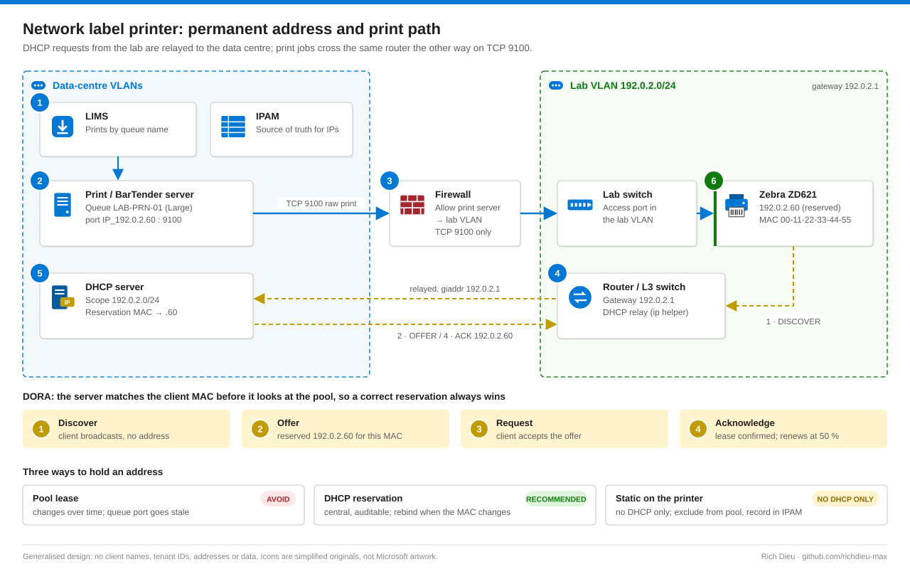
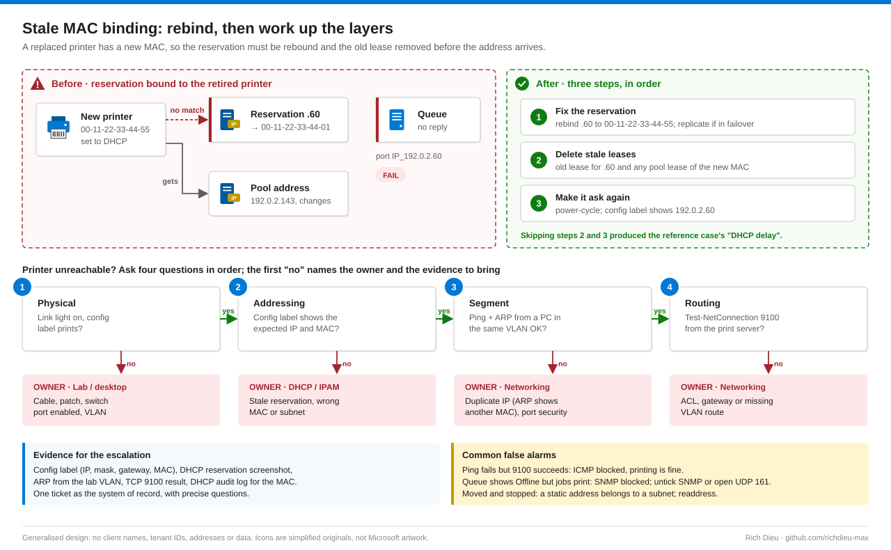

# SOP-LBL-002 · Static IP reservation and network label printer integration

Give a network label printer an address that never changes, then connect it to a Windows print queue, BarTender and the LIMS. The queue points at a TCP/IP port holding an IP address, so if the printer's address moves, every job goes into the void.

**Family:** Label printing · **Covers:** DHCP console reservation (Method A), the DhcpServer PowerShell template (Method B), a static address on the printer (Method C), queue, BarTender and LIMS integration (Method D), layer-by-layer verification and escalation · **Does not cover:** driver resolution (see SOP-LBL-001) or firewall and VLAN changes, which Networking makes.

## How it fits together



A **DHCP reservation** ("always give this MAC this IP") keeps gateway, mask and DNS coming from the scope and leaves a central, auditable record: use it for every queue target. A **static address** on the printer is the fallback where no DHCP exists; it is invisible to DHCP unless excluded from the pool and breaks when the printer changes subnet. A pool lease is never acceptable. Where IPAM is the source of truth, request the address there.

The router relays the printer's DHCP broadcast (`ip helper-address`), stamping its interface address (giaddr) to select the scope; the server matches the MAC before the pool, so a correct reservation always wins.

**Why replacements break:** leases and reservations outlive hardware. A replacement has a new MAC, finds no matching reservation and takes a pool address, while the queue points at the reserved address where nothing answers. In the reference case the address was still bound to a retired printer, and every team's own check came back "looks fine".



## Before you start

| Item | Requirement |
|---|---|
| DHCP | DHCP Users to diagnose; DHCP Administrators (or a delegated group, not Domain Admins) to change reservations and leases; RSAT DHCP tools. Where IPAM is the source of truth, change it there |
| Port and queue | Local Administrators on the print / BarTender server (driver installation is admin-only since the 2021 Point and Print hardening) |
| Static on the printer | Physical access or the printer's web admin password; change default printer passwords before production |
| Other teams | Networking for firewall and VLAN changes (you supply source, destination, port, justification); BarTender and LIMS administrators for registration |
| Privilege | DHCP and print-server admin rights held only for the change window |
| Checklist | Approved request (for example `CHG0012345`); the MAC **read from the printer's configuration label**, not the box or a spreadsheet; subnet, gateway and VLAN for an enabled port; a free address with no existing reservation or lease; firewall rule print server → printer TCP 9100; the correct ZPL driver; someone at the printer |
| Time and risk | About 30–60 minutes plus approval lead time · Low, one device; address conflicts possible |

## Steps

### Method A · DHCP console reservation

1. **Check what already holds the address.** In `dhcpmgmt.msc` open **DHCP › &lt;server&gt; › IPv4 › Scope [192.0.2.0] › Address Leases**, sort by IP and find 192.0.2.60: note its Unique ID (MAC). Open **Reservations**: a reservation for 192.0.2.60 with a different MAC is the stale binding. Search the leases for the new printer's MAC; if it holds a pool address, you can reach the printer there during the change.
2. **Back up.** Right-click the server › **Backup…**, or export the scope with PowerShell (Method B, stage 1).
3. **Correct or create the reservation.** For a stale one, right-click › **Properties** and replace the MAC, or delete and recreate it. To create: right-click **Reservations › New Reservation…**, name it after the queue (for example `LAB-PRN-01`), enter the IP, MAC, a description with the change number, supported types **Both** (some printers try BOOTP first), then **Add**.
4. **Delete stale leases.** In **Address Leases**, delete the old entry for 192.0.2.60 and any pool lease held by the new MAC.
5. **Replicate.** If the scope is in a failover relationship, right-click the scope › **Replicate Scope**. Reservations are not synchronised to the partner automatically.
6. **Make the printer ask again.** Power-cycle it (a device only runs DORA when it boots, renews or its lease is rejected). Within a minute 192.0.2.60 shows the new MAC with the reservation icon, and the configuration label reports 192.0.2.60 with the correct mask and gateway.

### Method B · DhcpServer PowerShell template

7. **Run `Set-PrinterReservation.ps1`.** It inspects reservations and leases for both the IP and the MAC (stage 0), exports the scope and leases to XML (1), removes a reservation or lease binding the IP to another MAC and any pool lease of the new MAC (2), adds the reservation with type Both and replicates to the failover partner (3), and writes JSON evidence (4). Run with `-WhatIf` first, then again without it once the output matches the plan, then power-cycle the printer.
   ```powershell
   .\Set-PrinterReservation.ps1 -DhcpServer srv-dhcp-01.contoso.com -ScopeId 192.0.2.0 -IPAddress 192.0.2.60 `
      -MacAddress 00:11:22:33:44:55 -Name 'LAB-PRN-01' -ChangeRef CHG0012345 -WhatIf -Verbose
   ```
   The DHCP audit log `%windir%\System32\dhcp\DhcpSrvLog-<Day>.log` shows whether the printer ever asked: event IDs 10 (new lease), 11 (renewal), 13 (address in use), 14 (pool exhausted), 15 (lease denied). Search for the MAC without separators.

### Method C · Static address on the printer

8. **Only where there is no DHCP** or Networking requires it. Record the address in IPAM and exclude it from every DHCP pool, or a conflict will follow.
9. **Set it.** Front panel (IP protocol **Permanent**, then address, mask, gateway; menus vary by model), the web page **View and Modify Printer Settings › Network Communications Setup › TCP/IP Settings**, or Zebra Setup Utilities over USB. Power-cycle and print the configuration label. To script it, send Set-Get-Do (SGD) commands to the printer's current address on port 9100:
   ```powershell
   $current = '192.0.2.143'   # address the printer has now
   $sgd = @'
   ! U1 setvar "internal_wired.ip.protocol" "permanent"
   ! U1 setvar "internal_wired.ip.addr" "192.0.2.60"
   ! U1 setvar "internal_wired.ip.netmask" "255.255.255.0"
   ! U1 setvar "internal_wired.ip.gateway" "192.0.2.1"
   ! U1 do "device.reset" ""
   '@
   $c = [System.Net.Sockets.TcpClient]::new($current, 9100)
   $b = [Text.Encoding]::ASCII.GetBytes($sgd + "`r`n"); $c.GetStream().Write($b, 0, $b.Length); $c.Close()
   Start-Sleep 45; Test-Connection 192.0.2.60 -Count 4
   ```
   The `internal_wired.ip.*` names apply to the built-in wired print server on Link-OS printers; check the Zebra SGD reference for your firmware and keep someone at the printer.

### Method D · Queue, BarTender and LIMS (every method finishes here)

10. **Create the port and queue.** `New-LabelPrinterQueue.ps1` (elevated, on the print / BarTender server) tests TCP 9100, adds port `IP_192.0.2.60` with `Add-PrinterPort`, checks the driver exists (it must match the printhead resolution) and creates the queue with `Add-Printer`, for example `LAB-PRN-01 (Large)` with driver `ZDesigner ZD621-203dpi ZPL`. GUI: **Print Management › Print Servers › &lt;server&gt; › Ports › Add Port… › Standard TCP/IP Port** (192.0.2.60, Generic Network Card, raw 9100), then **Printers › Add Printer… › Add a new printer using an existing port**.
11. **Address change only?** Keep the queue: `Add-PrinterPort` for the new address, then `Set-Printer -Name '<queue>' -PortName 'IP_<new address>'`. The queue name, and every BarTender and LIMS reference, stays the same.
12. **BarTender and LIMS.** Print a test format and confirm driver and stock under **File › Print › Document Properties**; confirm any Integration Builder or print-server service lists the queue. The LIMS administrator registers the exact queue name. Print one label from each with the lab present.

## Verify

| Check | Pass |
|---|---|
| Configuration label | Assigned IP, mask, gateway and the expected MAC |
| DHCP (Methods A/B) | Reservation shows the printer's MAC and an active lease |
| ARP from a PC in the same VLAN | `Get-NetNeighbor -IPAddress 192.0.2.60` maps the IP to the printer's MAC (from another VLAN you only see the router's MAC) |
| Raw port from the print server | `Test-NetConnection 192.0.2.60 -Port 9100` returns `TcpTestSucceeded : True` |
| DNS (if requested) | `Resolve-DnsName LAB-PRN-01.contoso.com` resolves |
| Labels | Test labels from BarTender and the LIMS are correct and accepted by the lab |

## Rollback

| Change | Rollback |
|---|---|
| Reservation (A/B) | Remove the new reservation and re-add the previous binding from the evidence JSON, or restore the exported scope with `Import-DhcpServer … -ScopeOverwrite` |
| Static on printer (C) | Set IP protocol back to DHCP (or All) on the panel or web page, or send `! U1 setvar "internal_wired.ip.protocol" "dhcp"` and reset |
| Port / queue (D) | `Set-Printer -PortName` back to the previous port; `Remove-Printer` / `Remove-PrinterPort` only for queues that never went live |

## Troubleshooting

Work up the layers (physical, addressing, segment, routing); the first failing check names the owning team. Escalate in one ticket with the evidence for every layer already cleared and precise questions: DHCP log and relay for the MAC, ARP / MAC table on the gateway and switch, any ACL blocking TCP 9100.

| Symptom | Cause and fix |
|---|---|
| Reservation correct, printer still unreachable | Stale lease still held, or the printer has not renewed. Delete the lease, power-cycle, check the DHCP log for event 10 from its MAC |
| Configuration label shows a pool address | Reservation names a different MAC (typo, old printer, wireless instead of wired MAC). Rebind to the MAC on the label |
| Label shows 0.0.0.0 or 169.254.x.x | No DHCP reply: VLAN mismatch, relay missing on the gateway, MAC filter, or pool exhausted (event 14) |
| ARP shows a different MAC | IP conflict. Find the other device (switch MAC table), move it, exclude the address from the pool |
| Ping fails, TCP 9100 succeeds | ICMP blocked by firewall policy. Printing is fine; record it |
| Ping OK, TCP 9100 fails | Firewall or ACL allows ICMP but not 9100, or the printer's raw port was changed. Check the configuration label |
| Queue shows Offline, jobs print | SNMP status enabled but SNMP blocked. Untick SNMP on the port (**Printer properties › Ports › Configure Port**) or open UDP 161 |
| Printer moved and stopped working | Static address from the old subnet (IP protocol Permanent). A static address belongs to a subnet: readdress it and update the queue port |

## Control mapping

| Framework | Reference | How this supports it |
|---|---|---|
| NIST SP 800-53 R5 | CM-3 Configuration change control | Reservation and queue changes run under an approved change with backup and JSON evidence |
| | CM-8 System component inventory | Every assignment recorded in IPAM / CMDB; the MAC read from the device |
| | AC-6 Least privilege | DHCP Administrators rather than Domain Admins, held only for the change window |
| | SC-7 Boundary protection | Firewall allows the print server to the lab VLAN on TCP 9100 only |
| | CP-9, CP-10 | Scope export and evidence allow the previous binding to be restored |
