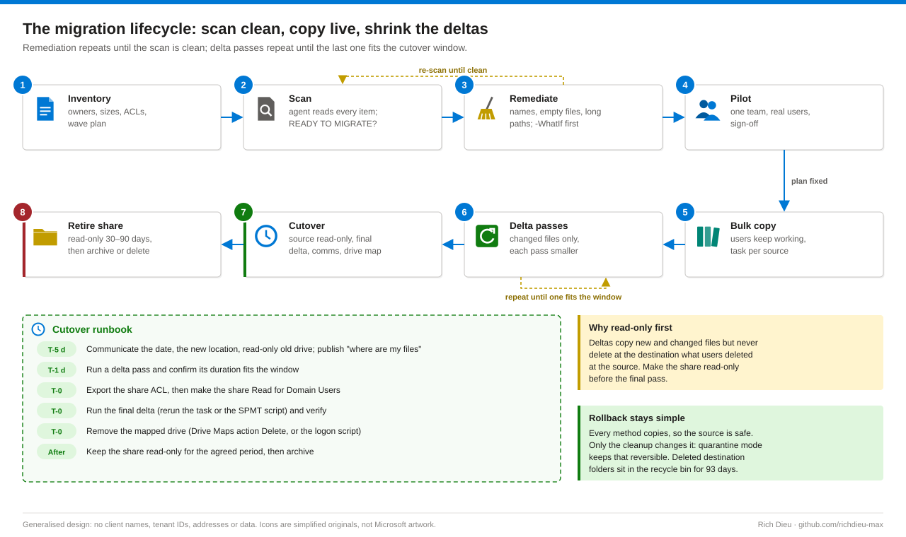

# SOP-M365-001 · Migrating file shares to Teams and SharePoint

Scan, remediate, migrate and cut over Windows file shares into Teams channels with Migration Manager or the SharePoint Migration Tool (SPMT), leaving the old share read-only. It is a change of storage platform, not a copy job: SharePoint Online has its own naming rules, path limits and permission model, and most problems come from the gap between that and NTFS.

**Family:** Microsoft 365 · **Covers:** Migration Manager (Method A), SPMT desktop (Method B), SPMT PowerShell driven by a CSV (Method C), the OneDrive sync anti-pattern (Method D), scripted pre-migration cleanup, delta passes, cutover and rollback · **Does not cover:** OneDrive personal data or tenant-to-tenant moves.

## How it fits together


**Teams stores no files.** Each team's Microsoft 365 group owns a SharePoint site whose **Documents** library (`Shared Documents`) holds one folder per standard channel; private and shared channels get their own site and membership. Access follows team membership, and `https://contoso.sharepoint.com/sites/ContosoIT/Shared Documents/Infrastructure/Projects/` already uses 87 of the 400 path characters allowed.

**Migration Manager** runs **scans** (what would fail or change) and **tasks** (one source to one destination, re-runnable as deltas) from the SharePoint admin center. A Windows agent on the file server's LAN reads over SMB, polls over HTTPS 443 and uploads through Azure storage; no inbound rule is needed, and upload bandwidth is usually the bottleneck.

**What SharePoint rejects** (`INVALID_SHAREPOINT_NAME`): `.lock`, `CON`, `PRN`, `AUX`, `NUL`, `COM0`–`COM9`, `LPT0`–`LPT9`, `desktop.ini`, any name containing `_vti_`, names beginning `~$`, and leading or trailing spaces. Paths may not exceed 400 decoded characters; files may not exceed 250 GB. Zero-byte files (`ITEM_IS_EMPTY`) and hidden files such as `Thumbs.db` are debris to remove first.

**Permissions:** leave **Preserve file share permissions** off; copied ACLs become thousands of unique item permissions. Re-express access as team membership, private channels or a separate team, and preserve ACLs only for a plain SharePoint site where the business requires it, documenting why.

## Before you start

| Item | Requirement |
|---|---|
| Cloud roles | SharePoint Administrator for Migration Manager (Global Administrator is excessive); Teams Administrator or team Owner for teams and channels; Global Reader for review only |
| SPMT (Methods B, C) | Site Owner on each destination site (site collection admin recommended); no tenant role |
| Agent / SPMT server | Local Administrator; a dedicated service account (not a person) with share Read and NTFS Read & execute on every source path. A folder it cannot read silently becomes a failure line |
| Cleanup script | NTFS Modify on the source folders |
| Cutover | Local Administrator on the file server and Group Policy edit rights on the OU, change window only |
| Privilege | Admin roles eligible in PIM, activated with MFA and the change number; agent password in the vault |
| Checklist | Approved change and wave plan (share → team, channel, folder); channels created and each Files tab opened once; 64-bit agent machine on the LAN with .NET Framework 4.6.2+; outbound 443 with TLS inspection bypassed; Entra Connect sync if user mapping is used; storage quota; installers, ISO and PST files sent to archive |
| Time and risk | Pilot about 1 day, bulk depends on volume · Low risk to source data: copy only, and only the cleanup deletes junk files |

## Steps

### Method A · Migration Manager (preferred beyond a handful of folders)

1. **Confirm the agent.** Activate your PIM role, then **Admin centers › SharePoint › Migration › File shares › View tasks**. The banner must read **Agent connected**. To add one: **Download agent**, run it as local administrator, sign in as SharePoint Administrator, enter the service account and use the UNC test.
2. **Scan each source.** **Scans › + Add source path › Specify a single source path** (for example `\\fileserver01\share\Projects`), or **Upload a CSV file** for many. Clear **Add all subfolders as source paths** unless each subfolder goes to a different destination. Keep **Automatically scan content** and **Add**. Wait for **READY TO MIGRATE**; **MIGRATION WARNINGS FOUND** means remediate first.
3. **Remediate.** **Download scan log**, save it to the evidence folder, filter `ResultCode` to non-blank rows and note the path and result-code column headers. Run the cleanup template: it reads the scan log, removes junk names and zero-byte files, renames fixable names, flags the rest **ManualReview**, can move items to a quarantine share instead of deleting, and writes a CSV of every action. Review the `-WhatIf` output, especially every ManualReview line, with the data owner, then re-scan.
   ```powershell
   .\Invoke-PreMigrationCleanup.ps1 -ScanLog '.\Projects - Scan Log.csv' -WhatIf
   .\Invoke-PreMigrationCleanup.ps1 -ScanLog '.\Projects - Scan Log.csv' `
       -QuarantineRoot '\\fileserver01\quarantine\CHG0012345' -Confirm:$false
   ```
   Address names with trailing spaces or dots through the `\\?\UNC\fileserver01\share\...` prefix. Find long paths early by measuring each item's future URL and agreeing shorter names with the owner.
4. **Create and run the task.** **Migrations › + Add task** (or **Copy to migrations** from a clean scan). Choose **Single source and destination**, or **Bulk migration** with a CSV / JSON file (six columns, no header: source path, two blanks, destination site URL, library, subfolder). Destination **Teams**, then the team and channel; to land in a subfolder use the arrow next to the channel › **Create folder**. Name the task with the change number, **Run now** or **Run later**, keep the default agent group, leave **Preserve file share permissions** cleared, review **All settings** (file-age filters, excluded extensions), then **Run**. For a delta pass select the completed task › **Run again** or **Schedule**: only new or changed files copy.

### Method B · SPMT desktop

5. **Run the wizard.** Install SPMT near the file server, sign in as Site Owner, **Start your first migration › File share**, then the UNC path, site URL (`https://contoso.sharepoint.com/sites/ContosoIT`), **Documents** and the channel folder. In **View all settings** keep hidden files and permission preservation off, exclude `.tmp, .lnk`, keep incremental on. **Migrate** and review the failure report; rerun for a delta. **Scan only** reports without an agent.

### Method C · SPMT PowerShell, CSV-driven

6. **Turn the wave plan into a change.** `Start-ShareToTeamsMigration.ps1` validates every source in `wave1-map.csv` (`Source,TargetSiteUrl,TargetList,TargetFolder`), runs `Register-SPMTMigration` with hidden items off and `tmp,lnk` skipped, adds one `Add-SPMTTask` per row, runs `Start-SPMTMigration` and writes JSON evidence. Run it in Windows PowerShell 5.1 on the SPMT machine; options vary by SPMT release, so check `Get-Help Register-SPMTMigration -Full`, and where MFA or Conditional Access applies use the modern-authentication sign-in your release supports.
   ```powershell
   .\Start-ShareToTeamsMigration.ps1 -MappingCsv .\wave1-map.csv -ChangeRef CHG0012345 -WhatIf
   .\Start-ShareToTeamsMigration.ps1 -MappingCsv .\wave1-map.csv -ChangeRef CHG0012345 -ScanOnly
   .\Start-ShareToTeamsMigration.ps1 -MappingCsv .\wave1-map.csv -ChangeRef CHG0012345
   # cutover night: same command again = incremental (delta) pass
   ```

### Method D · OneDrive sync (contrast only)

7. **Avoid.** Robocopy into a synced folder loses authors and timestamps, is throttled, has no report and can strand files on the server's disk. Only for a few gigabytes when every tool is blocked.

### Pilot and cutover

8. **Pilot, then bulk.** Pilot one share with a small team (edit, co-author, links, sync) and fix what breaks. Copy the bulk while users work, then run deltas until one fits the window.
9. **Cut over.** T-5 days: announce the date, new location and read-only old drive, publish a "where are my files" guide. T-1: run a delta and time it. T-0: make the share read-only, run the final delta, verify, then remove the mapped drive (the Group Policy **Drive Maps** item's action to **Delete**, or the logon script). Keep the share read-only for the agreed 30–90 days, then back up and archive or decommission. Deltas never delete destination files that users deleted at the source, which is why the share goes read-only first.
    ```powershell
    Get-SmbShareAccess -Name 'Projects' | Export-Csv .\Projects-share-acl-before.csv -NoTypeInformation
    Revoke-SmbShareAccess -Name 'Projects' -AccountName 'CONTOSO\Domain Users' -Force
    Grant-SmbShareAccess  -Name 'Projects' -AccountName 'CONTOSO\Domain Users' -AccessRight Read -Force
    ```



## Verify

| Check | Pass |
|---|---|
| Task status | Complete for every source in the wave; final delta finished inside the window |
| Summary report | Items scanned = migrated + skipped by design; failure report reviewed and every remaining failure explained |
| Cleanup evidence | CSV attached to the change |
| Counts | Source file count and size (`Get-ChildItem -Recurse -File` measured) match the library's **Site settings › Storage metrics** or the summary report, with differences from cleanup and excluded extensions recorded |
| User checks | Random files open and co-author in Teams; folder structure matches; modified dates and authors preserved; only team members can open the channel files |
| Source | Share is read-only |

## Rollback

| Situation | Action |
|---|---|
| Bulk copy wrong or incomplete | Delete the destination folder (it stays in the site recycle bin for 93 days), fix the mapping, run again |
| Cutover abandoned | Restore share permissions from the exported ACL with `Grant-SmbShareAccess`, re-enable the drive map, tell users to keep using the share |
| Cleanup removed something needed | Move it back from the quarantine share (path structure preserved), or restore from file-server backup |
| Permissions wrong in Teams | Fix team membership or move content to a private channel; do not break inheritance on individual files |

## Troubleshooting

Work in order: is the agent offline, is access denied, is a name or path bad, is the task throttled? Fix, then rerun the task, which copies only failed or changed items.

| Symptom | Cause and fix |
|---|---|
| Status Failed with a failure report link | Download the report ZIP; `FatalError_R1.csv` holds task-level errors, item reports hold per-file errors. Fix and rerun |
| Agent Disconnected or with warnings | Service stopped, service-account password changed, or proxy blocking 443. Restart, update credentials, check the proxy bypass |
| "Access denied" to source | Agent account lacks share or NTFS Read on a subfolder with broken inheritance. Grant Read, rescan |
| Channel missing as a destination | Channel folder not provisioned: open its Files tab once. Private channels must be chosen as their own site |
| `INVALID_SHAREPOINT_NAME` / `ITEM_IS_EMPTY` | Reserved names, `~$` files, `_vti_`, leading or trailing spaces, zero-byte files. Run the cleanup script, or accept empties as skipped |
| Path too long | Over 400 characters. Migrate the subtree to a shallower folder or shorten names with the owner |
| Very slow progress | SharePoint throttling or limited upload bandwidth. Add agents, split tasks, run outside business peaks |
| Migration account shown as author | Identity not found in Entra ID. Check Entra Connect sync or supply a user mapping file |

## Control mapping

| Framework | Reference | How this supports it |
|---|---|---|
| NIST SP 800-53 R5 | CM-3 Configuration change control | Approved change and wave plan; `-WhatIf` runs and CSV / JSON evidence for every cleanup and migration action |
| | AC-2, AC-6 | Admin roles eligible in PIM and activated per change with MFA; dedicated agent account with Read only, removed after decommissioning |
| | AC-3 Access enforcement | Access re-expressed as team, channel and private-channel membership instead of copied item ACLs |
| | SC-7 Boundary protection | Agent initiates every connection; SMB stays on the LAN and no inbound rule is opened |
| | CP-9, CP-10 | Source kept read-only for 30–90 days, quarantine instead of delete, recycle bin and exported share ACL for recovery |
