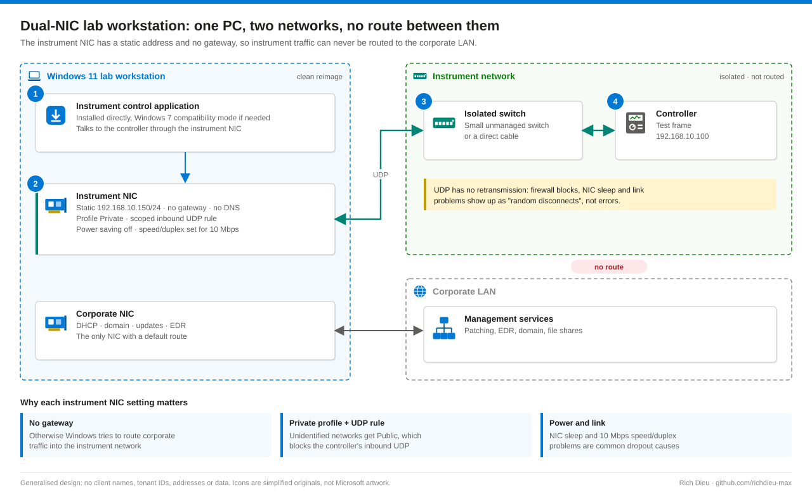
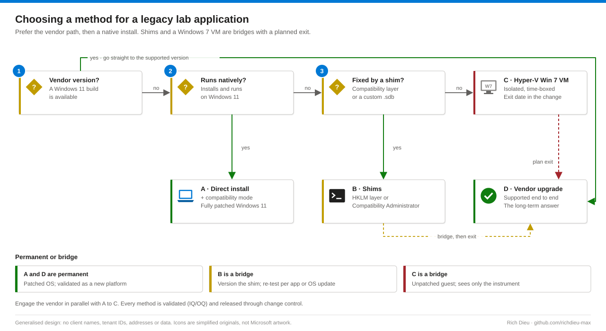

# SOP-LAB-001 · Modernizing a Windows 7 lab application onto Windows 11

Move an instrument-control application off an end-of-life OS in a regulated lab, with a validated instrument network and IQ/OQ evidence. Windows 7 has had no security fixes of any kind since paid ESU ended in January 2023, so a lab PC still running it is both a security exposure and an open compliance finding.

**Family:** Regulated lab IT · **Covers:** a dual-NIC Windows 11 workstation with an isolated instrument network, four delivery methods (direct install with compatibility mode, compatibility shims, an isolated Hyper-V Windows 7 VM, the vendor upgrade), OQ link testing, rollback · **Does not cover:** the change-control record itself (SOP-GOV-001).

In the reference engagement, AMTI NetControl controlled orthopaedic test frames and had only been qualified on Windows 7. Earlier Windows 10 attempts launched but kept dropping the connection. On a clean Windows 11 build with the instrument network configured deliberately, a direct install held the link through extended sessions and no VM was needed.

## Shape



## Choosing a method



| Method | Security posture | Validation effort | Longevity |
|---|---|---|---|
| A · Direct install | Fully patched Windows 11 | IQ/OQ of new platform | Until the app breaks on a future update |
| B · Shims | Fully patched; shim reviewed | As A, plus the shim as configuration | Re-test per app/OS update |
| C · Hyper-V VM | Unpatched guest, isolated | IQ/OQ of host and VM | Bridge only; set an exit date |
| D · Vendor upgrade | Supported end to end | Full change incl. data formats | Long term |

## Before you start

| Item | Requirement |
|---|---|
| Change | Approved change request and validation plan with acceptance criteria, for example *no dropouts during a 10-minute continuous control session*. Assign change-owner rights early: their absence was the first blocker in the reference case. Split the work into small, separately approved changes |
| Access | Local Administrators on the lab PC (LAPS-managed or time-bound); endpoint/imaging team for domain removal and reimage via the ITSM portal; Hyper-V Administrators for day-to-day VM management; vendor sessions through the recorded privileged remote access gateway, approved in advance |
| Reference system | A workstation still on the old OS, left untouched until OQ passes |
| From the old PC | Instrument IP, mask, controller address and the UDP ports the application uses |
| Media | Original installer, licence and any dongle; vendor OS support statement; approved Windows 11 Enterprise image; a second NIC |
| Hyper-V (Method C) | Windows 11 Pro, Enterprise or Education with hardware virtualization enabled in firmware |

## Steps

### Common foundation

1. **Reimage.** Request decommission and reimage through the ITSM portal (justification *legacy instrument software qualification on Windows 11*); remove the PC from the domain first so the build starts with a fresh computer object. Confirm a clean first boot, enrolled in endpoint management, current cumulative update installed.
2. **Name the NICs.** Rename them `Corporate` and `Instrument` so scripts and evidence are unambiguous.
3. **Instrument NIC.** Static address, **no gateway, no DNS**. A gateway here makes Windows route corporate traffic into the instrument network. If **Settings › Network & internet › Ethernet › IP assignment › Edit** says *Can't save IP settings*, use `ncpa.cpl` or PowerShell.
4. **Profile, firewall, power.** Windows sees the instrument network as Unidentified and applies the Public profile, which blocks inbound UDP. Set it Private, add a scoped UDP rule, and disable NIC power saving. For a 10 Mbps controller, set speed and duplex explicitly (`Get-NetAdapterAdvancedProperty -Name Instrument`).

These lines from the base template `Initialize-LabInstrumentPC.ps1` (run elevated, with `-WhatIf` first) carry the key settings; the template also writes an IQ evidence bundle with a hash of every file:

```powershell
New-NetIPAddress -InterfaceAlias $alias -IPAddress $InstrumentIp -PrefixLength $PrefixLength | Out-Null   # no -DefaultGateway
Set-DnsClientServerAddress -InterfaceAlias $alias -ResetServerAddresses
Set-DnsClient -InterfaceAlias $alias -RegisterThisConnectionsAddress $false
Set-NetConnectionProfile -InterfaceAlias $alias -NetworkCategory Private
$rule = @{ DisplayName = "Instrument UDP ($ChangeRef)"; Direction = 'Inbound'; Protocol = 'UDP'
           InterfaceAlias = $alias; RemoteAddress = $ControllerIp; Action = 'Allow'; Profile = 'Any' }
if ($UdpPorts) { $rule.LocalPort = $UdpPorts } else { $rule.Program = $AppExe }
New-NetFirewallRule @rule | Out-Null
Disable-NetAdapterPowerManagement -Name $alias
powercfg /change standby-timeout-ac 0          # no sleep during long tests
```

If Group Policy forces unidentified networks to Public or ignores local firewall rules, ask the endpoint team for an exception or a centrally deployed rule.

### Method A · Direct install

5. **Install.** Copy the installer locally (some legacy installers fail on UNC paths) and run it as administrator. If it refuses or fails, **Properties › Compatibility › Run this program in compatibility mode for › Windows 7** and run it again. Use the same options and path as the reference system; record installer name, version and hash.
6. **Launch and configure.** If the program misbehaves, apply compatibility mode to the executable too (for production, use the all-users setting in Method B). Restore station definitions, calibration files and test programs through the lab's controlled document process, then run the OQ.

### Method B · Shims at scale

7. **All-users layer.** Write `~ WIN7RTM` under `HKLM:\SOFTWARE\Microsoft\Windows NT\CurrentVersion\AppCompatFlags\Layers`, value name = full path to the executable. Avoid `RUNASADMIN` unless the vendor requires it, and record it in the risk assessment.
8. **Custom shim database.** In Compatibility Administrator (Windows ADK; 32-bit edition for 32-bit apps): **Custom Databases › New Database › Fix › Create Application Fix…**, choose Windows 7 mode plus specific fixes such as `CorrectFilePaths` or `VirtualRegistry`, test, save as `NetControl-Win11.sdb`. Deploy with `sdbinst.exe -q` packaged in Intune or Configuration Manager. Version the .sdb, reference it in the IQ and re-test when the application version changes.

### Method C · Isolated Hyper-V Windows 7 VM (time-boxed bridge)

9. **Build.** Bind the instrument NIC to an external vSwitch the host cannot use; Windows 7 needs Generation 1:

```powershell
New-VMSwitch -Name $switch -NetAdapterName 'Instrument' -AllowManagementOS $false
New-VM -Name $vm -Generation 1 -MemoryStartupBytes 4GB -SwitchName $switch `
       -NewVHDPath "D:\Hyper-V\$vm.vhdx" -NewVHDSizeBytes 80GB
Set-VMMemory -VMName $vm -DynamicMemoryEnabled $false               # predictable timing
Set-VM -Name $vm -AutomaticCheckpointsEnabled $false -AutomaticStartAction Start
Checkpoint-VM -Name $vm -SnapshotName "Validated baseline $(Get-Date -Format yyyy-MM-dd)"
```

10. **Contain it.** No corporate or internet network; Enhanced Session clipboard and drive redirection off; integration components update installed in the guest (use a legacy adapter until then). There is no general USB pass-through, so USB-dongle instruments cannot use this method without a validated USB-over-IP product. `Export-VM` to controlled storage (checkpoints are not backups); confirm guest licensing and put the exit date in the change record.

### Method D · Vendor upgrade

11. **Engage early, in parallel.** Ask for the OS support matrix, any firmware change and validation support material; assess data formats, retraining, cost and downtime; run the upgrade as its own change on the common foundation; decommission any interim VM or shim afterwards.

## Verify

| Check | Pass |
|---|---|
| Application | Detects the controller and shows live values |
| OQ session | Continuous control for the agreed duration (10+ minutes in the reference case) exercising actuators, jog, waveform start/stop and save, with zero disconnects, timeouts or errors |
| Link monitor | `Watch-InstrumentLink.ps1` CSV shows zero lost pings; optional `pktmon` capture converted to pcapng for the vendor |
| Data | Matches the same run on the reference system, if the protocol requires equivalence |
| IQ evidence | OS build, application version and installer hash, NIC and controller drivers, instrument NIC and firewall rule, compatibility setting or .sdb version |

Save evidence to the controlled location, submit the package to Quality, and close related requests once the change is approved.

## Rollback

| Situation | Rollback |
|---|---|
| OQ fails on Windows 11 | Keep the untouched reference system in service; raise a deviation; try Method B or C on the test PC |
| Compatibility setting causes problems | `Remove-ItemProperty` the Layers value, or `sdbinst -u` the database |
| VM unstable | `Restore-VMCheckpoint` to the validated baseline, or re-import the exported VM |
| Production machine fails after release | Lab contingency procedure (paired bench or reference system); log the event; reopen the change |

## Troubleshooting

Ask in order: addressing, firewall, power and link, then permissions.

| Symptom | Cause and fix |
|---|---|
| Installer exits with "unsupported OS" | Version check: Windows 7 compatibility mode, as administrator |
| App starts, controller never connects | Wrong address or subnet, wrong port, or inbound UDP blocked: check `Get-NetIPConfiguration -InterfaceAlias Instrument`, the rule, and that the profile is not Public |
| Connects, then drops after minutes | NIC power saving, PC sleep, or speed/duplex mismatch with a 10 Mbps controller: disable power management, set link speed, replace the cable |
| Works for admins, not operators | App writes to Program Files or HKLM: `CorrectFilePaths`/`VirtualRegistry` shims or scoped folder permissions |
| Corporate network slow after setup | A gateway was set on the instrument NIC: remove it |
| VM sees no network | Integration components missing: legacy adapter, then install the update |

## Control mapping

| Framework | Reference | How this supports it |
|---|---|---|
| FDA 21 CFR Part 11 | §11.10(a) validation | IQ/OQ evidence before release keeps the system validated |
| EU GMP Annex 11 | Validation; change and configuration management | The migration runs as a controlled change with a deviation path |
| ISPE GAMP 5 · FDA CSA | Risk-based validation | Testing focused on what could affect data integrity: the instrument link |
