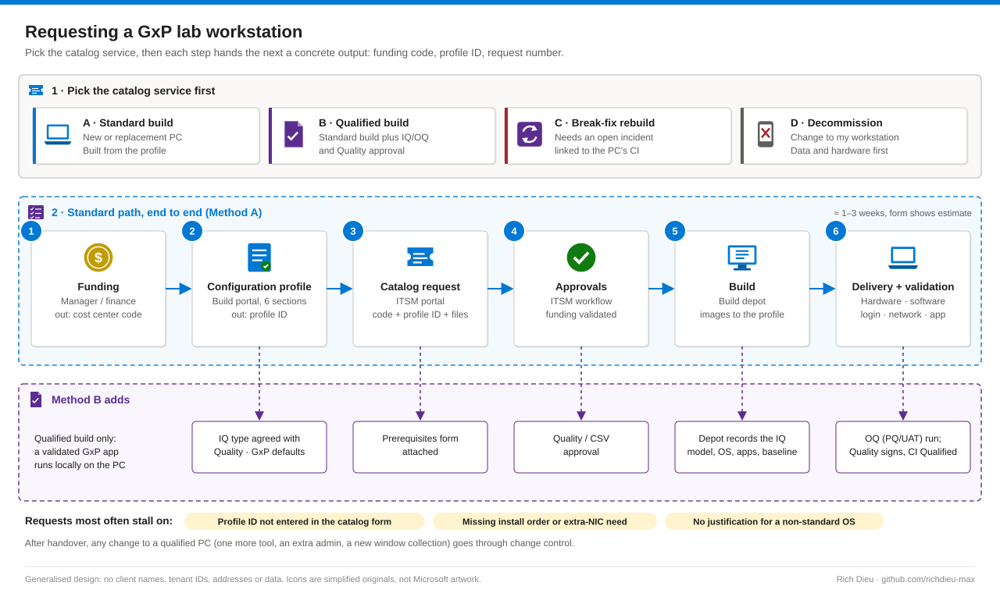

# SOP-LAB-003 · Requesting and provisioning a regulated (GxP) lab workstation

Order, build, hand over and retire a PC that sits beside a regulated lab instrument, through the ITSM catalog. Regulators treat the workstation, the instrument software and the instrument as one computerized system, so it has to be specified in advance, built to that specification, verified and kept under change control for its whole life.

**Family:** Regulated lab IT · **Covers:** the four catalog services (standard build, qualified build, break-fix rebuild, decommission), the workstation configuration profile, LTSC and maintenance-window choices, an inventory script, handover checks · **Does not cover:** the change-control record for later changes (SOP-GOV-001) or moving a legacy application onto the new PC (SOP-LAB-001).

## Flow



The configuration profile is the specification for one PC: the build depot builds from it, Quality verifies against it during IQ, and later changes are measured against it. A complete profile is the biggest single factor in a right-first-time build.

| Term | Meaning for the requestor |
|---|---|
| IQ | Installation qualification: the PC was built exactly as the profile says (model, OS, applications and versions, settings) |
| OQ | Operational qualification: the application works on this PC, for example captures data and writes the audit trail |
| PQ / UAT | The lab confirms it is fit for its intended use with real workflows |
| Qualified workstation | A PC whose build has been through IQ (and usually OQ). Rebuilding it repeats that evidence, which is why a qualified rebuild is a separate service |

## Before you start

| Item | Requirement |
|---|---|
| Lead time and risk | About 1–3 weeks (the form shows an estimate). Process-heavy, low technical risk; an incomplete profile causes rework and delay |
| Roles | Requestor's manager or finance contact for the funding code; any employee with build-portal access for the profile; ITSM (for example ServiceNow) portal user to submit; Quality / CSV lead for qualified builds; directory administrators for the AD groups; build depot / ConfigMgr operators for build, patching and windows. Requestors never need ConfigMgr access |
| Information | End user (name, employee ID); site, lab and delivery contact; business justification; funding code; replaced PC name(s) and inventory; main application name, version and install method (manual, or ConfigMgr application IDs with install order); whether it is validated GxP and connects to an instrument (extra NIC ports, serial/USB adapters, acquisition cards) |
| Profile decisions | Access groups, local admin group, screensaver lock, maintenance window, reboot behaviour, antivirus exclusions |
| Inventory script | Standard user for most data locally; local admin for BitLocker/TPM and for remote CIM sessions over WinRM (TCP 5985/5986) |
| Least privilege | Local admin only if the application genuinely needs it, granted to a small lab-admin AD group. Name groups, not individuals |

| OS edition | Support ends | Lab guidance |
|---|---|---|
| Windows 10 Enterprise LTSC 2019 (1809) | January 2029 | Existing validated PCs only; plan migration |
| Windows 10 Enterprise LTSC 2021 | January 2027 | Short remaining life; avoid for new builds |
| Windows 10 IoT Enterprise LTSC 2021 | January 2032 | Hardware-bound (OEM) licensing; instrument-embedded PCs |
| Windows 11 Enterprise LTSC 2024 | October 2029 | Preferred for new builds where the vendor supports Windows 11 |
| Windows 11 IoT Enterprise LTSC 2024 | October 2034 | Longest life; OEM licensing through the hardware supplier |

LTSC editions get security and quality updates only, so no feature update forces re-validation. Confirm the dates and the instrument vendor's supported OS list before submitting; anything other than the standard edition needs a written justification in the profile comments.

## Steps

### Gather the inventory (replacement or rebuild)

1. **Run the script.** `Get-LabWorkstationInventory.ps1` is read-only and collects model, serial, BIOS, OS build, CPU, RAM, disks, physical NICs and IP configuration, installed applications (64- and 32-bit uninstall keys), local administrators, printers, USB devices and TPM, then writes `<host>-<RequestRef>-inventory.json` and `-apps.csv`:

```powershell
# Local, on the PC being replaced
.\Get-LabWorkstationInventory.ps1 -RequestRef 'REQ0012345'
# Remote, from an admin workstation, for two PCs
.\Get-LabWorkstationInventory.ps1 -ComputerName PC-LAB-0001,PC-LAB-0002 -Credential (Get-Credential) -RequestRef 'REQ0012345'
```

2. **Walk the PC with the lab user.** No script sees licence dongles, acquisition cards that need vendor drivers, calibration files or data folders outside the user profile; add them to the request checklist by hand. For an external build depot, remove serial numbers and IP addresses your data-handling policy does not allow out.

### Method A · Standard build

3. **Funding.** Get the cost center / funding code from your manager and record it and the approver on the checklist. The request cannot proceed without it.
4. **Configuration profile.** In the build portal start a new profile (**Save for later** keeps progress; use **Comments** for the build team). Six sections: request type; common information (end user, workstation type Laboratory, *Will the PC run a validated (GxP) application locally?*, main application and version, automated IQ or None, instrument connection, replaced PC, location, OS edition, language, keyboard, time zone, OU); hardware (standard model meets vendor minimums, form factor, extra network ports); software (Office, naming convention tolerated by the app, who holds the media, install method, ConfigMgr IDs via **+ Add item** and install order); additional information (access restriction, local admin group, password-protected screensaver, automatic DST, disk image before handover, maintenance window, reboot allowed, antivirus changes); submit and record the **profile ID**.
5. **Maintenance window.** Pick a ConfigMgr window outside lab hours (for example Mon 20:00–02:00) with automatic reboot unless there is a documented reason not to. A required deployment whose deadline passes waits for the next window, so a 72-hour acquisition run is not interrupted; a PC in several collections gets all their windows combined.
6. **Time.** Audit trails are time-stamped; a DST change during an overnight run can show a one-hour gap or overlap. Decide automatic DST deliberately and document it.
7. **Catalog request.** In the ITSM portal select **New workstation order**; enter requestor, end user, location, justification and funding code; select who manages lab requests at your site; enter the **profile ID** (it links the build to the order); attach the inventory files and checklist; note the delivery estimate and **Order Now**.
8. **Approval, build, delivery.** Answer approver questions promptly. The depot images the PC to the profile, places it in the right OU and collections (including the maintenance-window collection), installs applications in order and runs its build checks. On delivery, verify hardware, software and access; for a replacement, confirm data and peripheral cutover before decommissioning the old PC.

### Method B · Qualified build

9. **Additions to Method A.** Agree the qualification type with Quality / CSV (automated IQ from the build team, a manual IQ protocol, or both) and select it in the profile; attach the qualification prerequisites form; keep GxP defaults (screensaver lock, restricted access, minimal local admins, automatic-reboot window outside lab hours). The depot records the IQ; the lab or validation team runs OQ (and PQ/UAT if required) and resolves deviations; Quality approves the summary and the CMDB CI is marked **Qualified**. From then on, any change (one more tool, an extra admin, a different window collection) goes through **Request a change to my workstation**.

### Methods C and D · Rebuild and decommission


10. **Break-fix rebuild.** An incident must be linked to the workstation CI, or the service cannot proceed. Run the inventory if the PC boots, back up local data to the retained share and record its location in the incident. Update the profile first if anything changed, because the depot rebuilds from the profile, not the old disk. Select **Request a break-fix (re)build › (Re)build a workstation** or **(Re)build a qualified workstation**, with CI, incident and profile ID (plus the prerequisites form if qualified). Afterwards repeat the Method A checks; for a qualified PC, repeat IQ and the OQ scope Quality specifies. For suspected malware, do not copy data back until security clears it, and keep the original disk or a forensic image if asked.
11. **Decommission.** Confirm the replacement passed delivery validation; back up data to a share covered by the records retention schedule and verify it; remove acquisition, GPIB and serial cards and licence keys and return them to the business unit; then **Request a change to my workstation › Decommission a workstation**, listing the CI, data location, cards and keys. IT removes the object from AD, ConfigMgr and Intune, retires the CMDB record and revokes device certificates; the disk is sanitized per NIST SP 800-88 (Clear, Purge or Destroy) and the certificate kept with the request. Quality may require a short system retirement record for a qualified PC.

```powershell
$src = 'D:\InstrumentData'; $dst = '\\SRV-FILE-01\LabArchive\PC-LAB-0001'
robocopy $src $dst /E /COPY:DAT /DCOPY:T /R:2 /W:5 /LOG:"$env:TEMP\archive.log"   # keeps original timestamps
$a = Get-ChildItem $src -Recurse -File | Get-FileHash -Algorithm SHA256
$b = Get-ChildItem $dst -Recurse -File | Get-FileHash -Algorithm SHA256
Compare-Object ($a.Hash) ($b.Hash)   # no output = every file arrived intact
```

## Verify

| Check | Pass |
|---|---|
| Hardware | Model, RAM, disks and NIC count match the profile |
| OS | Edition and build are the selected LTSC (`Get-CimInstance Win32_OperatingSystem`) |
| Name and OU | Computer name follows convention; correct OU |
| Maintenance window | Correct collection; `CCM_ServiceWindow` in `root\ccm\ClientSDK` shows the expected window (elevated) |
| Applications | Every one present at the right version and launches; instrument connects and acquires a test result |
| Access | Only approved users and groups sign in; `Get-LocalGroupMember -SID 'S-1-5-32-544'` shows only the approved admin group |
| Policy | Screensaver lock and AV settings as specified (policy-enforced values may sit under `HKCU:\Software\Policies\Microsoft\Windows\Control Panel\Desktop`); `gpresult /r /scope computer` |

## Troubleshooting

| Symptom | Cause and fix |
|---|---|
| Request sits in approval for days | Funding code invalid or approver unaware: check the approval tab, contact the approver |
| Break-fix service cannot be submitted | No incident linked to the workstation CI: raise one, link it, retry |
| Delivered PC missing an application | Not in the profile or wrong ConfigMgr ID: update the profile and request a change; never install ad hoc on a qualified PC |
| Application fails after install | Runtime or driver installed after the application: state the order in profile comments |
| PC reboots during a run | Wrong or extra maintenance-window collection, or a deployment allowed outside the window: check `CCM_ServiceWindow` and collection memberships |
| Application cannot reach instrument | Second NIC not requested or not configured; the link needs a static address on a private subnet (for example 192.168.100.x) |
| Application rejects the computer name | Legacy name-length or character limits: confirm in the profile and choose a supported naming basis |
| Depot cannot start | Profile ID not linked in the catalog request, the step most often forgotten |

## Control mapping

| Framework | Reference | How this supports it |
|---|---|---|
| ISPE GAMP 5 | Risk-based computerized system validation | Profile as configuration specification, verified by IQ, then OQ and PQ/UAT |
| GxP / CSV | Computerized system lifecycle | Specify, build to spec, verify, then control changes for the PC's whole life |
| NIST SP 800-88 | Media sanitization (Clear, Purge, Destroy) | Disk sanitized at retirement, certificate kept with the request |
