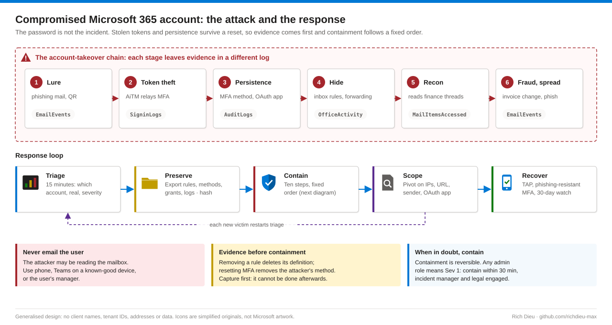
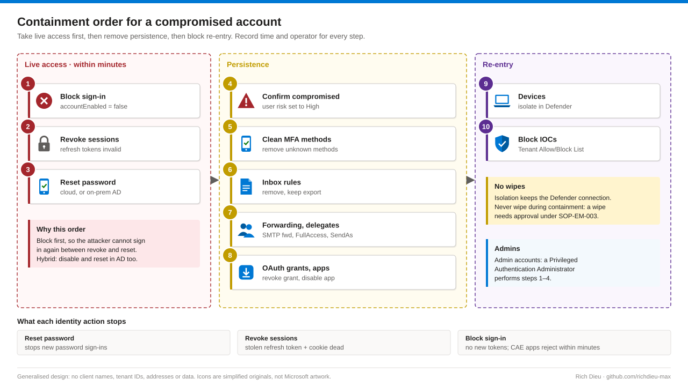

# SOP-SEC-002 · Containing a compromised Microsoft 365 account

Respond to business email compromise and account takeover in Entra ID and Exchange Online: triage the alert, preserve evidence first, contain in a fixed order, scope the incident, then recover the user on phishing-resistant MFA. By the time anyone notices, the attacker has usually set something up that survives a password reset.

**Family:** Security operations · **Covers:** triage and severity, evidence capture, the ten-step containment order, Unified Audit Log and KQL scoping, recovery and communication · **Does not cover:** device wipe (needs approval under SOP-EM-003) or the legal decision on notification duties.

## Flow



Modern phishing kits sit between the user and the real sign-in page (adversary-in-the-middle), relay the password and MFA approval, and keep the session cookie and tokens. Blocking sign-in and resetting the password stop new sign-ins; revoking sessions invalidates the stolen refresh tokens and cookies. Continuous Access Evaluation lets Exchange, SharePoint and Teams reject existing access tokens within minutes; other apps honour the token until it expires (about 60–90 minutes). The three identity actions belong together, and persistence (rules, forwarding, app consents, new MFA methods) must also be removed.

| Severity | Typical indicators | Response target |
|---|---|---|
| Sev 1 · Critical | Admin account; payment fraud; exfiltration confirmed; many accounts | Contain within 30 min; incident manager and legal engaged |
| Sev 2 · High | Confirmed takeover of a standard user; malicious rules or forwarding; internal phishing sent | Contain within 1 hour |
| Sev 3 · Medium | High-risk sign-in, no post-compromise activity yet; MFA prompt fatigue | Triage within 4 hours |
| Sev 4 · Low | Single risky sign-in already remediated by policy | Next business day |

## Before you start

| Item | Requirement |
|---|---|
| Roles | Security Reader for triage; Security Operator (ID Protection, Defender XDR); User Administrator, or Privileged Authentication Administrator for admins; Authentication Administrator; Exchange Recipient Administrator; Audit Reader in Purview; Cloud Application Administrator; Security Administrator for the Tenant Allow/Block List. Activate through PIM |
| Licensing and data | Entra ID P2 for risk detections; Purview Audit with MailItemsAccessed confirmed for your licences; Defender for Office 365 Plan 2 and Defender for Endpoint; Sentinel or Log Analytics with sign-in, audit and Office 365 logs for 90 days (SOP-AZ-107) |
| Ticket | Incident ticket open, severity assigned, incident manager named; every action logged with time and operator |
| Workstation | Clean admin workstation with `Microsoft.Graph` and `ExchangeOnlineManagement` v3 |
| Evidence | Access-restricted folder or Purview eDiscovery case, hashes recorded on export |
| Contacts | Out-of-band contact for the user (phone, manager); legal / privacy contact for Sev 1–2 |
| Safety net | Emergency access accounts and CA baseline (SOP-ID-001) so containment cannot lock out responders |

## Steps

### Detect and triage (15 minutes)

1. **Read the alert.** Sources: Entra ID Protection risky users, Defender XDR incidents, Defender for Cloud Apps alerts, Sentinel incidents, or a user or partner report. Note UPN, first suspicious time, source IP and country, and app.
2. **Check the logs.** **Entra ID › Monitoring & health › Sign-in logs**, last 7 days: compare IP, location, device and browser with normal. *Previously satisfied* from a new location is a sign of token replay. In **Audit logs**, look for User registered security info, Update user and Consent to application.
3. **Ask the user by phone.** Travel or VPN? An MFA prompt they did not start? A password entered after clicking a link? Never email the user: the attacker may be reading the mailbox.
4. **Decide.** Record account, validity and severity with evidence. Any admin role means Sev 1. When in doubt, treat it as real: containment is reversible.

### Preserve evidence first

5. **Export before you touch anything.** Removing a rule deletes its definition; resetting MFA removes the attacker's method. Export inbox rules (including hidden), forwarding, mailbox, SendAs and calendar permissions, authentication methods, OAuth grants, registered devices and sign-ins (interactive and non-interactive) to the case folder, then hash.

```powershell
$case = "C:\IR\INC-2026-0412"
Get-InboxRule -Mailbox $upn -IncludeHidden | Export-Clixml "$case\inboxrules.xml"
Get-Mailbox $upn | Select-Object ForwardingAddress,ForwardingSmtpAddress,
  DeliverToMailboxAndForward,GrantSendOnBehalfTo | Export-Clixml "$case\forwarding.xml"
Get-MgUserAuthenticationMethod -UserId $u.Id | ConvertTo-Json -Depth 5 | Out-File "$case\authmethods.json"
Get-MgUserOauth2PermissionGrant -UserId $u.Id -All | ConvertTo-Json -Depth 5 | Out-File "$case\oauthgrants.json"
Get-ChildItem $case -File | Get-FileHash -Algorithm SHA256 | Export-Csv "$case\hashes.csv" -NoTypeInformation
```

### Contain, in this order



6. **Steps 1–3, live access, within minutes.** Untick **Account enabled** (hybrid: also disable in AD or sync re-enables it). **Revoke sessions › Yes**. **Reset password** to a random value not yet given to the user (hybrid: reset in AD or via writeback and force a sync). Block first, so the attacker cannot sign in between revoke and reset.

```powershell
Update-MgUser -UserId $u.Id -AccountEnabled:$false            # 1 block sign-in
Revoke-MgUserSignInSession -UserId $u.Id                      # 2 revoke refresh tokens
$pw = -join ((48..57)+(65..90)+(97..122) | Get-Random -Count 24 | ForEach-Object {[char]$_})
Update-MgUser -UserId $u.Id -PasswordProfile @{
  Password = $pw; ForceChangePasswordNextSignIn = $true }      # 3 reset
```

7. **Steps 4–8, persistence.** **ID Protection › Risky users › Confirm user compromised** (sets risk High so CA008 applies). In **Authentication methods**, delete any method the user did not register; when unsure, delete all except organisation-issued FIDO2 keys. Remove malicious inbox rules (also check Outlook on the web and Sweep). Clear SMTP forwarding and unexpected FullAccess, SendAs, SendOnBehalf and calendar delegates. Revoke the user's grant for unfamiliar apps; if an app is malicious, set **Enabled for users to sign-in?** to No and record its App ID as an IOC.
8. **Steps 9–10, re-entry.** In the Defender portal, **Isolate device** for any endpoint showing malware, an infostealer or suspicious processes. Never wipe as part of containment. Add sending domains and phishing URLs to **Threat policies › Tenant Allow/Block Lists**, and attacker IPs to a blocked Conditional Access named location. If Defender AIR proposes remediation, approve it from the Action center only when it matches what you found, and record the investigation ID.

### Investigate and scope

9. **Build the timeline** from the first suspicious sign-in: how they got in (EmailEvents, SigninLogs), what they changed (AuditLogs, OfficeActivity), what they read (MailItemsAccessed), what they sent (message trace), what else they touched (CloudAppEvents). A MailItemsAccessed **Bind** means messages were opened; **Sync** means the whole folder must be treated as accessed.
10. **Pivot** on attacker IPs, the phishing URL (`UrlClickEvents`), the sender's recipients and other users consenting to the OAuth app. Every new account restarts triage and containment; stop when a pass finds nothing new.

```kql
let badIPs = dynamic(["203.0.113.24","198.51.100.77"]);
union SigninLogs, AADNonInteractiveUserSignInLogs
| where TimeGenerated > ago(14d) and IPAddress in (badIPs)
| summarize First = min(TimeGenerated), Last = max(TimeGenerated),
            Apps = make_set(AppDisplayName, 10) by UserPrincipalName, IPAddress
```

### Eradicate, recover, communicate

11. **Eradicate.** No attacker sign-ins to any account for 24 hours; re-run the exports and diff; phishing mail soft-deleted from all mailboxes via Threat Explorer or AIR; devices cleared or reimaged.
12. **Recover the user.** Verify identity in person or by verified video against HR records. Issue a one-time Temporary Access Pass, re-enable the account, register a passkey, FIDO2 key or Windows Hello for Business, set a new password. Risk shows Remediated, or dismiss it citing the ticket. Watch the account for 30 days for new countries, ASNs, inbox rules or MFA methods.
13. **Communicate.** User and manager by phone at containment; finance at once if payment or bank details were involved (verify by phone using numbers on file); internal phishing recipients from IT; external parties and legal at Sev 1–2. Notification deadlines can run in days or hours, so give legal the facts early.
14. **Lessons learned.** Blameless review within five business days for Sev 1–2: root cause, time to detect and contain, and one control change with an owner and date.

## Verify

| Check | Pass |
|---|---|
| `(Get-MgUser -UserId $upn -Property AccountEnabled).AccountEnabled` | False until recovery |
| Sign-in logs after revoke | Non-interactive sign-ins fail with 50173, 70043 or similar token errors |
| `Get-InboxRule -Mailbox $upn -IncludeHidden` | Only rules the user confirms |
| `Get-Mailbox $upn \| fl Forwarding*` | Both fields empty |
| Authentication methods | Only methods registered at recovery |
| ID Protection › Risky users | Remediated, or Dismissed with ticket reference |
| Case folder | All exports present and listed in `hashes.csv` |

## Rollback

If triage was wrong (the impossible travel was a new VPN), undo in reverse order and record why: re-enable the account (in AD too for hybrid); the user sets a new password via TAP or SSPR, never the old one; dismiss user risk with a reason; recreate a rule from the export only if the user confirms it was theirs; **Release from isolation** only after the device is cleared.

## Troubleshooting

Re-entry after containment almost always means a foothold was missed.

| Symptom | Cause and fix |
|---|---|
| Attacker still signs in | Sync re-enabled the account (disable in on-premises AD); an attacker MFA method was left; or a second account is compromised (pivot again) |
| App access continues | Non-CAE app token still valid (wait, or revoke the grant); a malicious OAuth app uses its own tokens |
| `Revoke-MgUserSignInSession` returns 403 | Reconnect with `User.ReadWrite.All` (or `User.RevokeSessions.All`) and an activated User Administrator role |
| No rules shown but mail still disappears | Hidden or Sweep rule: use `-IncludeHidden`, check Sweep, check UpdateInboxRules in the UAL |
| Forwarding continues after clearing | Inbox rule with ForwardTo / RedirectTo, or a transport rule (`Get-TransportRule`) or mail-flow connector |
| No MailItemsAccessed records | Auditing not enabled or licensed: check `AuditEnabled,AuditOwner`; treat the mailbox as fully read |
| User cannot re-register MFA | CA002 needs a trusted location or MFA: issue a Temporary Access Pass |

## Control mapping

| Framework | Reference | How this supports it |
|---|---|---|
| NIST SP 800-53 R5 | IR-4, IR-5, IR-6 | Handling, monitoring and reporting of the incident |
| | AU-6, SI-4 | Audit records reviewed and hunted across identity, mail and endpoint |
| | AC-2(3) | Compromised account disabled at once |
| NIST SP 800-61 R3 | DE.AE, RS.MA, RS.AN, RS.MI, RC.RP | Detect, respond and recover phases aligned to CSF 2.0 |
| CIS Controls v8 | 17, 8, 6 | Incident response, audit log and access control management |
| FDA 21 CFR Part 11 | §11.10(e), §11.300(d) | Audit trails retained for review; unauthorised use of identification codes detected and reported |
