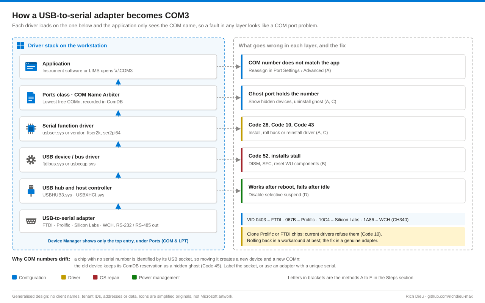
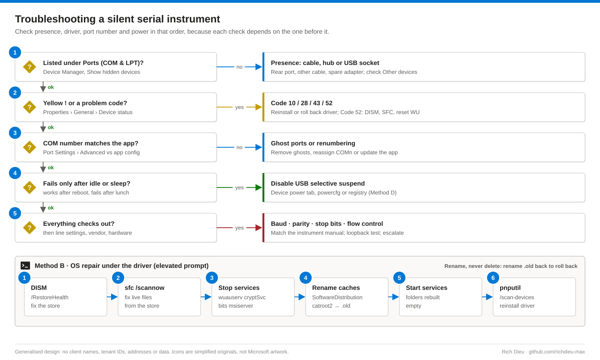

# SOP-WIN-001 · Troubleshooting USB serial (COM port) device connectivity on Windows

Diagnose and repair the USB-to-serial adapters that connect lab instruments, scanners, PLCs and test rigs to a Windows PC. Most "the instrument stopped talking to the PC" tickets are COM number, driver or power problems, not broken hardware.

**Family:** Windows support · **Covers:** five methods (Device Manager, a CMD repair sequence, PowerShell with pnputil, power management, remote PowerShell and Intune Remediations), ghost ports, verification and rollback · **Does not cover:** instrument line settings or RS-232/RS-485 wiring beyond a loopback test.

## How it fits together



A COM port is a name, not a socket. The COM Name Arbiter hands out the lowest free number and records it in the ComDB bitmap and the device's `PortName` value. If the adapter's chip has no serial number, Windows identifies it by USB socket location, so moving it creates a new device with a new COM number while the old one stays reserved as a hidden ghost (Code 45). The instrument software keeps waiting on COM3.



## Before you start

| Item | Requirement |
|---|---|
| Access | Viewing Device Manager needs no rights. Every change (drivers, devices, DISM/SFC, services, power settings) needs local administrator: retrieve the device's Windows LAPS password for the session rather than a shared account |
| Driver policy | Non-admins can be allowed specific classes under **Computer Configuration › Administrative Templates › System › Driver Installation**. If **Device Installation Restrictions** block the device, the fix belongs to the policy owner |
| Remote | Administrator on the target and WinRM enabled (or Remote Management Users with a JEA endpoint) |
| Intune | Intune Administrator or a custom role with Device configurations and **Remote tasks › Run remediation**; Windows Enterprise/Education E3/E5 licensing |
| Prepare | Ticket or change record, instrument name and the COM number its software expects; adapter vendor (from the VID) and its current signed driver staged locally; known-good cable and spare adapter; instrument software closed; no run or acquisition in progress; at least 5 GB free on C: for DISM |
| Time and risk | 15 minutes (driver/port) to 45 minutes (OS repair). Inspection is read-only; DISM/SFC low; WU reset, driver uninstall and ghost removal moderate (document the current COM mapping first); deleting a driver package from the store higher (other adapters of that vendor lose their driver) |

## Steps

### Method A · Device Manager

1. **Triage.** Close the instrument software, open `devmgmt.msc`, expand **Ports (COM & LPT)** and note every entry. Unplug and replug the adapter to see which entry is yours. Nothing under Ports: check **Other devices** for **USB-Serial Controller** with a yellow triangle (Code 28). Nothing changes at all: the fault is physical; try a port directly on the PC, another cable, then a spare adapter.
2. **Read the code and hardware ID.** **Properties › General** shows the code; **Details › Hardware Ids** shows a string such as `USB\VID_0403&PID_6001`. VID 0403 = FTDI, 067B = Prolific, 10C4 = Silicon Labs, 1A86 = WCH (CH340). Note provider and version on **Driver** and recent changes on **Events**.
3. **Fix the driver.** Code 28: vendor installer, or **Update driver › Browse my computer for drivers**. Code 10/43 after an update: **Roll Back Driver**. Persistent 10/43: **Uninstall device**, then **Action › Scan for hardware changes**. Code 52: do not disable signature enforcement; use Method B. Clone chips refused by current drivers (Code 10, "PL2303HXA PHASED OUT") need a genuine adapter.
4. **Remove ghosts and reassign the number.** **View › Show hidden devices**, uninstall greyed-out ports for hardware no longer in use, then **Port Settings › Advanced… › COM Port Number**. If Windows says the number is "in use", a ghost still holds it. Replug to confirm it sticks; label the socket for adapters without a serial number.

### Method B · Command Prompt repair sequence

5. **Repair the store, then the files.** DISM first, because SFC copies from the component store and can only be as good as it. `/RestoreHealth` takes 10–20 minutes and may pause at 20% or 62%.
   ```bat
   DISM /Online /Cleanup-Image /CheckHealth
   DISM /Online /Cleanup-Image /RestoreHealth
   sfc /scannow
   :: No Windows Update access: matching media, index from DISM /Get-WimInfo
   DISM /Online /Cleanup-Image /RestoreHealth /Source:WIM:D:\sources\install.wim:1 /LimitAccess
   ```
6. **Reset Windows Update components** when installs stall or signatures fail. Stop `wuauserv`, `cryptSvc`, `bits` and `msiserver`, rename `C:\Windows\SoftwareDistribution` and `C:\Windows\System32\catroot2` to `*.old` (use a dated suffix if `.old` exists; "Access is denied" means a service is still running), start the services and reinstall the driver. Windows rebuilds both folders; Update history just looks empty.
7. **Re-detect.** `pnputil /scan-devices`, `pnputil /enum-devices /class Ports`, check **Event Viewer › Applications and Services Logs › Microsoft › Windows › Kernel-PnP › Configuration**, and `reg query HKLM\HARDWARE\DEVICEMAP\SERIALCOMM`: a port missing from that key has no running driver.

### Method C · PowerShell and pnputil

8. **Inventory, then targeted repair.** Quote instance IDs, and target the Ports class device, never a USB hub (disabling a hub can drop the keyboard and mouse).
   ```powershell
   Get-PnpDevice -Class Ports | Select-Object Status, Present, FriendlyName, ConfigManagerErrorCode, InstanceId
   [System.IO.Ports.SerialPort]::GetPortNames()
   $ghosts = Get-PnpDevice -Class Ports | Where-Object { -not $_.Present }
   $ghosts | ForEach-Object { pnputil /remove-device "$($_.InstanceId)" }
   pnputil /add-driver 'C:\Staging\VendorSerial\*.inf' /install
   ```
9. **Scripted repair with evidence.** `Repair-UsbSerial.ps1` wraps inventory, OS repair, WU reset, ghost removal and selective suspend behind switches with `-WhatIf`, and writes a JSON evidence file: `.\Repair-UsbSerial.ps1 -ExpectedPort COM3 -RepairOs -ResetWindowsUpdate -RemoveGhostPorts -WhatIf`.

### Method D · Power management (drops after idle)

10. **Narrowest scope first.** Per device: **Universal Serial Bus controllers › hub › Properties › Power Management**, clear **Allow the computer to turn off this device to save power** (FTDI also has **Enable Selective Suspend** under Port Settings › Advanced). Power plan: set USB selective suspend to 0 for AC and DC (`powercfg /setacvalueindex` and `/setdcvalueindex SCHEME_CURRENT 2a737441-1930-4402-8d77-b2bebba308a3 48e6b7a6-50f5-4782-a5d4-53bb8f07e226 0`, then `/setactive SCHEME_CURRENT`). Machine-wide, dedicated mains-powered instrument PCs only: `reg add HKLM\SYSTEM\CurrentControlSet\Services\USB /v DisableSelectiveSuspend /t REG_DWORD /d 1 /f` and reboot. If the plan is enforced by Group Policy or Intune, change it there.

### Method E · At scale

11. **Remote and fleet.** `Invoke-Command -ComputerName PC-LAB-0001 -FilePath .\Repair-UsbSerial.ps1 -ArgumentList 'COM3'` for a few PCs; coordinate with someone at the instrument for swap tests. For a fleet, create a Remediation in **Intune admin center › Devices › Scripts and remediations › Remediations › + Create** (64-bit, SYSTEM, assigned only to instrument workstations): detection exits 1 on a port problem code or suspend enabled; remediation disables suspend and restarts problem ports. Deploy drivers as a Win32 app (`pnputil /add-driver .\*.inf /install`), pin versions with Windows driver update policies, and allow the Ports class `{4d36e978-e325-11ce-bfc1-08002be10318}` for non-admins by Group Policy.

## Verify

| Check | Pass |
|---|---|
| Device Manager | Adapter under Ports (COM & LPT), no problem code, COM number matches the software, no ghost holds that number |
| Driver running | Port listed in `HKLM\HARDWARE\DEVICEMAP\SERIALCOMM`; no new Kernel-PnP or System errors |
| OS integrity | DISM and SFC report no unrepaired corruption |
| Loopback | Pins 2 and 3 bridged on the DB9: `$sp = New-Object System.IO.Ports.SerialPort 'COM3', 9600, 'None', 8, 'One'`, `WriteLine('LOOPBACK-OK')` reads back |
| Instrument | Connects and reads data, completes a self-test, survives unplug/replug, 30+ minutes idle or sleep/resume and a restart; user confirms |
| Evidence | JSON from the template, driver provider and version, COM mapping, DISM/SFC outcome (`dism.log`, `CBS.log`), any power change and its scope |

## Rollback

| Action | Undo |
|---|---|
| Driver updated | **Roll Back Driver**, or `pnputil /delete-driver oemNN.inf /uninstall` and reinstall the previous package |
| Ghost removed | Nothing to restore; reconnecting the hardware recreates it |
| COM number reassigned | Set it back in Port Settings › Advanced; record both numbers in the ticket |
| WU reset | Stop the four services, delete the new folders, rename the `.old` folders back, start the services |
| Selective suspend | `powercfg` value 1, re-tick the Device Manager box, or delete `DisableSelectiveSuspend` and reboot |

## Troubleshooting

| Symptom | Cause and fix |
|---|---|
| Nothing changes when plugging in | Cable, port or adapter failure, or an underpowered front or hub port. Use a rear motherboard port, another cable, a spare adapter |
| Other devices, Code 28 | No driver. Install the vendor package matching the VID |
| Code 10 right after Windows Update | New driver rejects a clone chip, or a regression. Roll back, replace with a genuine adapter, pause that driver in Intune driver policy |
| Code 52, or installs stall | Catalog or store damage. Method B, then reinstall |
| Port number changes every time | No serial number and moved between sockets. Label the socket or use an adapter with a unique serial |
| "COM port in use" when reassigning | Ghost reservation. Show hidden devices, uninstall it, retry |
| Works after reboot, fails after idle | USB selective suspend. Method D |
| "Access denied" opening the port | Another process holds it. Close it or reboot; Sysinternals `handle.exe` finds the holder |
| Garbled data | Baud, parity or flow-control mismatch or wrong wiring. Fix in the application and cabling, not Windows |
| Escalate | A known-good adapter works elsewhere but not here after Methods A–D, the adapter is built into the instrument, or a validated system's driver must change (may need a change record and revalidation) |

## Control mapping

| Framework | Reference | How this supports it |
|---|---|---|
| NIST SP 800-53 R5 | CM-3 Configuration change control | Driver changes on regulated instrument PCs go through a change record, with JSON evidence and a documented rollback per action |
| | CM-11 User-installed software; CM-7 | Driver installation stays admin-only, with only the Ports class allowed and Device Installation Restrictions blocking the rest |
| | AC-6 Least privilege | Session-scoped Windows LAPS credential instead of a shared technician account; JEA for remote work |
| | SI-7 Software and information integrity | Signature enforcement never disabled; catalog, component store and system files repaired with DISM and SFC |
