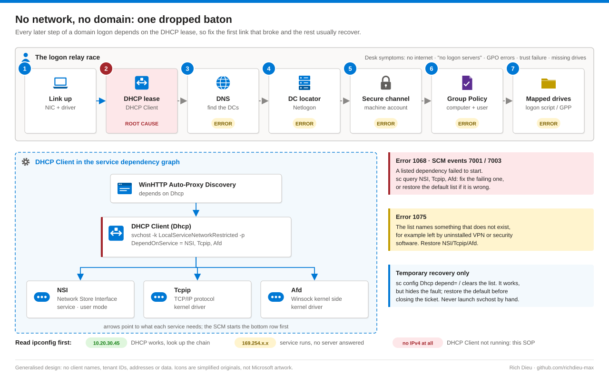
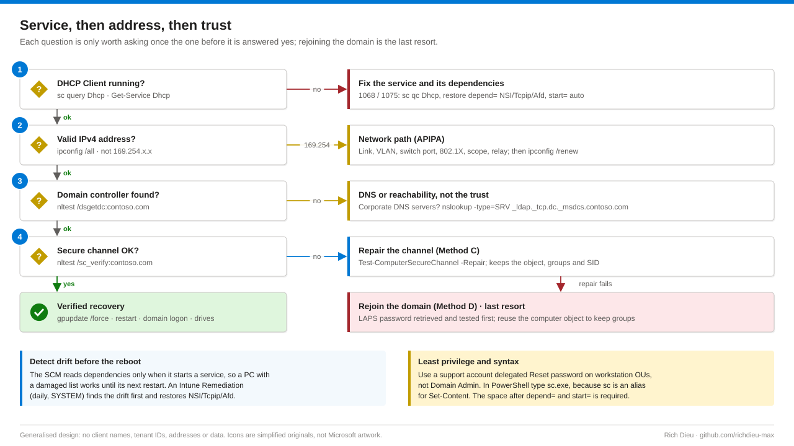

# SOP-WIN-002 · Restoring the DHCP Client service and domain connectivity

Bring a domain workstation back from "no network, no domain": no internet, "There are currently no logon servers available", Group Policy errors, a trust failure and missing drives. In the reference case every one of those symptoms came from a single root cause, the DHCP Client service failing to start with error 1068 because of a broken service dependency.

**Family:** Windows support · **Covers:** the consoles and command line (Methods A and B), PowerShell with a repair template (C), a controlled domain rejoin (D), Intune and Group Policy prevention (E), verification and rollback · **Does not cover:** DHCP server, scope or relay configuration, or mapped-drive faults with a healthy network (see SOP-WIN-003).

## How it fits together



A domain logon is a relay: link, DHCP lease, DNS, DC locator, secure channel, Group Policy, mapped drives. If the DHCP Client never starts, the five steps after it each report their own failure. `ipconfig` tells you where to look: a normal address means DHCP works; 169.254.x.x means the service runs but no server answered; **no IPv4 address at all on a connected adapter** means the DHCP Client service is not running.

On Windows 10 and 11, DHCP Client (service name `Dhcp`) runs as `svchost.exe -k LocalServiceNetworkRestricted -p` under `NT AUTHORITY\LocalService` and depends on **NSI, Tcpip and Afd**. Error 1068 means a listed dependency failed to start; 1075 means the list names something that does not exist. Either way the misconfigured service is Dhcp, not the one named in the error.



## Before you start

| Item | Requirement |
|---|---|
| Read-only checks | Standard user: `sc qc`, `ipconfig /all`, `Get-Service`. System log locally; Event Log Readers remotely |
| Service changes | Local Administrators, elevated. The PC may not validate domain credentials, so retrieve and test the Windows LAPS password first (it cannot be retrieved for a machine that never reconnects) |
| Secure channel | Local admin plus a domain account with **Reset password** on the computer object, delegated on workstation OUs to a support group, not Domain Admins |
| Rejoin | Local admin plus delegated Create/Delete Computer objects on the target OU (hardened domains often set `ms-DS-MachineAccountQuota` to 0) |
| Prevention | Intune Administrator or a custom role with Device configurations (E3/E5 licensing); GPO edit and OU link rights |
| Prepare | Ticket or change record with symptoms in order of appearance; physical or console access (remote tools cannot reach a PC with no address); a known-good PC of the same build; confirmation the network port works |
| Time and risk | 15–30 minutes, plus 15 for a rejoin. Inspection read-only; restoring defaults low; clearing dependencies and channel repair moderate; rejoin higher |

## Steps

### Methods A and B · Consoles and command line

1. **Confirm the symptom.** Sign in with the LAPS account, run `ipconfig /all`, then in `services.msc` note **DHCP Client** status and startup type (default Automatic). Try **Start**; on 1068 or 1075 open **Properties › Dependencies**. In **eventvwr.msc › Windows Logs › System**, filter on Service Control Manager: event 7001 or 7003 names the dependency.
2. **Inspect.** `sc qc Dhcp`, `sc query Dhcp`, `sc query NSI`, `sc query Tcpip`, `sc query Afd`. A healthy result shows `START_TYPE: 2 AUTO_START`, `DEPENDENCIES: NSI / Tcpip / Afd` and `SERVICE_START_NAME: NT Authority\LocalService`. Look for an extra name (1075), a stopped dependency (1068), DISABLED, or a changed account.
3. **Repair, in order of preference.** Fix a genuinely stopped dependency (`sc config NSI start= auto`, `sc start NSI`); otherwise restore the default list. The separator is `/` and the space after `depend=` is mandatory.
   ```bat
   sc config Dhcp depend= NSI/Tcpip/Afd
   :: Temporary recovery only, restore the defaults before closing the ticket
   sc config Dhcp depend= /
   sc config Dhcp start= auto
   sc start Dhcp
   ```
   `depend= /` writes an empty list: the service starts without waiting for TCP/IP and Winsock and hides the real fault. Never start the service by running `svchost.exe -k LocalServiceNetworkRestricted -p` by hand; that does not start the group's services. Use `sc start`, `net start`, `Start-Service` or services.msc.
4. **Re-establish network and domain.** `ipconfig /renew`, `ipconfig /all`, `ipconfig /registerdns`, then `nltest /dsgetdc:contoso.com` (must return a DC; if not, the problem is DNS or reachability), `nltest /sc_verify:contoso.com` (must end in `NERR_Success`), `gpupdate /force`, `gpresult /r /scope computer`. Restart and confirm DHCP Client starts automatically, logon works and drives appear.

### Method C · PowerShell

5. **Inspect as objects.** Type `sc.exe`, because `sc` is an alias for `Set-Content`; `Set-Service` cannot change dependencies. Use `Get-Service Dhcp -RequiredServices`, the registry value `DependOnService`, and `Get-WinEvent` for SCM IDs 7000, 7001, 7003, 7023 and 7024.
6. **Repair the secure channel without rejoining** (Windows PowerShell 5.1, elevated). This resets the computer password on both sides and keeps the object, its groups and its SID.
   ```powershell
   Test-ComputerSecureChannel -Verbose
   Test-ComputerSecureChannel -Repair -Credential (Get-Credential CONTOSO\svc-deskside) -Verbose
   Reset-ComputerMachinePassword -Server DC01.contoso.com -Credential (Get-Credential CONTOSO\svc-deskside)
   ```
7. **Scripted recovery with evidence.** `Repair-DhcpDomain.ps1` exports `Dhcp-backup.reg`, restores the dependencies (or clears them with `-ClearDependencies`), sets Automatic and starts the service, renews, tests the DC locator and secure channel, repairs it with `-RepairSecureChannel`, runs `gpupdate` and writes JSON. Preview with `.\Repair-DhcpDomain.ps1 -DomainName contoso.com -RepairSecureChannel -WhatIf`.

### Method D · Rejoin (last resort)

8. **Only when the channel cannot be repaired** (object deleted, repair account refused, `-Repair` keeps returning False). Test the LAPS password, note the object's OU and groups, then **sysdm.cpl › Computer Name › Change…** to WORKGROUP and back to `contoso.com`, or `Remove-Computer -UnjoinDomainCredential … -WorkgroupName WORKGROUP -Restart` then `Add-Computer -DomainName contoso.com -OUPath 'OU=Workstations,DC=contoso,DC=com' -Restart`. Reuse the same name to keep memberships. With no DC reachable at all, use offline domain join (`djoin /provision`, then `djoin /requestodj`).

### Method E · Prevent at scale

9. **Find drift before the reboot.** The SCM reads dependencies only at start, so a damaged PC works until its next restart. Once a PC is back online, `Invoke-Command` can sweep `OU=Workstations` for lists other than `NSI/Tcpip/Afd`. In **Intune admin center › Devices › Scripts and remediations › Remediations › + Create**, a daily SYSTEM pair detects a wrong list or start type and runs `sc.exe config Dhcp depend= NSI/Tcpip/Afd`. Confirm the default on each Windows build first, or a stale remediation becomes the drift.
10. **Group Policy.** **Computer Configuration › Policies › Windows Settings › Security Settings › System Services › DHCP Client** set to Automatic; optionally a Preferences Registry item enforcing `DependOnService` (REG_MULTI_SZ), targeted by OS build.

## Verify

| Check | Pass |
|---|---|
| Service | `sc qc Dhcp` shows NSI, Tcpip, Afd and AUTO_START; running after a full restart; no new SCM 7000-series errors |
| Network | Valid IPv4 lease, gateway and corporate DNS; `nslookup contoso.com` resolves domain controllers |
| Domain | `nltest /sc_verify` returns NERR_Success; `gpupdate /force` completes for computer and user |
| User | Domain sign-in without cached-logon warnings; mapped drives and printers appear; user confirms |
| Evidence | Template JSON, before/after `sc qc Dhcp`, exported `Dhcp-backup.reg` attached to the ticket |

## Rollback

Dependencies changed: `reg import` the exported `Dhcp-backup.reg`, or `sc config Dhcp depend= <original list>`, and restart the service. Dependencies cleared: `sc config Dhcp depend= NSI/Tcpip/Afd` is the expected follow-up, not just a rollback. Secure channel reset: nothing to undo. Rejoin: re-add group memberships if a new object was created and remove any stale duplicate.

## Troubleshooting

| Symptom | Cause and fix |
|---|---|
| Error 1068 | A dependency failed. `sc query` NSI, Tcpip, Afd; fix the failing one or restore the default list |
| Error 1075 | The list names a missing component, often left by uninstalled software. Restore `NSI/Tcpip/Afd` |
| Error 1079 or 1069 logon failure | Service account changed. `sc config Dhcp obj= "NT Authority\LocalService" password= ""` |
| Tcpip or Afd will not load | Damaged stack or third-party filter driver. `netsh winsock reset`, `netsh int ip reset`, remove recent VPN or security software, then DISM and SFC |
| 169.254.x.x | No server reply: cable, switch port, VLAN, 802.1X, scope exhausted or IP helper misconfigured |
| "No logon servers available" | Wrong DNS or DC unreachable. `nltest /dsgetdc`, `nslookup -type=SRV _ldap._tcp.dc._msdcs.contoso.com` |
| "Trust relationship … failed" | Secure channel broken. `Test-ComputerSecureChannel -Repair`, rejoin if that fails; check duplicate names or restored snapshots |
| Returns after every reboot | A GPO, configuration-management package or security software re-applies it. Find it with `gpresult /h` and software inventory |

## Control mapping

| Framework | Reference | How this supports it |
|---|---|---|
| NIST SP 800-53 R5 | CM-2 Baseline configuration; CM-6 | DHCP Client's shipped dependencies and start type are the baseline, enforced by Intune Remediation or Group Policy and confirmed per build |
| | CM-3 Configuration change control | Work runs under a ticket or change record, with a registry backup, JSON evidence and a rollback |
| | AC-6 Least privilege | LAPS local admin and a delegated Reset password group instead of Domain Admin on an untrusted workstation |
| | IA-3 Device identification and authentication | The computer secure channel is verified and repaired in place, keeping the device identity |
