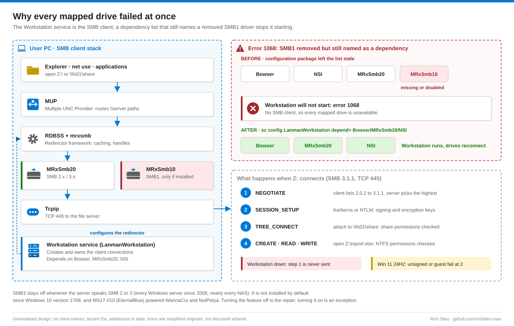
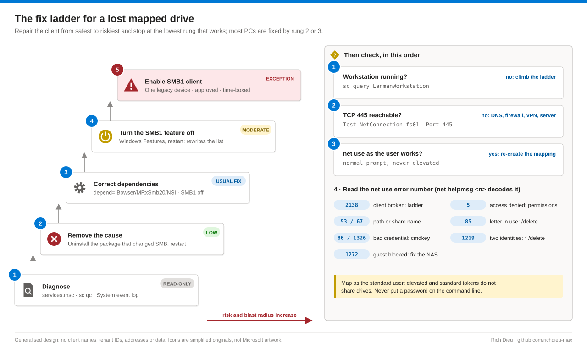

# SOP-WIN-003 · Restoring mapped network drive access on Windows 11

Recover the Workstation service and SMB client after a configuration change has broken it, then re-map drives, without re-enabling SMB1. In the reference case a configuration-management package altered the PC's SMB settings, the Workstation service stopped starting with error 1068, and every mapped drive failed at once.

**Family:** Windows support · **Covers:** the GUI fix ladder (Method A), sc, net use and cmdkey (B), PowerShell SMB cmdlets and a repair template (C), Group Policy and Intune at scale (D), net use error codes, verification and rollback · **Does not cover:** share or NTFS permission changes (file-services team) or server-side SMB configuration.

## How it fits together



The **Workstation** service (`LanmanWorkstation`) is the SMB client; the **Server** service (`LanmanServer`) only shares this PC's folders, so mapped-drive problems on a user's PC are almost always Workstation. On a current Windows 11 PC without the SMB1 client, Workstation depends on **Bowser, MRxSmb20 and NSI**; with SMB1 installed, MRxSmb10 is added. The most likely mechanism here: the package removed or disabled the SMB1 mini-redirector but left the dependency list still naming it.

Toggling the **SMB 1.0/CIFS File Sharing Support** feature fixed the reference case because turning it off makes Windows rewrite the list consistently. The "off" half is the repair; turning it back on only re-introduces SMB1, which has no pre-authentication integrity or encryption and was the target of MS17-010 (EternalBlue, WannaCry, NotPetya). SMB1 stays off whenever the server speaks SMB 2 or 3.



## Before you start

| Item | Requirement |
|---|---|
| Access | Map drives as a standard user (non-elevated). Service, dependency and Windows feature changes need local Administrators, elevated: use the device's Windows LAPS password |
| Not a desktop task | Share or NTFS permission changes go to the file server administrator or data owner |
| At scale | GPO edit rights on the user GPO and link rights on the OU; Intune Administrator or a custom role with Device configurations (Remediations need E3/E5 licensing) |
| Package owner | Notify the configuration-management owner: if the package is still assigned it will reinstall and break the PC again, and other PCs are probably affected |
| Prepare | Ticket number; the user's drive letters and UNC paths (from the user, the GPO or `net use` on a working PC); file server confirmed up from another PC; user present to sign in after restarts; the name of any recent package that changed SMB settings; whether any device truly needs SMB1 (assume no) |
| Time and risk | 15–40 minutes with two or three restarts. Inspection read-only; uninstalling the package, correcting dependencies and disabling SMB1 low; enabling SMB1 high (exception approval, scoped and time-boxed) |

## Steps

### Method A · GUI

1. **Check the Workstation service.** `services.msc` › **Workstation**. Running: go to step 5. Stopped: **Start**, check the System log for why, then step 5. Error 1068: **Properties › Dependencies** and look for a disabled or missing entry, typically **SMB 1.x MiniRedirector**.
2. **Remove the cause.** **Settings › Apps › Installed apps** (or Programs and Features), uninstall the package identified in planning and restart. Some packages restore what they changed on uninstall; many do not.
3. **Repair with SMB1 left off (preferred).** **Turn Windows features on or off** › **SMB 1.0/CIFS File Sharing Support**: if checked or partly filled, clear it and all sub-options (Automatic Removal, Client, Server), **OK** and restart. If it is already clear, correct the list directly (step 6). Confirm Workstation is Running and Automatic.
4. **Exception only: re-enable SMB1.** After confirming a specific device needs it and an exception is approved, check **SMB 1.0/CIFS Client** only and restart; record the device, exception reference and replacement date. Automatic Removal can later remove SMB1 again and bring back 1068 on a stale list, which is another reason to fix the list itself.
5. **Re-map and verify** as the user, not elevated. **This PC › … › Map network drive**, letter, UNC path such as `\\fs01.contoso.com\share`, keep **Reconnect at sign-in**; tick **Connect using different credentials** only for servers outside the domain. Open a file and save and delete a test file.

### Method B · Command line

6. **Inspect, then repair.** `sc query LanmanWorkstation`, `sc qc LanmanWorkstation`, `sc query MRxSmb20`, `sc query MRxSmb10` ("does not exist" is normal on an SMB1-free PC), `net use`. If MRxSmb10 is listed but missing or `START_TYPE: 4 DISABLED`, that is the cause. These are Microsoft's documented values; confirm against a healthy PC of the same build.
   ```bat
   sc config LanmanWorkstation depend= Bowser/MRxSmb20/NSI
   sc config LanmanWorkstation start= auto
   sc start LanmanWorkstation
   DISM /Online /Disable-Feature /FeatureName:SMB1Protocol /NoRestart
   :: Exception only: DISM /Online /Enable-Feature /FeatureName:SMB1Protocol-Client /All
   ```
7. **Re-map** in a normal prompt. Never put a password on the command line (console history, process listings, EDR telemetry); let Windows prompt or use `cmdkey`.
   ```bat
   net use Z: \\fs01.contoso.com\share /persistent:yes
   net use * /delete /y
   cmdkey /add:nas01.contoso.com /user:nas01\svc-scan /pass
   net use S: \\nas01.contoso.com\scans /persistent:yes
   ```

### Method C · PowerShell

8. **Inspect.** `Get-Service LanmanWorkstation -RequiredServices`, `Get-SmbMapping`, `Get-SmbConnection | Select-Object ServerName, ShareName, UserName, Dialect, Signed, Encrypted`, `Get-SmbClientConfiguration`, `Get-WindowsOptionalFeature -Online` for `SMB1Protocol*`, `Test-NetConnection fs01.contoso.com -Port 445`. Dialect 3.1.1 is current; 1.5 reveals an SMB1 connection and the server that still needs upgrading.
9. **Repair and re-map.** Elevated: `Disable-WindowsOptionalFeature -Online -FeatureName SMB1Protocol -NoRestart`, `& sc.exe config LanmanWorkstation depend= Bowser/MRxSmb20/NSI` (`sc.exe`, not the `sc` alias), set Automatic, start, restart. As the user: `New-SmbMapping -LocalPath 'Z:' -RemotePath '\\fs01.contoso.com\share' -Persistent $true`.
10. **Scripted repair with evidence.** `Repair-SmbClient.ps1` exports `LanmanWorkstation-backup.reg`, optionally uninstalls the named package, disables SMB1, corrects the list, starts the service, tests 445 and writes JSON. Preview with `.\Repair-SmbClient.ps1 -TestServer fs01.contoso.com -WhatIf`.

### Method D · At scale

11. **Group Policy Preferences.** **User Configuration › Preferences › Windows Settings › Drive Maps › New › Mapped Drive**, Action **Replace** (also cures stale mappings) or **Update**, Location `\\fs01.contoso.com\share`, Reconnect, label and letter; on **Common** use item-level targeting by the data owner's security group. Check with `gpupdate /force` and `gpresult /r`.
12. **Intune.** No native drive-map profile: use a platform script (**Devices › Scripts and remediations › Platform scripts**) with **Run this script using the logged on credentials** = Yes that maps each letter with `New-SmbMapping`. For the client itself, a SYSTEM Remediation detects MRxSmb10 listed while SMB1 is not enabled, or Workstation not running, and resets the list. Keep SMB1 disabled centrally and fix the package at source.

## Verify

| Check | Pass |
|---|---|
| Client | Workstation Running and Automatic; dependencies Bowser, MRxSmb20, NSI (no MRxSmb10 unless excepted); SMB1Protocol Disabled; survives a restart; no new SCM 7001 errors |
| User | `net use` shows every drive with Status OK; `Get-SmbConnection` dialect 3.x; files open and save on each drive; drives reconnect after sign-out and sign-in; user confirms |

## Rollback

Dependencies changed: `reg import` the exported `LanmanWorkstation-backup.reg` and restart the service. SMB1 disabled: re-enable only under an approved exception. Package removed: reinstall only after its owner has corrected it. Mappings changed: `net use` or `New-SmbMapping` to the previous paths; GPO mappings return at next logon.

## Troubleshooting

| Symptom | Cause and fix |
|---|---|
| All drives fail at once, error 1068 | Workstation depends on a missing or disabled MRxSmb10. Correct the dependencies (step 6) |
| Fixed, broken again next day | A configuration package or policy reapplies it. Remove or correct it at source |
| Drive visible in elevated prompt, not Explorer | Mapped under the elevated token. Map as the standard user, or set `EnableLinkedConnections` (DWORD 1) under `HKLM\SOFTWARE\Microsoft\Windows\CurrentVersion\Policies\System` if your baseline allows |
| One NAS fails after the 24H2 upgrade | Windows 11 24H2 requires signing and blocks guest logons. Update the NAS: SMB 2/3, signing, real accounts. Turning these off on the client is exception-only |
| Red X at logon, works when opened | Drive reconnects before the network is ready. GPO **Always wait for the network at computer startup and logon**, or GPP Replace |
| net use 2138 / 5 / 53 / 67 | Client broken / share or NTFS permissions / name, route, firewall or server down (`Test-NetConnection fs01 -Port 445`) / share name wrong |
| net use 85 / 86, 1326 | Letter in use (`net use Z: /delete`) / bad stored credential (`cmdkey /delete:`) |
| net use 1219 / 1272 | Two identities to one server (`net use * /delete`, reconnect with one) / guest access blocked: require an account on the server |

## Control mapping

| Framework | Reference | How this supports it |
|---|---|---|
| NIST SP 800-53 R5 | CM-7 Least functionality | SMB1 stays disabled; enabling it is a scoped, approved, time-boxed exception |
| | CM-3 Configuration change control; CM-6 | The faulty package is traced to its owner and fixed at source; registry backup, JSON evidence and rollback per change |
| | SC-8 Transmission confidentiality and integrity | SMB 3.1.1 with signing preferred; 24H2 signing and guest-logon protections kept on the client |
| | IA-5 Authenticator management | Passwords never typed on the command line; saved through `cmdkey` or Credential Manager |
| | AC-6 Least privilege | LAPS for elevation; drives mapped in the user's standard session |
