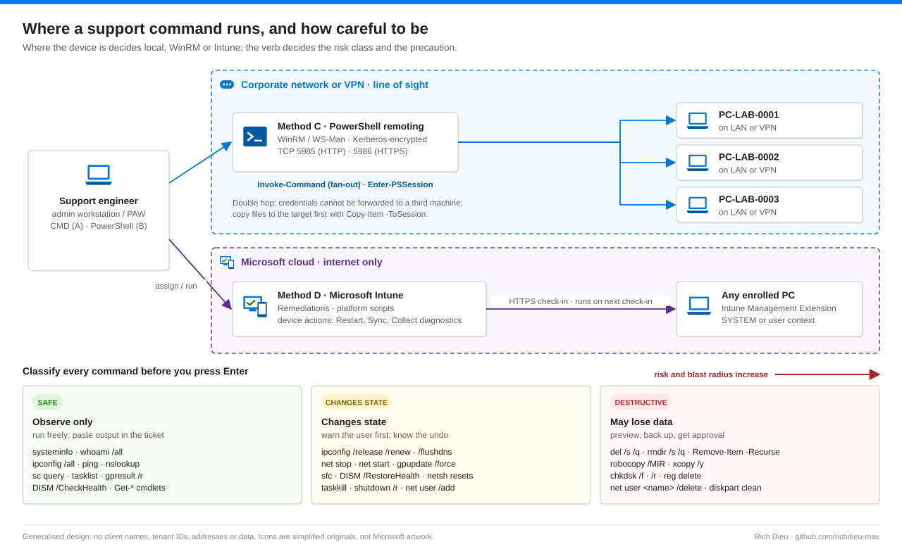
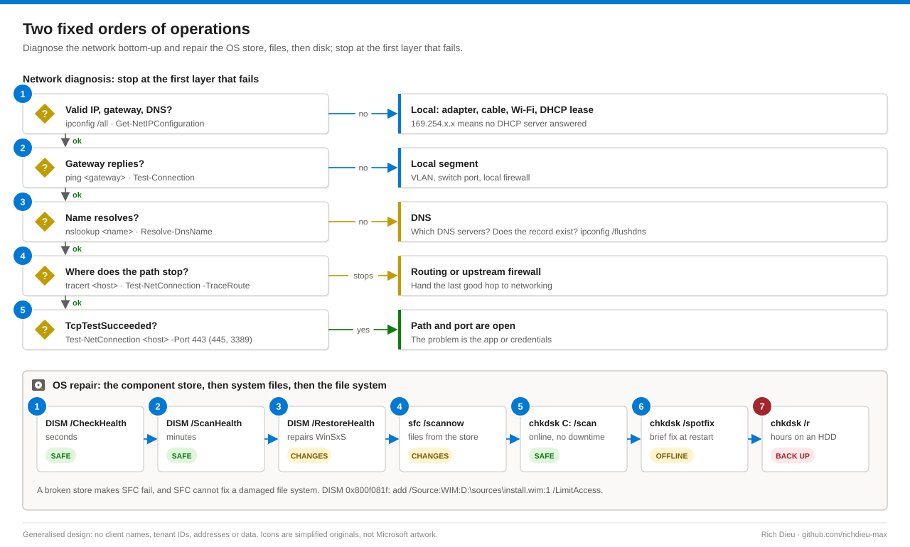

# SOP-WIN-004 · The Windows command-line toolkit for support engineers

A reference to the everyday Windows 10 and 11 support commands, each in Command Prompt and PowerShell form with its risk class, then run remotely with PowerShell remoting and at scale with Intune.

**Family:** Windows support · **Covers:** CMD (Method A) and PowerShell (Method B) locally, PowerShell remoting (C), Intune (D), risk classes, the network and OS repair orders, a support snapshot template, common errors · **Does not cover:** fault-specific procedures (see SOP-WIN-001 to SOP-WIN-003) or Active Directory administration beyond read access.

## How it fits together



CMD passes **text** between programs; PowerShell cmdlets (Verb-Noun) pass **objects** with typed properties, so `Get-Process | Sort-Object WS -Descending` sorts numbers while sorting `tasklist` output sorts characters. Read a command left to right before running it: the verb gives the risk class (`Get-` safe; `Set-`, `Restart-`, `Stop-` change state; `Remove-`, `Clear-`, `Format-` destructive), the parameter and value name the target, and `-WhatIf` turns it into a rehearsal. CMD rarely has a preview (`robocopy /L` is the exception), so run the matching read-only command first. Paths are the danger, not the command: `Remove-Item "$folder\*"` with an empty `$folder` becomes `\*`, the root of the drive.



## Before you start

| Item | Requirement |
|---|---|
| Read | Standard user for information, network diagnosis, `gpresult /r` and `Get-*` (other users' processes and the Security log need elevation) |
| Change | Local administrator, elevated (**Run as administrator**, title bar begins `Administrator:`), for services, drivers, DISM, SFC, chkdsk and netsh resets. Use the device's Windows LAPS password, not a shared account. Stay unelevated for user-specific work such as mapping drives |
| Accounts | Local users and groups need local admin, and creating admins should be a tracked change. Domain changes need delegated AD rights |
| Remote | Administrators or Remote Management Users on the target, WinRM enabled; JEA endpoints can expose only approved commands |
| Intune | A role with Device configurations and Remote tasks (Help Desk Operator covers many device actions); Remediations need appropriate licensing |
| Habits | Ticket or change record and the user's consent before interrupting their session; capture evidence (`command > %PUBLIC%\Documents\out.txt` or `Start-Transcript`); confirm `hostname` and `whoami` before any change; preview destructive operations; never type passwords on a command line |

## Steps

Each table gives the CMD form (Method A), the PowerShell form (Method B) and the risk. **Safe** reads only: run freely. **Changes** interrupts or reconfigures: warn the user and know the undo. **Destructive** deletes, overwrites or takes a disk offline: verify the target, preview, back up, follow change control.

### System information and cleanup

| Task | CMD | PowerShell | Risk |
|---|---|---|---|
| OS, build, uptime, hotfixes | `systeminfo` | `Get-ComputerInfo -Property OsName, OsBuildNumber, OsLastBootUpTime` | Safe |
| Computer and user | `hostname` · `whoami /all` | `$env:COMPUTERNAME` · `whoami /groups` | Safe |
| Disk space | `fsutil volume diskfree C:` | `Get-Volume C` | Safe |
| Clear the user's temp | `del /s /q %temp%\*` | `Remove-Item "$env:TEMP\*" -Recurse -Force -ErrorAction SilentlyContinue` | Changes |
| Shrink WinSxS | `DISM /Online /Cleanup-Image /StartComponentCleanup` | `Repair-WindowsImage -Online -StartComponentCleanup` | Changes |
| Largest files | `dir /s /o-s %USERPROFILE%` | `Get-ChildItem $HOME -Recurse -File \| Sort-Object Length -Desc \| Select-Object -First 20` | Safe |

`wmic` is deprecated and missing from recent Windows 11 builds: use `Get-CimInstance`. In a script running as SYSTEM, `%TEMP%` is `C:\Windows\Temp`, so `echo %temp%` first. Clean WinSxS with DISM, never by hand.

### Networking (bottom-up: IP configuration, gateway, DNS, route, port)

| Task | CMD | PowerShell | Risk |
|---|---|---|---|
| IP configuration | `ipconfig /all` | `Get-NetIPConfiguration -Detailed` | Safe |
| Reachability | `ping 10.0.0.1` | `Test-Connection 10.0.0.1 -Count 4` | Safe |
| Name resolution | `nslookup host 10.0.0.10` | `Resolve-DnsName host -Server 10.0.0.10` | Safe |
| Route and per-hop loss | `tracert host` · `pathping host` | `Test-NetConnection host -TraceRoute` | Safe |
| TCP port open | (none built in) | `Test-NetConnection host -Port 443` | Safe |
| Listening ports, owners | `netstat -ano` | `Get-NetTCPConnection -State Listen` | Safe |
| Flush DNS cache | `ipconfig /flushdns` | `Clear-DnsClientCache` | Changes |
| Release and renew | `ipconfig /release` · `/renew` | `Restart-NetAdapter -Name Ethernet` | Changes |
| Reset TCP/IP and Winsock | `netsh int ip reset` · `netsh winsock reset` | (same; restart required) | Changes |

Stop at the first failing layer: if the lease and gateway are fine but `nslookup intranet.contoso.com` returns Non-existent domain, the problem is DNS and there is no point running `tracert` or resetting Winsock. In a remote session chain `ipconfig /release && ipconfig /renew` on one line and expect to reconnect; a netsh reset removes static IP settings, so record them first.

### Accounts, sessions, processes and services

| Task | CMD | PowerShell | Risk |
|---|---|---|---|
| List users, group members | `net user` · `net localgroup Administrators` | `Get-LocalUser` · `Get-LocalGroupMember Administrators` | Safe |
| Create user, prompted password | `net user kiosk01 * /add` | `New-LocalUser kiosk01 -Password (Read-Host -AsSecureString)` | Changes |
| Add to a group | `net localgroup "Remote Desktop Users" kiosk01 /add` | `Add-LocalGroupMember -Group 'Remote Desktop Users' -Member kiosk01` | Changes |
| Disable or delete user | `net user kiosk01 /active:no` · `/delete` | `Disable-LocalUser` · `Remove-LocalUser` | Destructive |
| Restart with warning | `shutdown /r /t 300 /c "Restart for CHG0012345"` | `Restart-Computer -Confirm` | Changes |
| Registry read, export | `reg query` · `reg export` | `Get-ItemProperty HKLM:\…` | Safe |
| Registry change | `reg add` · `reg delete` | `Set-ItemProperty` · `Remove-ItemProperty` | Destructive |
| Processes | `tasklist /svc` · `taskkill /PID 4321` | `Get-Process` · `Stop-Process -Id 4321` | Safe · Changes |
| Service state and config | `sc query Spooler` · `sc qc Spooler` | `Get-Service Spooler \| Select *` | Safe |
| Restart, start type | `net stop` / `net start Spooler` · `sc config Spooler start= auto` | `Restart-Service Spooler` · `Set-Service -StartupType Automatic` | Changes |

```powershell
$pw = Read-Host -Prompt 'Password for kiosk01' -AsSecureString
New-LocalUser -Name 'kiosk01' -Password $pw -FullName 'Lab kiosk' `
  -Description "Created for CHG0012345" -PasswordNeverExpires:$false
Add-LocalGroupMember -Group 'Users' -Member 'kiosk01'
Remove-Variable pw
```

Never put a password on the command line: it lands in console history, process-creation logs and EDR telemetry. Add to Administrators only with an approved reason and remove the membership when the need ends. `reg export "HKLM\SOFTWARE\Contoso\App" %PUBLIC%\Documents\app-before.reg` before any edit gives a one-command rollback.

### Files, repair, policy and logs

| Task | CMD | PowerShell | Risk |
|---|---|---|---|
| Copy a tree | `robocopy C:\source D:\backup /E /COPY:DAT /R:2 /W:5 /LOG:C:\Temp\rc.log` | (call robocopy) | Overwrites |
| Preview, then mirror | `robocopy C:\src D:\dst /MIR /L`, then without `/L` | | Safe, then Destructive |
| Delete file or tree | `del /f /q` · `rmdir /s /q C:\path\folder` | `Remove-Item C:\path\folder -Recurse -WhatIf` | Destructive |
| Store check, scan | `DISM /Online /Cleanup-Image /CheckHealth` · `/ScanHealth` | `Repair-WindowsImage -Online -CheckHealth` · `-ScanHealth` | Safe |
| Repair store, files | `DISM … /RestoreHealth` · `sfc /scannow` | `Repair-WindowsImage -Online -RestoreHealth` | Changes |
| Volume scan, fix | `chkdsk C: /scan` · `/spotfix` · `/r` | `Repair-Volume -DriveLetter C -Scan` · `-SpotFix` · `-OfflineScanAndFix` | Safe · Offline · Hours offline |
| Policy | `gpupdate /force` · `gpresult /h C:\Temp\gp.html` | `Invoke-GPUpdate` · `Get-GPResultantSetOfPolicy` (RSAT) | Changes · Safe |
| Recent errors, export | `wevtutil qe System /c:20 /rd:true /f:text` · `wevtutil epl System C:\Temp\System.evtx` | `Get-WinEvent -FilterHashtable @{LogName='System'; Level=2} -MaxEvents 20` | Safe |

`/MIR` deletes anything in the destination that is not in the source, so swapped arguments delete the user's data: always run it with `/L` first and read the summary counts. `chkdsk /f` and `/r` on C: are queued for the next boot; `/r` can take hours and can accelerate a failing HDD, so back up first and prefer `/scan` plus `/spotfix` on healthy hardware.

### Method C · PowerShell remoting

WinRM authenticates with Kerberos in a domain and encrypts the session even on 5985; it is on by default on Windows Server and commonly enabled on managed clients by Group Policy (`Enable-PSRemoting`).

```powershell
Enter-PSSession -ComputerName PC-LAB-0001          # interactive; Exit-PSSession to leave
$pcs = 'PC-LAB-0001','PC-LAB-0002','PC-LAB-0003'
Invoke-Command -ComputerName $pcs -ScriptBlock {
  [pscustomobject]@{ Build    = (Get-CimInstance Win32_OperatingSystem).BuildNumber
                     LastBoot = (Get-CimInstance Win32_OperatingSystem).LastBootUpTime
                     FreeGB   = [math]::Round((Get-Volume C).SizeRemaining / 1GB, 1) }
} | Select-Object PSComputerName, Build, LastBoot, FreeGB | Export-Csv .\fleet.csv -NoTypeInformation
```

Some CMD tools take a remote target: `shutdown /r /m \\PC-LAB-0001 /t 600 /c "Restart for CHG0012345"`, `sc.exe \\PC-LAB-0001 query Spooler`. `Get-SupportSnapshot.ps1` collects OS, uptime, disk, network, a port test, stopped automatic services and recent System errors into JSON, read-only unless `-ClearTemp` (which honours `-WhatIf`): `.\Get-SupportSnapshot.ps1 -ComputerName PC-LAB-0001,PC-LAB-0002 -TestHost intranet.contoso.com -TestPort 443`.

### Method D · Intune for devices you cannot reach

Use **Devices › All devices › <device>** for device actions (**Restart**, **Sync**, **Collect diagnostics**), Remediations for scheduled or on-demand check-and-fix pairs (**Run remediation**), and platform scripts for one-off PowerShell. Example: a detection script exits 1 if `Spooler` is not running; the remediation stops the spooler, clears `%SystemRoot%\System32\spool\PRINTERS\*`, starts it, and writes the status as its last output line, which Intune shows in the report.

## Verify

| Check | Pass |
|---|---|
| Exit status | `echo %ERRORLEVEL%` is 0 in CMD; `$?` or `$LASTEXITCODE` in PowerShell |
| Read-back | The matching read-only command confirms the change (`sc query` after `net start`, `net use` after a mapping) |
| Event log | No new errors at the time of the change |
| User and ticket | User confirms the symptom is gone; transcript or output file attached |

## Troubleshooting

| Message | Cause and fix |
|---|---|
| Access is denied / requires elevation | Shell not elevated or account not a local admin. Reopen with **Run as administrator** |
| 'x' is not recognized as an internal or external command | Typo, tool not installed (RSAT, Sysinternals) or not on `PATH`. In PowerShell call CMD built-ins as `cmd /c dir /s` |
| Running scripts is disabled on this system | Execution policy. Use signed scripts or a GPO/Intune policy; for a one-off, `powershell -ExecutionPolicy Bypass -File .\x.ps1` where allowed |
| WinRM cannot complete the operation | Target offline, WinRM off, 5985 blocked or name not resolving. `Test-WSMan PC-LAB-0001` |
| Access denied inside `Invoke-Command` reaching a share | Double hop. Copy files with `Copy-Item -ToSession`, or use a share the computer account can read |
| SFC found corrupt files but was unable to fix some | Run `DISM /RestoreHealth` first, then SFC; read `%windir%\Logs\CBS\CBS.log` |
| DISM 0x800f081f | No repair source. `/Source:WIM:D:\sources\install.wim:1 /LimitAccess`, index from `DISM /Get-WimInfo` |
| Chkdsk cannot run because the volume is in use | Expected for C:. Answer Y to schedule at restart, or use `/scan` online |
| `sc config` prints DESCRIPTION / USAGE | Missing space after `=`: `start= auto`, not `start=auto`. In PowerShell, `sc` is `Set-Content`: type `sc.exe` |

## Control mapping

| Framework | Reference | How this supports it |
|---|---|---|
| NIST SP 800-53 R5 | CM-3 Configuration change control | Commands are classed by risk; destructive ones need a preview, a backup and change control, with output attached to the ticket |
| | AC-6 Least privilege | Standard user for reads, LAPS-backed elevation only for changes, JEA endpoints for remoting, admin group membership removed when the need ends |
| | IA-5 Authenticator management | Passwords prompted or held as SecureString, never typed on a command line |
| | AC-17 Remote access | Remote work over Kerberos-authenticated, encrypted WinRM or Intune check-in |
| | AU-3 Content of audit records | Transcripts, output files and the snapshot JSON record what ran, where and with what result |
